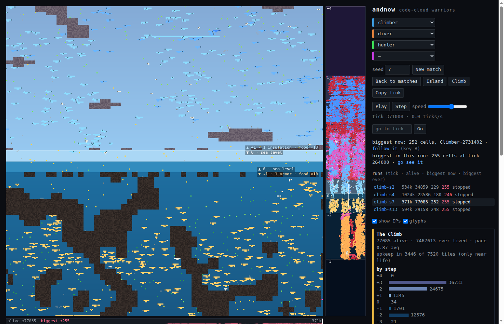
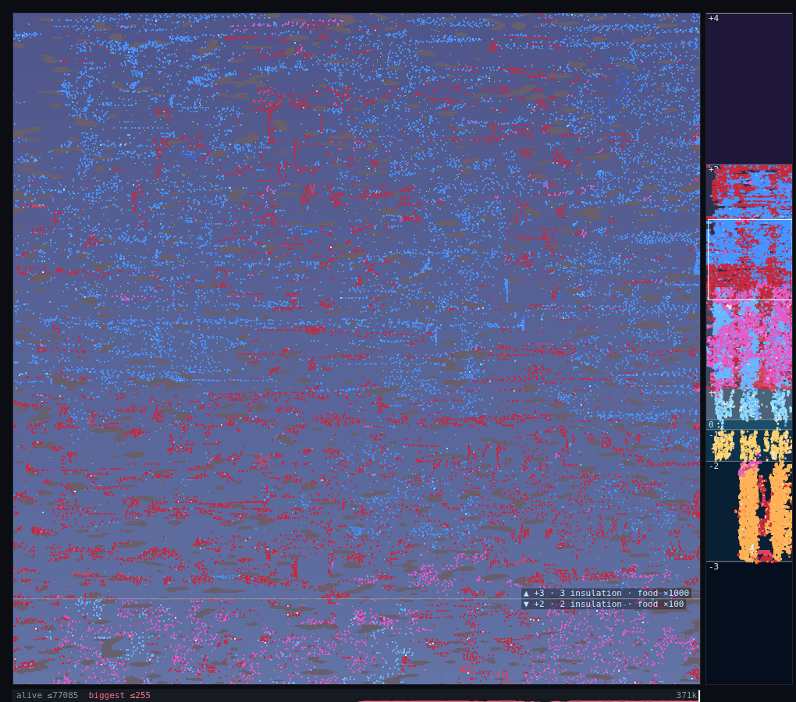
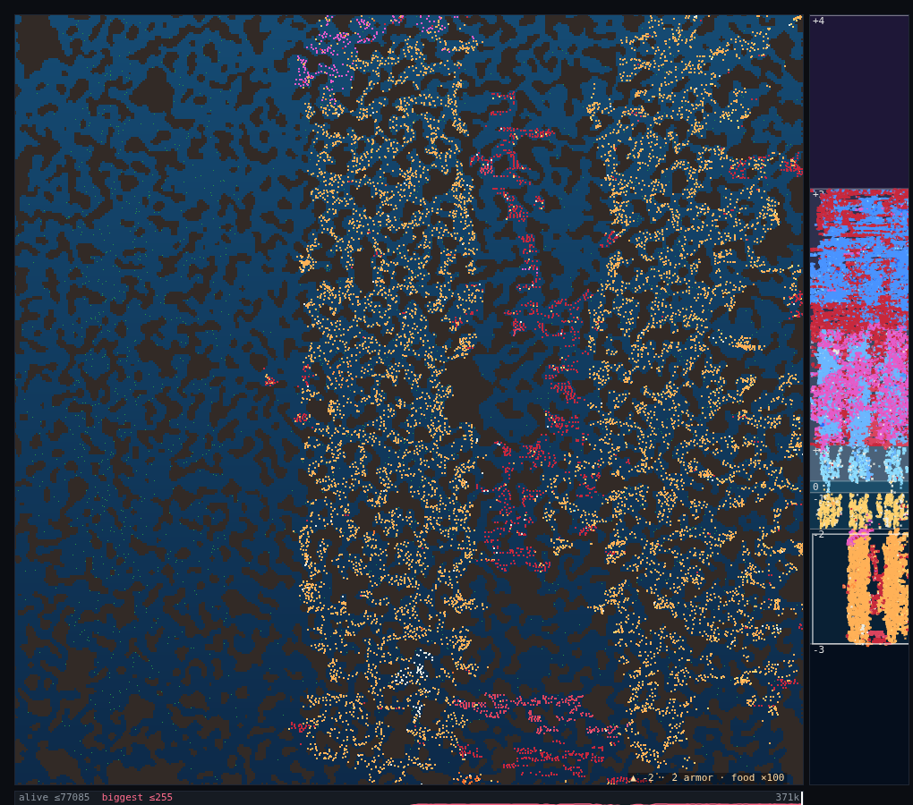
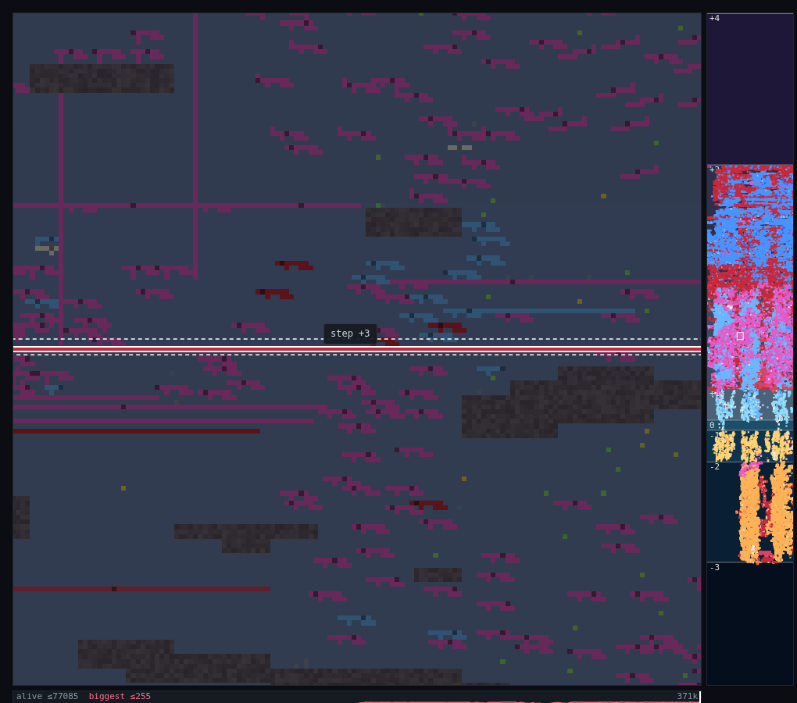
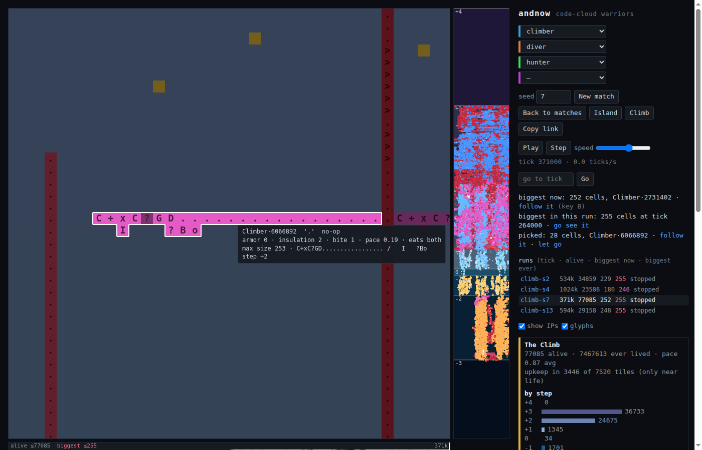

# andnow

**Code-cloud warriors: Tierra × Core War × RTS.** Each creature is a connected cloud of cells on a 2D board, and every cell is one Befunge-style instruction. The body *is* the program: an instruction pointer walks the creature's own cells, and its moves, bites, growth and division come from what it runs. Copy errors when a creature divides make evolution. Nobody writes the creatures that end up winning.



## The Climb

The current mode is a world that grows forever, both up and down.

- **Steps:** step 0 is a thin band at sea level.
  - Above it, each step up is colder air. Living there needs one more point of **insulation** (`I` cells).
  - Below it, each step down is deeper water. Living there needs one more point of **armor** (`K` cells).
- **Reward and size:** each step out has food worth **10× more** than the step before, and allows bodies twice as large.
- **Growth:** when life gets near the top or bottom of the world, a new step is generated from the seed and joined on. Steps past ±2 are each about 1.5× taller than the last. Only tiles near living bodies are simulated.
- **Body chemistry:** traits come from the cells a creature is made of, and neighbours can rewrite each other.
  - `~` swaps armor and insulation.
  - `x` doubles a trait.
  - `n` makes a cell weightless.
  - Mass slows a creature down. `B` (bite) and `C` (collect) decide whether it eats meat, plants or both.
  - Evolution found the modifiers on its own. Seed 4's deep colony is `CxKDTM`: the diver moved its armor cell onto its code path and put a doubler beside it.
- **Founders:** three species start the run, each about seven cells. Climbers have a spare insulation cell, divers a spare armor cell, and hunters are a slow, fat biter. Everything after that is evolved.

|  |  |
|---|---|
|  |  |
| **Step +3,** 7,000 rows up: insulated grazers (blue) and meat eaters (red). Food here is worth ×1000. | **Step −2,** in the deep: armored colonies (orange) in the caves, with meat eaters (red) working through them. |



*Tap a body to pick it, so you can tell where one creature ends and the next begins. This is the biggest one in seed 7: a 252-cell thread lying along the boundary into step +3.*



*Zoomed in with **glyphs** ticked, every cell shows its instruction. This climber runs `C+xC?GD`: collect, then divide. Its `x` sits next to the `I` below it and doubles that cell, so one insulation cell counts as 2, enough for step +2 (the hover card shows `insulation 2`). The long tail of `.` is fat from `G` (grow). Hover any cell to see its body's traits and genome.*

### Forever runs

Four seeds have been baked for days, saving a checkpoint every 1,000 ticks. At the latest checkpoints:

| seed | tick | alive | notes |
|---|---|---|---|
| 4 | 1,024,000 | 23.6k | the first run past a million ticks |
| 7 | 371,000 | 77k | grown to steps +4 and −3; 36k bodies live in step +3 |
| 13 | 594,000 | 29k | meat eaters came back after dying out in every earlier batch |
| 2 | 534,000 | 35k | reached the top of the original world, step +2 |

The viewer hops between runs, scrubs a timeline of each one (alive count and biggest body), and can follow the biggest body.

## Running it

```bash
npm install && npm run build
python3 serve.py 8765        # then open http://localhost:8765/?climb=1
```

**Viewer controls:**
- drag to pan; wheel or `+`/`-` to zoom; WASD or the arrow keys to move;
- click the minimap strip to jump to a step;
- `B` follows the biggest body; tap a body to pick it;
- tick **glyphs** and zoom in close to read each cell's instruction;
- hover over a cell to see its traits and genome;
- **Copy link** shares the exact view; *copy link* beside a picked body shares that body at that tick, so the link opens with it picked and followed.

**Headless tools,** all in `dist/` after a build:

| tool | what it does |
|---|---|
| `bake.mjs "<query>" <ticks\|forever> --out runs/bake/<name>` | runs a world and saves checkpoints; open the result with `?bake=runs/bake/<name>` |
| `headless.mjs` | plays a match without the viewer |
| `evolve.mjs` | the genetic-algorithm and MAP-Elites warrior search |
| `petri.mjs` | runs the petri dish |
| `check.mjs --verify test/golden.json` | determinism check: replays 1,991 recorded matches |

Runs are deterministic: the same seed and settings always replay the same history, and a world restored from a checkpoint continues exactly as the original run would have.

## Other modes

The project started as Core War-style duels on a board of rooms and corridors, then picked up modes as it went:
- free-for-alls;
- a GA and MAP-Elites search for warriors;
- creatures that rewrite their own code mid-game;
- amorphous "ooze" bodies that change shape;
- a toxin-gradient petri plate;
- island survival, with water pressure and mines.

The Climb grew out of all of those. They're still reachable from the viewer (*Back to matches*, *Island*).

## Docs

- [`docs/journal.md`](docs/journal.md): the whole journey, session by session, including the dead ends.
- [`docs/climb.md`](docs/climb.md): the Climb's design.
