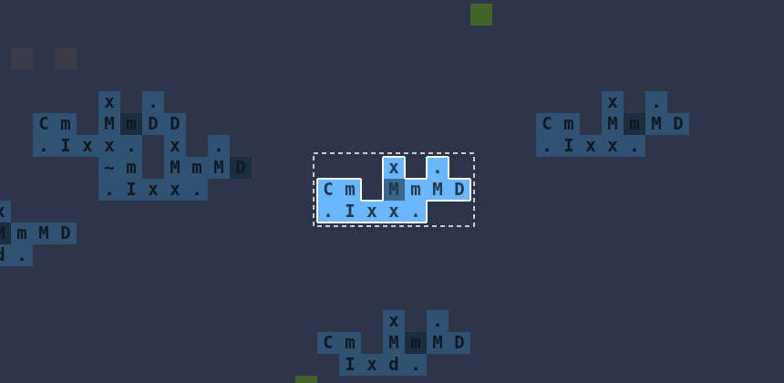
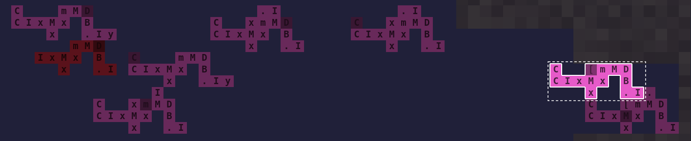
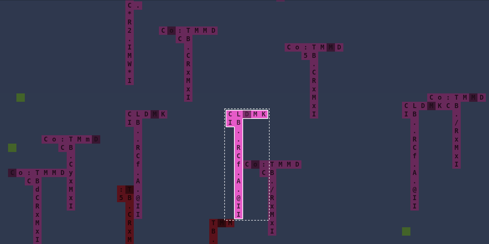
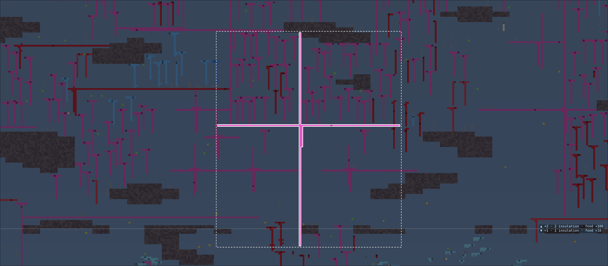
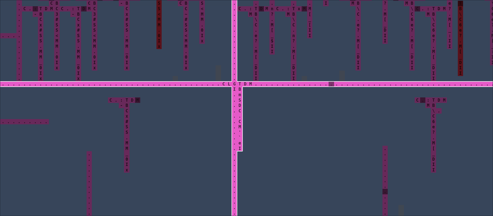
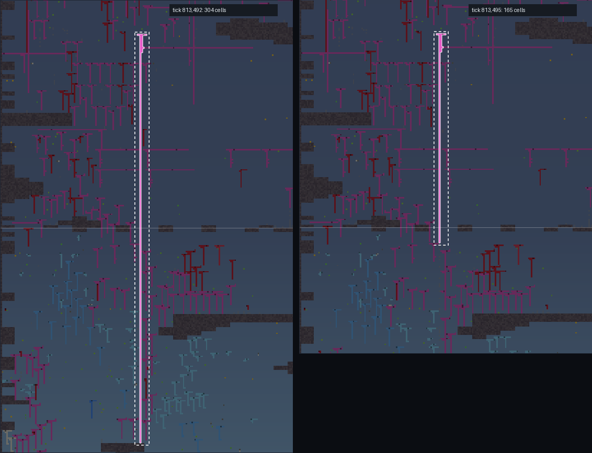

# andnow

**Code-cloud warriors: Tierra × Core War × RTS.** Each creature is a connected cloud of cells on a 2D board, and every cell is one Befunge-style instruction. The body *is* the program: an instruction pointer walks the creature's own cells, and its moves, bites, growth and division come from what it runs. Copy errors when a creature divides make evolution. Nobody writes the creatures that end up winning.


## The Climb

The current mode is a world that grows forever, both up and down.

- **Steps:** step 0 is a thin band at sea level.
  - Above it, each step up is colder air. Living there needs one more point of **insulation** (`I` cells).
  - Below it, each step down is deeper water. Living there needs one more point of **armor** (`K` cells).
- **Reward and size:** each step out has food worth **10× more** than the step before, and allows bodies twice as large.
- **Growth:** when life gets near the top or bottom of the world, a new step is generated from the seed and joined on. Steps past ±2 are each about 1.5× taller than the last. Only tiles near living bodies are simulated.
- **Body chemistry:** traits come from the cells a creature is made of, and neighbours can rewrite each other.
  - `~` swaps armor and insulation.
  - `x` doubles a trait.
  - `n` makes a cell weightless.
  - Mass slows a creature down. `B` (bite) and `C` (collect) decide whether it eats meat, plants or both.
  - Evolution found the modifiers on its own. Seed 4's deep colony is `CxKDTM`: the diver moved its armor cell onto its code path and put a doubler beside it.
- **Kills:** a kill leaves a rich corpse, food for whoever eats it first, killer or scavenger.
- **Founders:** three species start the run, each about seven cells. Climbers have a spare insulation cell, divers a spare armor cell, and hunters are a slow, fat biter. Everything after that is evolved.

|  |  |
|---|---|
|  |  |
| **Step +3,** 7,000 rows up: insulated grazers (blue) and meat eaters (red). Food here is worth ×1000. | **Step −2,** in the deep: armored colonies (orange) in the caves, with meat eaters (red) working through them. |


*Tap a body to pick it, so you can tell where one creature ends and the next begins. This is the biggest one in seed 7: a 252-cell thread lying along the boundary into step +3.*


*Zoomed in with **glyphs** ticked, every cell shows its instruction. This climber runs `C+xC?GD`: collect, then divide. Its `x` sits next to the `I` below it and doubles that cell, so one insulation cell counts as 2, enough for step +2 (the hover card shows `insulation 2`). The long tail of `.` is fat from `G` (grow). Hover any cell to see its body's traits and genome.*

### Forever runs

Six seeds have baked on the current rules (rules 6), saving a checkpoint every 1,000 ticks (older ones thin out: see below). Two broke out of the middle steps and are still baking; the other four are paused.

| seed | tick | alive | notes |
|---|---|---|---|
| 2 | 1.25M | 151k | climbers took +2 and +3 at ~700k: both-eaters, meat-eating hunters and fat whales; the biggest body yet (1,447 cells) at ~1.12M |
| 4 | 1.19M | 124k | divers took +2 at ~450k as plant eaters, then turned both-eaters; the biggest ~1,090 cells at ~1.06M |
| 1, 3, 7, 13 | 4.9–14.4M | 3.6–46k | paused; mostly on steps ±1 |

Crowded runs like these take about 3 GB of memory each (`HEAP=12288 ./bake.sh 2` gives the heap room to spare).

### What evolved

Pictures from the two breakout runs, with glyphs on. Each picked body is outlined, and its darker cell is the IP. More detail in [the journal](docs/journal.md).



*Seed 4's forager loops `m M D C`: push my max size, move that way, divide, collect. How full it is picks its direction, so every meal turns it. Its `I` has an `x` on each side, so it counts as 4.*



*Programs can turn. In this one (picked, right) the `[` makes a circuit: east along the row, north up the column below the `[`, west along the row, south down the column. One loop runs four moves and two divides.*



*Seed 2's looker (picked) runs `L C . M D`: LOOK pushes the distance and type of what it sees, MOVE takes the type as its direction and DIVIDE the distance. What it sees steers it and places its child. The tail holds its insulation.*





*Seed 2's whales are mostly fat: this one is 239 cells and 77,000 ticks old, where most bodies live about 1,000 ticks. Its program `CLGTDM` sits where the arms cross. `T` picks a random direction and `G` grows a fat cell at the end of that arm, so the arms grow at random in four directions. The IP then walks ~100 fat cells before it reaches the code again, so it eats and grows only now and then.*



*Bites are rare on the long arms: an auto-bite (`B` with an empty stack) never targets your own lineage, and the colonies at the top are all one lineage. But a bite aimed by stray numbers on the stack can land, and a bite near the core cuts off everything beyond it. Here a 304-cell body loses its lower 139 cells in one bite. Arms are fat and cheap, and grow back.*

*The same thing ended seed 2's biggest body ever. Climber·27349073 grew for 100,000 ticks without moving to 1,447 cells and a 12,800-glyph genome, at a pace of 0.019 (one action every ~50 ticks: mass slows a body). At tick 1,124,521 one bite cut it at a narrow point and it lost 1,141 cells at once. It lived on at 308 cells and regrew for a while. The biggest bodies since are half its size, with genomes a twentieth as long.*

The viewer hops between runs, scrubs a timeline of each one (alive count and biggest body), and can follow the biggest body. With **live** ticked (the default when a run opens at its newest checkpoint) it loads each new checkpoint as the bake writes it, keeping the camera and whoever it follows; jumping back in time unticks it.

## Running it

```bash
npm install && npm run build
python3 serve.py 8765        # then open http://localhost:8765/?climb=1
```

**Viewer controls:**
- drag to pan; the zoom **−**/**+** buttons (or the `-`/`+` keys) zoom around the middle of the view, and pinch zooms on touch screens and trackpads; WASD or the arrow keys to move;
- click the minimap strip to jump to a step;
- `B` follows the biggest body; tap a body to pick it;
- tick **glyphs** and zoom in close to read each cell's instruction;
- hover over a cell to see its traits and genome;
- **Copy link** copies a URL to the exact view; *copy link* beside a picked body shares that body at that tick, so the link opens with it picked and followed.

**Headless tools,** all in `dist/` after a build:

| tool | what it does |
|---|---|
| `bake.mjs "<query>" <ticks\|forever> --out runs/bake/<name>` | runs a world and saves checkpoints; open the result with `?bake=runs/bake/<name>`. Checkpoints thin out with age: all of the newest 100, every 10th of the 1,000 before, every 100th further back. The timeline snaps to the kept ones; a tick between them loads the one before and simulates on |
| `thin.mjs runs/bake/<name> [...] [--dry]` | thins a stopped bake's checkpoints the same way (for runs baked before bakes did it) |
| `headless.mjs` | plays a match without the viewer |
| `evolve.mjs` | the genetic-algorithm and MAP-Elites warrior search |
| `petri.mjs` | runs the petri dish |
| `check.mjs --verify test/golden.json` | determinism check: replays 2,491 recorded matches |
| `bench.mjs <checkpoint.andnow.gz> [ticks]` | times the sim on a saved world and prints a hash of where it ends up, so a speed-up can be checked to change nothing |
| `diet.mjs <bake dir> [...] [--every 50000]` | who eats what in climb runs over time (plants, meat, both), meat eaters' size, dead cells and rich ones; reads runs on any rules, for comparing them |

Runs are deterministic: the same seed and settings always replay the same history, and a world restored from a checkpoint continues exactly as the original run would have.

Each bake records the rules version it was made on (`RULES` in `src/sim/world.ts`, bumped whenever a change makes runs play out differently). The viewer's runs list shows only runs on the current rules; older runs stay on disk for comparison, and can't be carried on.

```bash
./bake.sh 4    # start (or carry on) seed 4 as runs/bake/climb7-s4, in the background at low priority
```

## Other modes

The project started as Core War-style duels on a board of rooms and corridors, then picked up modes as it went:
- free-for-alls;
- a GA and MAP-Elites search for warriors;
- creatures that rewrite their own code mid-game;
- amorphous "ooze" bodies that change shape;
- a toxin-gradient petri plate;
- island survival, with water pressure and mines.

The Climb grew out of all of those. They're still reachable from the viewer (*Back to matches*, *Island*).

## Docs

- [`docs/journal.md`](docs/journal.md): the whole journey, session by session, including the dead ends.
- [`docs/climb.md`](docs/climb.md): the Climb's design.
