# A field survey of the Climb

What lives in the four forever runs (seeds 1–4, rules 6), surveyed on 2026-11-10/11:

- **Census:** every living body, in 72 checkpoints from tick 0 to now.
- **Body plans:** a closer look at the most common plans at 33 of those checkpoints.
- **Behaviour:** the newest checkpoint of each run replayed for 200–300 ticks, following every body of the common plans (about 114,000 bodies) to see what it runs, how far it moves, whether it breeds, bites or is bitten, and how it dies.

Scripts and raw data are in the session scratchpad; the method is at the end.

## Reading a creature

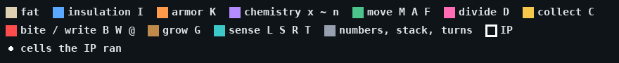

Each picture is one body, a cell to a square, coloured by what the cell does, with its glyph on it. Beige squares are fat (`.`). A white dot marks a cell the body's instruction pointer (IP) actually ran during the replay.

The dots show the most useful fact in the survey: **in every common form, the IP runs only the top row.** That row is the program, a loop of four to seven glyphs. Everything below it is never executed. It is anatomy: cells that count only for what they add to the body's traits.
- `I` and `K` are insulation and armor.
- `M` off the code path still adds to speed.
- `B` gives a taste for meat and `C` for plants.
- `x` doubles its neighbours, and `n` makes them weightless.

The only exceptions are a handful of giants whose IP wanders off into their fat.

So a Climb creature is a short program on top of a body plan, and evolution works on both: the program decides what it does, the anatomy decides where it can live and how fast it goes.

## The big picture

Every run went the same way. For a long time a few thousand scanner-grazers held the middle steps. Then a new program appeared, opened the high steps, and the population jumped 10–30× in a few hundred thousand ticks. Each boom is a new form taking over: a speciation event, not just more of the same.

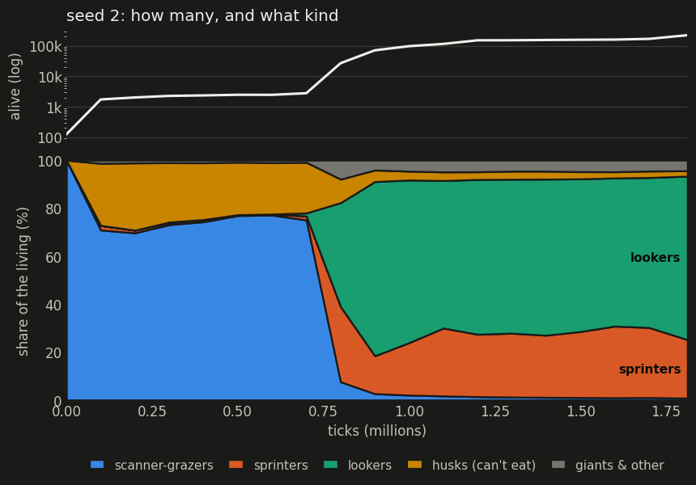

| run | quiet era | the boom | what took over | now |
|---|---|---|---|---|
| s1 | 0–4.5M, 3–12k bodies | 4.5M–5M | sprinters `CDmM` | 95k, 70% sprinters |
| s2 | 0–700k, ~2.5k | 700k–900k | lookers `CLDM`, masted | 221k, 68% lookers |
| s3 | 0–5M, ~3k | 5.5M–6M | sprinters `CMxDm`, then `CMDm` | 111k, 74% sprinters |
| s4 | 0–400k, ~3.5k | 400k–700k | sprinters `CmMmMD`, then `CxmMD`, `CmMD`; [lookers](#lookers-in-s4) `CLMD` since 1.5M | 185k at 1.835M: 73% sprinters, 10% lookers |

Through each quiet era two lineages shared the world: Climbers above sea level, Divers below. In s3 they were level for 4 million ticks (1,823 each at 4M). The boom forms swamped that balance, and each run is now practically one lineage: Climbers in s1, s2 and s3 (99.4–99.9%), and Divers in s4 (99.8%). A relict of the other lineage holds on in each, steadiest in s1, where about 500 Divers have lived below sea level all run long. The Hunters are extinct everywhere.

## The species

The names below are mine.

### Scanner-grazers: the founders' plan

| a climber (s3, 1M) | a diver (s3, 2M) |
|---|---|
|  | 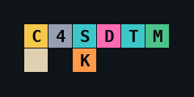 |

**Program `C 6 S D T M`** (or `C 4 S …`): collect; push 6; SCAN for the nearest thing of that kind (food), pushing where it is and whether it found one; divide; turn toward it; move. It's a seeker: it heads for food it can see.

**Anatomy:** one cell under the row.
- An `I` makes it a climber, living at step +1.
- A `K` makes it a diver, living at step −1.

This is the founders' plan with small edits. It held 60–80% of every run for its first 400k (s4) to 5M (s3) ticks.

**Life history:** a slow, long-lived plant eater.
- Pace about 1, which is one action a tick.
- Median age 800–1,200 ticks, and some live past 4,000.
- One cell of protection allows only one step out, so the grazers never left the middle steps.

[the climber in the viewer](http://lilg:8765/?climb=1&w=climber,diver,hunter&seed=3&bake=runs/bake/climb7-s3&t=1000000&pick=4756384) · [the diver](http://lilg:8765/?climb=1&w=climber,diver,hunter&seed=3&bake=runs/bake/climb7-s3&t=2000000&pick=9844246)

### Ladder grazers

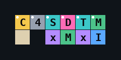

**Program:** the same scanner, `C4SDTM`.

**Anatomy:** a row of chemistry, `x M x I`. Each `x` doubles the cells beside it, so the one `I` counts twice and the off-path `M` adds speed.

**Life history:**
- Insulation 2 takes it to step +2, and it's 2.7× the founders' pace.
- It moves ~130 cells in 300 ticks, against ~50 for the plain grazers.

It's the founders' plan tuned for one step higher. 2,258 of them live at step +2 in s1 now: a niche the sprinters overflew.

### Sprinters: the boom species, three times over

| s1 `CDmM` | s3 `CMDm` | s4 `CmMD` |
|---|---|---|
| 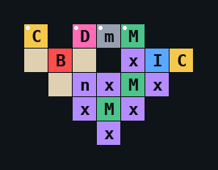 | 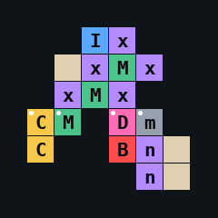 | 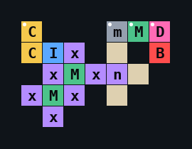 |

**Program `C D m M`**, in some order: collect; divide; push my max size; move. There's no SCAN and no TOWARD: the sprinter is blind. The direction it moves and divides comes from its max size (mod 4), so how full it is steers it, and every meal turns it.

**Anatomy:** the staircase. Diagonal steps of `x M x`, with an `I` near the top, sometimes a `B`, often an `n`.
- Each `M` sits between two `x`s, so the off-path `M`s count several times over. Move trait 26–34, pace 11–14: **ten times the founders' speed.**
- The same doubling lifts one or two `I`s to insulation 4, which is step 4.
- A `B` adds meat, so they eat both.

**Life history: live fast, breed, freeze.** In 300 ticks the average sprinter:
- moves 400–500 cells;
- divides 1.1–1.4 times;
- has a 78–90% chance of dying.

Median age is about 100–300 ticks, and three in four of the deaths are from cold, at the top of the range they can reach.

**Convergence.** The same form evolved separately in three runs, in the Climbers of s1 and s3 and in the Divers of s4: the scanner dropped from the program, the staircase grew below it. **s4's Divers came up out of the deep and are now sky creatures:** 14,550 sprinters of a single plan live at step 4, and nearly 90% of the run lives above sea level.

The cross shape that held s3 at 5.9M was the step before the staircase. It had the same program, with a single `x M x` step and `I` on top, insulation 2:

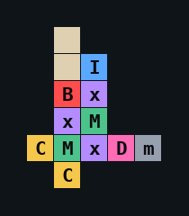

[a cross in the viewer (s3, 5.9M)](http://lilg:8765/?climb=1&w=climber,diver,hunter&seed=3&bake=runs/bake/climb7-s3&t=5900000&pick=51106260)

### Deep sprinters

| s3 (Climbers) | s4 (Divers) |
|---|---|
| 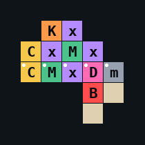 |  |

**Program and anatomy:** the sprinter program with `K` where the sky form has `I`, between `x`s: armor 4, at step −2.

**Origin:** in s3 it's Climbers that went down. 15,400 of s3's bodies live at step −2 now, in a colony separate from the sky.

**Life history:** slower and longer-lived than the sky sprinters.
- Pace 7–8.
- Median age 160–220 ticks.
- 40–56% die in 300 ticks, mostly crushed by the pressure.

### Lookers and their masts (s2)

| `CLDM` looker | `CTDM` | `C5:mMMD` crawler |
|---|---|---|
|  | 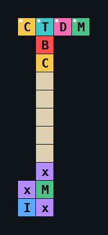 | 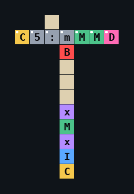 |

**Program `C L D M`:** collect; LOOK, which pushes the distance and the type of the first thing it sees; DIVIDE, which takes the type as its direction; MOVE, which takes the distance as its direction. What it sees steers it and places its child. 128,000 of s2's 221,000 bodies run exactly this.

**Anatomy:** a mast. The code row sits on top of a column 9–12 cells long, mostly fat, with the working cells hung along it: `I` near the top, then `C` and `B`, with `x M` / `I x` at the foot. 77% of s2's bodies have a mast. s2's "sprinters" (`CTDM`, `C5:mMMD`) wear masts too.

Because fat gaps of any length work, the masts vary endlessly. s2 has 92,000 distinct body plans among its 247,000 bodies, against 26,000–56,000 in the other runs.

**Life history:**
- Insulation 4–5 takes the lookers to steps 5 and 6, the highest anyone lives. 110,000 of s2's bodies are at steps 5–6.
- They are slow, pace about 2, and barely move: about 25 cells in 300 ticks.
- They breed fast (1.2 children a body in 200 ticks) and freeze young (median age 60–200).
- The crawler at step 2 lives ten times longer: median 780 ticks.

Below, the densest patch of s2: masts hanging side by side, and a row of `CLDM` heads packed in a line along the bottom.

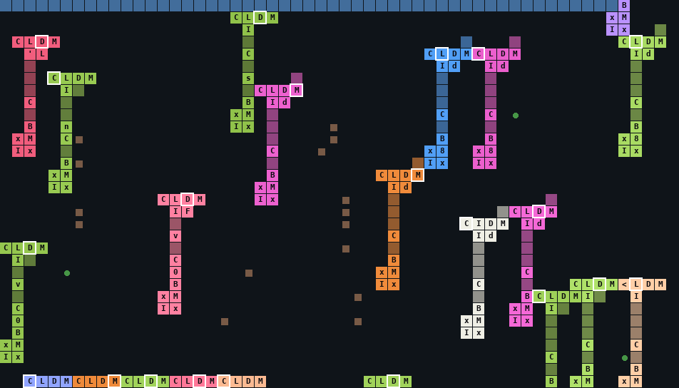

#### `LDMC`: a faster looker from an old line (s2)

*Found 2026-11-25.* The row has come and gone in small numbers since 1.97M (27, then 0, 170, 30, 0). From 2.047M it took off: 150 → 815 → 1,208 → 1,542 at 2.076M.
- **The row.** It's `CLDM` with the `C` moved from the front to the end. Read as a loop, it's the same four instructions in the same order, and the mast still hangs from the `L`.
- **What's different: a foot.** Every `LDMC` we looked at carries an `M` at the foot of its mast, beside an `x` (which doubles it) and the `I`. The `CLDM` feet have an `x`, a digit or another glyph there instead.
  - So `LDMC` has move 5 where `CLDM` has 1, and pace 1.7–2.1 against 0.67.
  - It's an old line: median generation about 9,400, against 23,300 for `CLDM`. It also lives longer (median age 98 ticks against 39), and 843 of its 1,540 bodies have an `LDMC` parent.
- **Where and how it does.** 99% live at step 4. A 200-tick replay at 2.076M compared it with `CLDM`:
  - survival at step 4: 0.236, against 0.212 for `CLDM` at the same step;
  - children: 0.28 a body, against `CLDM`'s 0.15 overall. Most `CLDM` live higher, at steps 5–6, so that comparison flatters `LDMC`.
- **It crowds itself.** Its colonies are dense (669 measured bodies in 102 tiles), and it does worse beside its own row: −0.15, −0.23, −0.27 over three scans, reaching z −3.8 at 2.076M.
- A viewer link goes in at 2.1M, the first 100k checkpoint it's alive at.

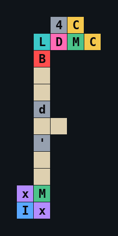

*An `LDMC` looker at step 4: the row on top, the mast hanging from the `L`, and the `xM` foot at the bottom.*

#### Hungry lookers shed their row (s2)

*Found 2026-11-16.*

| `CLD` | `LD` | `L` |
|---|---|---|
| 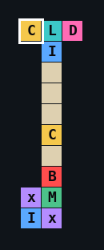 |  |  |

When hunger brings a body's max size below its cell count, it sheds a cell each tick. Fat goes first, then code, farthest from the IP first, and armor and insulation (with the `x`s beside them) last. The body has to stay in one piece.

A looker's fat is all inside its mast, where dropping a cell would cut the body in two, and its foot is `I` and `x`, which are kept till last. So the first cells a hungry looker can drop are the ends of its row:
- `CLDM` → `CLD`: the `M` goes first. Without it the looker can't move, but it can still look, eat and divide.
- `CLD` → `LD` or `CL`: then the `C` or the `D`. An `LD` can't eat: a `C` lower down the mast is off its IP's path.
- → `L`: a bare LOOK on a mast, which only looks.

**How common:** about 10,400 bodies, 4.6% of s2, at both 1.9M and 1.915M: `CLD` 4,100, `LD` 2,800, `L` 2,100, `CL` 1,500. In a 30-tick replay from 1.915M, 42,000 of the 131,000 `CLDM` shed their `M`, and not one body grew it back. They're young (median age 25–75), so most of the shed lookers die soon.

The ages and parents fit. A `CLD`'s children are often `CLDM`: the parent divided while it still had its `M` and shed it afterwards.

[A shed `CLD` in the viewer (1.9M)](http://lilg:8765/?climb=1&w=climber,diver,hunter&seed=2&bake=runs/bake/climb7-s2&t=1900000&pick=1735402645)

#### T-crawlers (s2)

*Found 2026-11-16.*

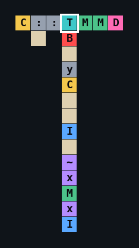

**Program `C : : T M M D`:** the crawler's row with a `T` where the crawler has its `m`. Where the crawler steers by how full it is, the T-crawler walks at random: `T` pushes a random direction and both `M`s take it. The mast hangs from the `T`, not from the `C`, which is why the README calls them T shapes. The second glyph varies (`Cm:TMMD`, `C::TMMD`, `Co:TMMD`), much as it does in the crawlers.

**Where they live:** one step above the crawlers. 98% of the T-crawlers are on step 3, against 95% of the crawlers on step 2. With insulation 3 and a heavier mast, they're slower (pace 1.8 against the crawler's 3.4), and die younger (median age 180 against 390).

**How common:** 11,800 bodies (5% of s2) at 1.9M and again at 1.91M, against 16,200 crawlers. They've been around since at least 1.0M, but in small numbers then.

**Crowding:** T-crawlers do worse beside their own row (z −3.2 in both s2 scans), and `CTDM` sprinters do worse beside them (−0.25 at z −2.4, then −0.50 at z −3.8). One to watch.

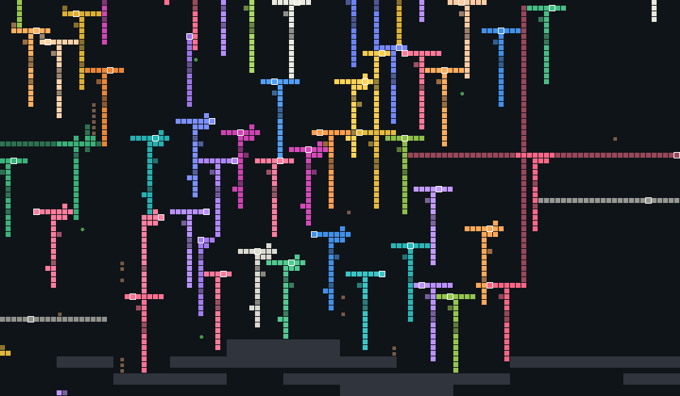

T-crawlers at step 3, where they're densest, with lookers' masts among them.

[A T-crawler in the viewer (1.9M)](http://lilg:8765/?climb=1&w=climber,diver,hunter&seed=2&bake=runs/bake/climb7-s2&t=1900000&pick=1752281385)

#### The crawler's digit doesn't matter (s2)

*Found 2026-11-21.*

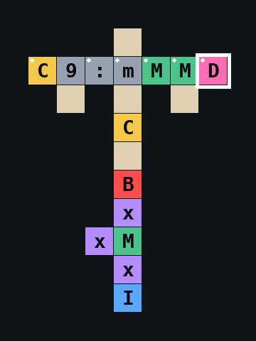

`C9:mMMD`, `C5:mMMD` and `C1:mMMD` are one program. The crawler's IP runs west, so the row reads `D M M m : 9 C`: both MOVEs take the max size (pushed by `m`, doubled by `:`), and only the DIVIDE takes the digit. The digit only becomes a direction (mod 4), and 9, 5 and 1 all place the child south. The bodies match cell for cell and fare the same (step 2, pace 3.4–3.7, survival 0.78 against 0.70). `C9` is the older strain, here since 1.1M. Each digit holds its own colonies (98–99% of a tile's 5/9 crawlers share one digit), and by 2.0M drift has made `C9` twice as common as `C5`, while the three together stay at about 5,100–5,700.
- **`:` and `m` are synonyms here** (2026-11-22). Read west, `C9mmMMD` is `D M M m m 9 C`: two pushes of the max size where `C9:mMMD` has a push and a dup, so the stack is the same and so is the program. That's why the dup in this slot keeps turning into `m` in both crawler families. It's drift, not selection: `C9mmMMD` rose from 612 to 1,123 bodies between 2.025M and 2.037M while its survival and births matched `C9:mMMD`'s (0.80 and 0.43 against 0.78 and 0.37).
- `C0:mMMD` places its child east. Its 426 bodies did worse beside their own row at 2.0M (−0.39 at z −3.2), but it didn't repeat: −0.06 at z −0.4 at 2.014M, and by 2.025M `C0` was down to 140 bodies. A blip.
- **`Ce:mMMD` places its child by whether its last step worked** (found 2026-11-22). `e` pushes 1 if the last action succeeded, else 0, and the last action before it is the second MOVE (`C` comes after `e`, so whether it ate never reaches the stack). So a child goes south after a step that went through and east after one that was blocked: 57% south and 43% east, where `C9`'s go 92% south. It isn't new: at 2,700–3,950 bodies in every scan since 1.9M it's as common as `C9`, and only its commonest plan just reached the top 10. It lives and breeds like `C9` (step 2, survival 0.77 against 0.78, 0.45 births a body against 0.46), so steering its children this way buys nothing measurable.
- **`Ce` is losing ground to `C9` by drift** (2026-11-24). Between 2.025M and 2.067M, `Ce:mMMD` fell from 3,454 to 1,861 while `C9:mMMD` rose from 3,625 to 6,866. In a 200-tick replay at 2.067M, they matched almost exactly at step 2, where nearly all of them live:
  - survival: 0.725 for `Ce`, 0.758 for `C9`;
  - children a body: 0.356 for `Ce`, 0.323 for `C9`;
  - survival plus children: 1.08 each.

  A scan at 2.057M found `C9` doing worse beside `Ce` (−0.37, z −3.1), which is the wrong way round to explain the swing.

  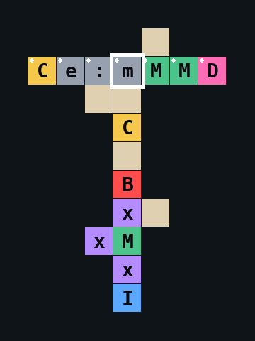

  [A `Ce` crawler in the viewer (2.0M)](http://lilg:8765/?climb=1&w=climber,diver,hunter&seed=2&bake=runs/bake/climb7-s2&t=2000000&pick=2108096874)

[A `C9` crawler in the viewer (2.0M)](http://lilg:8765/?climb=1&w=climber,diver,hunter&seed=2&bake=runs/bake/climb7-s2&t=2000000&pick=2337415915)

### Lookers in s4

*Found 2026-11-15.*

| s4 `CLMD` looker | s4 `CmMD` sprinter, its ancestor |
|---|---|
|  |  |

**Origin:** s4's Divers evolved looking too. s2's Climbers did it at about 700k, and s4's Divers at about 1.5M. The `CLMD` body is the s4 sprinter's staircase, with one glyph changed: the `m` (push my max size) became `L` (look). Its program is `C L M D`: collect; look; move toward the type of what it saw; divide at its distance. It's s2's `CLDM` with the last two swapped, and it grew no mast.

**The rise** (bodies with `L` in the code row):

| tick | 1.1M | 1.3M | 1.5M | 1.6M | 1.7M | 1.8M | 1.835M |
|---|---|---|---|---|---|---|---|
| lookers | 556 | 332 | 1,625 | 7,308 | 9,782 | 16,249 | 17,761 |
| at step 5 | 0 | 0 | 1,428 | 7,005 | 9,456 | 15,496 | 16,206 |
| at step 6 | 0 | 0 | 0 | 0 | 0 | 491 | 1,321 |

At 1.835M, 15,195 bodies run exactly `CLMD`.

**Where they live:**
- Sprinters took step 5 between 1.3M and 1.5M. Lookers arrived there soon after, and now they lead the way onto step 6: 1,321 lookers live at step 6 against 112 sprinters.
- Sprinters at step 5 are falling as the lookers rise, from 38,561 at 1.6M to 30,612 at 1.835M.

**How they differ from the sprinter:**
- They're slow: pace 3.1, against 8 for the step 5 sprinters.
- They're a little heavier (mass 23 vs 17).
- Their insulation is 5 at step 5, and the ones at step 6 have 6.
- Most eat both plants and meat. Several common plans have lost their spare `C` and eat only meat.

The scan also caught `CLMB` mutants (the `D` turned to `B`) biting their `CLMD` kin. One scan (1.85M) found that sprinters touching lookers do worse: 0.44 less survival plus children, at z −3.0, which is just at the bar. Lookers touching sprinters were unaffected. If this holds up in later scans, the lookers are crowding the sprinters out, not just outclimbing them.

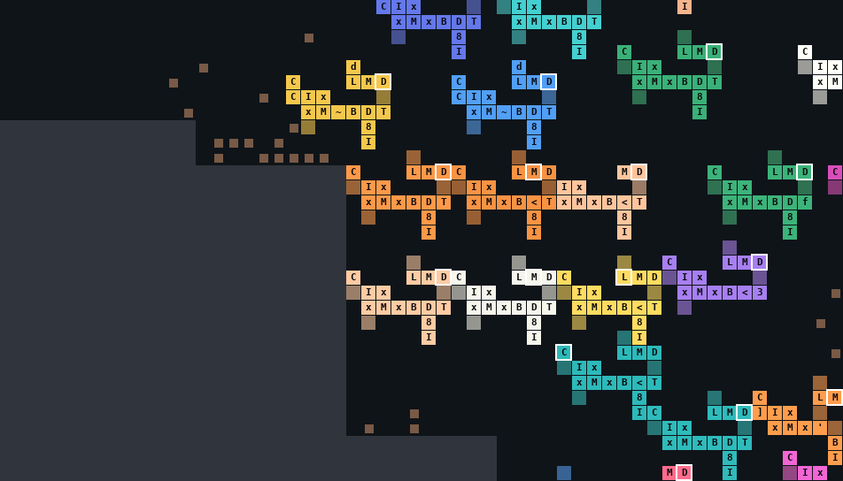

#### `CxLMD`: a looker with double insulation (s4)

*Found 2026-11-23.* A new row: none at 2.017M, 493 at 2.032M, and 1,345 at 2.044M. It's a `CLMD` looker with an `x` after its `C`. The `x` sits on top of the `I`, and `x` doubles the trait of the cells beside it, so insulation 4 becomes 8.
- **Where it lives.** 1,326 of the 1,345 are at step 6, the top step, with insulation 8.1 on average. Step 6 needs 6, which the `CLMD` lookers there have (6.1). That makes `CxLMD` 43% of step 6's lookers, against 1,774 `CLMD`.
- **How it does.**
  - It isn't doing better: step 6 is a sink for both. Over a 200-tick replay, 0.1% of `CxLMD` and 0.3% of `CLMD` at step 6 survived. Median age is 19 ticks.
  - `CxLMD` comes from the lookers (median generation about 17,000, against 18,800 for `CLMD`), and half its living bodies have a `CxLMD` parent.
  - Its rise is churn in a place where nearly everything dies young.
- **Why watch it.** Insulation 8 is two steps' worth of spare. If the world opens a step 7, these would be the first lookers that could live there.
- **It crashed** (2026-11-24): from 1,386 at 2.056M to 227 at 2.068M. The rise and fall are both churn in a step where almost nothing survives 200 ticks.
- **A different `CxLMD`.** The row turns up again in 12 bodies at step −2: armored sprinters (gen about 7,500), not lookers.

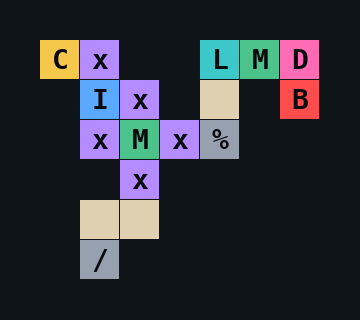

*A step-6 `CxLMD`: its `x` doubles the `I` below it.*

*Lookers packed at step 5, s4 at 1.8M. Each body is its own colour. Many carry a second working row, `x M x B D T`.* [A looker in the viewer](http://lilg:8765/?climb=1&w=climber,diver,hunter&seed=4&bake=runs/bake/climb7-s4&t=1800000&pick=943101389)

### Giants

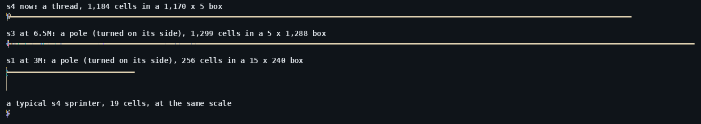

Every giant's IP runs a `G` (grow): in its code row, or below it, reached by a turn (`v`, `|`) that sends the IP down a column. That's how the giants' IPs leave the top row. Each pass of the loop adds a fat cell at the end of a line, in the direction on its stack, so a giant is a growth mutant. In s2, many giants have two `G`s and grow two threads at once (see [combs](#combs-s2) below). Giants are nearly all fat: 97–99% of their cells.

The direction decides the shape:
- **Poles** grow straight down or up. s3's record at 6.5M was 1,299 cells in a column 1,288 tall and 5 wide.
- **Threads** grow sideways. s4's biggest now is 1,184 cells in a 1,170 × 5 box.

| s4's thread, the code end | s3's pole, the code end |
|---|---|
| 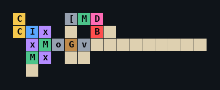 | 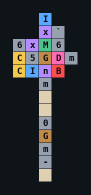 |

**Life history:**
- Giants are sterile in practice. A DIVIDE needs a max size three times the cell count, and they never get there.
- Mass makes them glacial: s2's 1,447-cell giant acted about once every 50 ticks.
- They end the way that one did, cut by a single bite at a narrow point (see the [journal](journal.md)).
- They're rare, about 1% of a run at any time, but they set every size record.

**The simplest giant (s1, found 2026-11-21)** is a sprinter with one copy error. In `CDmM` the `C` became `[`, which turns the IP south. The IP then loops down a column of three cells, `[`, `G`, `C`, and never runs `D`, `m` or `M` again. The `G` pops an empty stack, 0, which is east, so the body grows one thread east forever, eating as it goes. At 7.0M it was 485 cells (479 × 3) and 62,658 ticks old, with a pace of 0.06. It's the same kind of mutation that made the hunters (`D` → `]`), here landing on a `C`. s4's biggest body at 2.021M is another turn mutant: row `C]M4`, 992 cells in a thread 977 × 5.

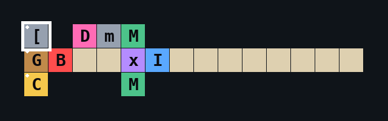

[The `[DmM` giant in the viewer (7.0M)](http://lilg:8765/?climb=1&w=climber,diver,hunter&seed=1&bake=runs/bake/climb7-s1&t=7000000&pick=633019399)

[s3's pole in the viewer (6.5M)](http://lilg:8765/?climb=1&w=climber,diver,hunter&seed=3&bake=runs/bake/climb7-s3&t=6500000&pick=61967760)

#### Combs (s2)

*Found 2026-11-14.*

The code end of three s2 combs. Each "tooth" is a thread of fat, a few hundred cells long, cut short here (→).

**Anatomy:** a comb is a mast, as the lookers have, with two `G`s hung on it. Each `G` grows a thread sideways, so the body grows two threads side by side, like a comb with two teeth. The teeth sit next to each other, or up to 8 rows apart.

**How the IP reaches both `G`s:** the code row has a turn in it: `v` (go south), `^` (go north) or `|` (pop: 0 → south, else north). An IP runs only its own cells: it skips gaps and wraps to the far end of the body. So once it turns, it runs the whole mast, top to bottom or bottom to top, and passes both `G`s on every loop. Each loop adds one cell to each tooth, so the teeth stay about the same length (214 + 201, 341 + 340, 402 + 401).

The heads differ: sprinter heads (`CvDM`, `C|DM`, `C^DM`) and a looker head (`CL|M`). Since combs come with different heads, the form has probably evolved more than once.

**The biggest body today** (1.89M) is a comb: 885 cells, teeth 409 and 461 long and still growing.

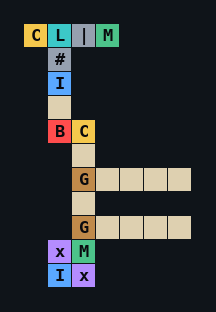

**How common:** the comb is s2's main giant form. A two-`G` comb was s2's biggest body at 40% of the checkpoints from 945k on, and at least 14 different combs held the title since the first, at 870k. Two-tooth combs are rare elsewhere: 1% of the time in s3, and never in s1 or s4. Giants with one `G` grow a single thread or pole.

[A comb in the viewer (1.8M)](http://lilg:8765/?climb=1&w=climber,diver,hunter&seed=2&bake=runs/bake/climb7-s2&t=1800000&pick=1382784584)

### Husks

| s1 | s3 | s4 |
|---|---|---|
|  |  |  |

**What they are:** bodies with no `C`, which can't eat. They're what's left of a sprinter after the cold has taken its cells one at a time. Frozen cells go first, and a starving body sheds fat, then plain cells, then its protection last. So what remains is the insulated corner: the `I`, the `x`s around it, an `M` or two, and maybe the `D`.

**Life history:**
- Not one of them divided in the replays.
- All of them died within it, of cold.

**How common:** at any moment they're 12–18% of a sprinter run. In the grazer era 20–25% of every run were husks, mostly single cells (`S`, `D`, `$`). Those lasted far longer, median age 500–1,500 ticks, because one cell costs almost nothing to keep.

**Why s1's husk rows reshuffle (2026-11-23).** A husk's shape is set by where its parent's `I` sits, so the husk rows follow the parents' layouts.
- **Two layouts, one program.** s1's sprinter `CDmM` comes in two common layouts, and they differ only in where the `I` sits:
  - in the left layout, below and left of the second `M`, so an `x` links that `M` to the insulation;
  - in the right layout, beside the second `C`.
- **What's left after shedding.** A starving body keeps its protection and the cells tied to it:
  - The left layout leaves `DmM+IMxxx`, which keeps the lower `M`.
  - The right layout leaves `DmM+Ixx`.
- **The swap.** Over 100k ticks (t7.0M to t7.1M), the left layout's parents rose from about 7,800 to about 9,400 bodies, and its husk from 325 to 604. The right layout's parents fell from about 7,400 to 4,200, and its husk from 788 to 425. That put `DmM+IMxxx` into the top 10.
- **No new form.** The living layouts do about the same in the replay: 23% and 27% survive 200 ticks, with about 1.3 children each. So the husk rows are mostly relabelling, as in [s4's starvation wave](#up-high-the-insulated-starve-outright-s4).

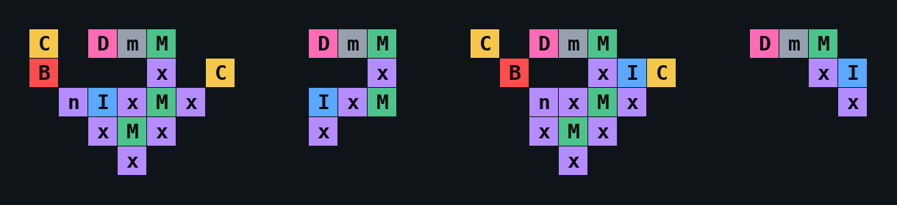

*From left: the left layout and its husk, then the right layout and its husk. These are code cells only; plain cells aren't shown.*

### Extinct: the Hunters

**At the start:** the third founder, a slow fat biter. Every run began with 41 of them.

**At the end:** by s4's 100k they had become plant eaters. The program was `S C T M D`, with no `B` left, and a `K` in the body, at step −1. They were gone from s2 by 100k and from s1 and s3 by 300k. s4's held out longest, peaking at 1,002 at 500k, and were gone by 1M.

[a late Hunter (s4, 100k)](http://lilg:8765/?climb=1&w=climber,diver,hunter&seed=4&bake=runs/bake/climb7-s4&t=100000&pick=233891)

## New finds

New forms and behaviours, as they turn up. Each gets a write-up in its section above.

| found | run | what | where |
|---|---|---|---|
| 2026-11-14 | s2 | Combs: giants with two `G`s on a mast, growing two threads at once | [Combs](#combs-s2) |
| 2026-11-14 | all | Vandals: `W` mutants that write fat or `@` into their kin | [Ecology scan](#what-the-ecology-scan-found) |
| 2026-11-14 | s2 | Steerers: `CTDW` mutants that write turn arrows into their own children | [Ecology scan](#what-the-ecology-scan-found) |
| 2026-11-14 | s4 | A sprinter hunting the other lineage's grazers | [Ecology scan](#what-the-ecology-scan-found) |
| 2026-11-14 | s2, s4 | Growers smother their neighbours | [Ecology scan](#what-the-ecology-scan-found) |
| 2026-11-14 | s2, s3, s4 | The living do better beside husks (read backwards at first; explained 2026-11-20) | [Ecology scan](#what-the-ecology-scan-found) |
| 2026-11-15 | s4 | Lookers: s4's Divers evolved `CLMD`, which now leads the climb onto step 6 | [Lookers in s4](#lookers-in-s4) |
| 2026-11-15 | s3 | A second hunter, made by the same `D` → `]` mutation as s4's: it hunts the relict Divers | [Ecology scan](#what-the-ecology-scan-found) |
| 2026-11-16 | s2 | T-crawlers: the crawler with `T` for `m`, walking at random, one step higher (5% of s2) | [T-crawlers](#t-crawlers-s2) |
| 2026-11-16 | s2 | Hungry lookers shed their row from the ends (`CLDM` → `CLD` → `LD` → `L`): 4.6% of s2 | [Hungry lookers](#hungry-lookers-shed-their-row-s2) |
| 2026-11-21 | all | Why they die of cold: it's hunger, ending when the insulation is shed | [Why they die of cold](#why-they-die-of-cold-its-hunger) |
| 2026-11-21 | all | Height sets the pace of life: survival against births is the step, and dividing starves the parent up high | [Height sets the pace of life](#height-sets-the-pace-of-life) |
| 2026-11-21 | s3 | Grazer pairs are two grazers chasing one plant, not kin, and it halves their births | [Ecology scan](#what-the-ecology-scan-found) |
| 2026-11-21 | s7, s13 | Why runs stall: each boom is one founding into one meadow | [Breaking out](#how-runs-break-out-and-why-some-stall) |
| 2026-11-20 | s2 | Lookers eat their dying kin: a looker beside a husk of its own lineage eats the corpse and divides on it (s1's version is a confound) | [Ecology scan](#what-the-ecology-scan-found) |
| 2026-11-21 | s4 | A second starvation wave at steps 5–6: insulated husks starve before they can shed their insulation | [Up high, the insulated starve](#up-high-the-insulated-starve-outright-s4) |
| 2026-11-21 | s4 | The `CmMD` old-age bump was a faster sprinter form taking over step 3 | [Height sets the pace of life](#height-sets-the-pace-of-life) |
| 2026-11-21 | s4 | Nibblers: `M` → `R` sprinter mutants whose aimed bites hit the kin stacked above them | [Ecology scan](#what-the-ecology-scan-found) |
| 2026-11-21 | s2 | The crawler's digit is neutral: `C9`, `C5`, `C1` are one program in separate colonies; `C0` (east) crowds itself | [The crawler's digit](#the-crawlers-digit-doesnt-matter-s2) |
| 2026-11-21 | s1 | The simplest giant: `C` → `[` sends a sprinter's IP down a 3-cell loop through a `G`, growing an east thread for 62k+ ticks | [Giants](#giants) |
| 2026-11-22 | s4 | The starvation wave is a change of label: new step-6 looker layouts shed tails and keep insulation, so hunger ends in "starved" instead of "frozen" | [Up high, the insulated starve](#up-high-the-insulated-starve-outright-s4) |
| 2026-11-22 | s2 | `:` → `m` in the crawlers is a synonym (same stack), so its spread is drift | [The crawler's digit](#the-crawlers-digit-doesnt-matter-s2) |
| 2026-11-22 | s2 | `Ce` crawlers: the child goes south after a step that went through, east after a blocked one (as common as `C9`) | [The crawler's digit](#the-crawlers-digit-doesnt-matter-s2) |
| 2026-11-23 | s1 | The husk rows reshuffle because two layouts of the same sprinter trade places, and each leaves a different husk | [Husks](#husks) |
| 2026-11-23 | s4 | `CxLMD`: step-6 lookers whose `x` doubles their insulation to 8, two steps beyond what step 6 needs; 43% of step 6's lookers, but no fitter there | [`CxLMD`](#cxlmd-a-looker-with-double-insulation-s4) |
| 2026-11-24 | s2 | `Ce` crawlers halving while `C9` doubles is drift: same survival plus children (1.08) | [The crawler's digit](#the-crawlers-digit-doesnt-matter-s2) |
| 2026-11-24 | s1, s3 | Growers touching sprinters lean better, and the sprinters a little worse, scan after scan: a weak form of s2/s4's smothering | [Ecology scan](#what-the-ecology-scan-found) |
| 2026-11-25 | s2 | `LDMC`: an old looker line with an `xM` foot (pace about 1.8 against 0.67) rising at step 4, 150 → 1,542; it crowds itself | [`LDMC`](#ldmc-a-faster-looker-from-an-old-line-s2) |

## How they interact

**Hardly anybody eats anybody.**
- **Death causes over each run's whole history:**

  | run | cold | pressure | old age | bitten to death |
  |---|---|---|---|---|
  | s1 | 92% | 1% | 6% | 0.01% |
  | s2 | 99.5% | 0.1% | 0.1% | 0.02% |
  | s3 | 82% | 9% | 8% | 0.01% |
  | s4 | 90% | 6% | 4% | 0.004% |

- **Why:** an automatic bite (`B` with nothing on the stack) never targets your own lineage, and each run is practically one lineage now (see [the big picture](#the-big-picture)), with a small relict of the other. In s4 the relict includes `C4SDTM` Climber grazers among the Divers. Meat-eating has become a trait for scavenging the dead, not for hunting.
- The [ecology scan](#what-the-ecology-scan-found) below finds the exceptions: rare mutants that bite or write into their own kin, and once a sprinter that hunted s4's other lineage.

**They crowd, and they pack.** 37–39% of bodies touch another body (56% in s2's mast forests), and almost always it's kin. Bodies can't overlap, so crowded ones settle into each other's gaps. Same-shaped bodies interlock: crosses nest in each other's notches, masts hang side by side, and `CLDM` heads line up in rows.

The rules give no reward for touching: there's no shared warmth and no shared food. So it's packing, not symbiosis. The one real effect of a neighbour is negative. A tile that's too crowded blocks DIVIDE, and the neighbour eats the same plants.

**The real enemy is the climate.** The sprinter strategy is a race:
- A sprinter breeds as fast as it can at the edge of the cold its anatomy can stand.
- Its children are copied with errors, and some come out with less insulation.
- The cold then takes them, and a population lives in balance with its frostbite.

In s1's replay, 22,600 of 30,400 tracked bodies died in 300 ticks and 17,300 were born.

**Scenes.** The densest patch of each run:
- s1's densest patch isn't sprinters at all. It's a colony of armored `C6SDTM / M K` grazers, tightly packed.
- s3's densest patch is the deep sprinter colony.
- s4's has a giant thread running through it, with sprinters packed in rows above.

| s1 | s3 | s4 |
|---|---|---|
| 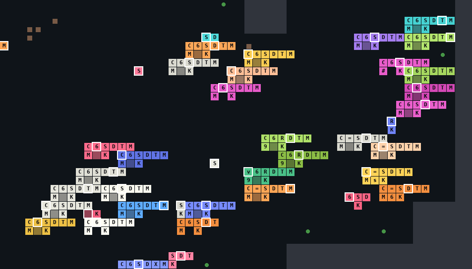 | 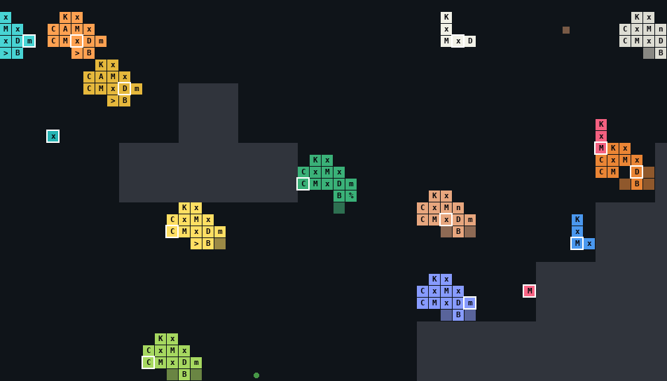 | 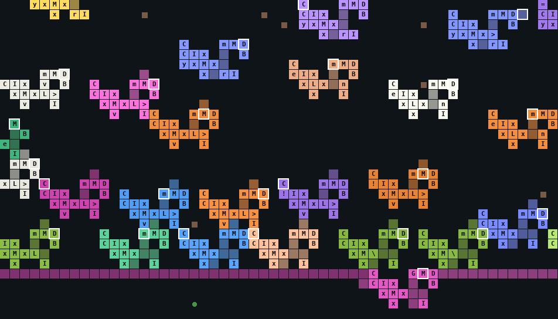 |

Wider views: [s1](img/survey/scene-s1.png) · [s2](img/survey/scene-s2.png) · [s3](img/survey/scene-s3.png) · [s4](img/survey/scene-s4.png). Each body is its own colour and fat is darker; walls are grey, food is green dots and dead cells are brown.

### What the ecology scan found

*Found 2026-11-14,* with `dist/ecology.mjs` (see the README). It replays a run's newest checkpoint for 200 ticks, watching every bite, every write into another body, whose dead cells get eaten and who blocks whose moves. Then it compares bodies touching each kind of neighbour with bodies of the same kind alone on the same step. An earlier replay (above) followed only the common plans, so it missed what rare mutants do.

**Bites and writes come from rare mutants, and they hit kin.** A `B` with numbers on the stack bites a chosen cell, and that bite can hit kin.

| per 200 ticks | s1 | s2 | s3 | s4 |
|---|---|---|---|---|
| bites | 5 | 1,263 (69 kills) | 29 (3 kills) | 104 (13 kills) |
| writes into another body | 242, into 54 bodies | 7,325, into 1,304 bodies | 802, into 52 bodies | 851, into 124 bodies |
| deaths by running `@` | 138 | 1,318 | 171 | 507 |
| …that another body wrote | 2 | 33 | 2 | 2 |

- **Vandals.** In sprinters and lookers, a copy error can turn a code-row glyph into `W` (write): `CMWm`, `CMDW`, `CWD`. Such a mutant loses its divide or its move, and its loop writes into the nearest body instead, again and again, up to 112 times in 200 ticks. The nearest body is usually its own parent or child. Mostly it writes fat over the victim's code. Some write `@`, which kills whatever runs it.
- **Steerers (s2).** `CTDW` mutants write turn arrows (`>`, `<`, `^`) into their own children, rewriting the direction the child's code runs. It's the closest thing to one body controlling another so far, though nothing shows it helps the writer.
- **Nibblers (s4).** An `M` → `R` copy error in a sprinter's row (`CmR?`, `CmRB`, `CmR[`) leaves `R`'s reading on the stack, and the row's `B` fires with it: an aimed bite. Only an empty-stack bite spares kin, so these bite whatever sits above them, which is usually a sprinter of the same plan travelling stacked in lockstep. One `CmR?` (1.984M) tried 309 bites in 200 ticks and hit kin 12 times, with no kills and nothing gained: its store fell 99 → 22. With no `D` it's a dead end, like the hunters. [In the viewer (1.984M)](http://lilg:8765/?climb=1&w=climber,diver,hunter&seed=4&bake=runs/bake/climb7-s4&t=1984000&pick=1335298633)

  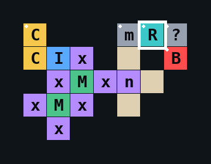

- **Hunters (s4, then s3).** Twice now, the same mutation has made a hunter out of a sprinter. Each time it hunted the relict of the other lineage.
  - **The mutation:** the `D` in the code row became `]` (turn right). Both hunters carry a `B` just below that slot, so the IP turns south straight onto it. An empty-stack bite never targets kin, so the bite lands on the nearest body of the other lineage.
  - **s4 (found 2026-11-14):** a Diver sprinter, `CmM]`, bit the relict Climbers' `C4SDTM` grazers 12 times in 200 ticks and killed 3.
  - **s3 (found 2026-11-15):** a deep Climber sprinter, `CMx]m` with armor 2, bit the relict Divers' `C4SDTMD` grazers 13 times at step −2 and killed 4.
  - **No `D`, no children:** a hunter can't divide, so it's a dead end. The s3 one was 799 ticks old, three times a sprinter's usual age. It's still the only predation between lineages the scans have found.

  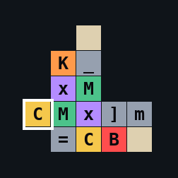

  *The s3 hunter: `C M x ] m`, with `= C B` below. At `]` the IP turns south onto the `B`. Next to it in the run (not shown) was an unmutated `C M x D m` deep sprinter, with a `D` where the hunter has `]`.*
- Most deaths by `@` are the dead body's own copy errors, not poisonings. The numbers fit: they are 0.14–0.16% of deaths in every seed, against about 0.13% expected from the copy-error rate (0.02 ÷ 62 glyphs, over a 4-glyph row).

**Scavenging.** Of the dead cells eaten, 42–49% came from a body of another plan, 9–17% from the same plan, and the rest were already there when the replay began. Sprinters mostly eat the dead husks their own lineage keeps producing (`D`, `Dm`, `mMD`: no `C`, never move, all dead within 200 ticks).

**Who's good for whom.** Each test compares bodies touching a given kind of neighbour with bodies of their own kind alone on the same step. It measures survival plus children over the 200 ticks. Since 2026-11-21 the lone bodies are also matched on size, pace and husks nearby, and z counts each 64×64 tile as one sample. The old z crossed 3 three to five times too often by chance, and three of its hits turned out false (see the journal). Findings above that date were made with the old z.
- **Crowding hurts.** In every run, bodies touching their own kind do worse: −0.06 to −0.26.
- **Growers smother their neighbours** (s2, s4). Mutants with `G` in the code row (`CLGM`, `CLDG`, `CGDM`, `CmGD`) grow fat into the space around them. Lookers and sprinters touching one do 0.3–0.5 worse, with z −13 to −19 in s2. In s2, growers are 2.6% of bodies but cause 7.5% of blocked moves.
- **The living do better beside husks: they eat their dying kin** (s2; s1 is a confound; explained 2026-11-20). This used to read "husks do better beside the living", but that was the table read backwards: the + was always on the living side. A husk's own score can't move, since nearly all of them die within the replay and none has children.
  - **What the gain is.** In s2, lookers (`CLDM`) touching a husk `L` do +0.40 better (z 6.0, n 651), and all of it is births (survival +0.02).
  - **How it happens.** The husk is a starving relative, always of the same lineage and often a sibling. 649 of the 651 died, most within 50 ticks. When it freezes, the looker COLLECTs its dead cells. At steps 3–6 one dead cell fills a looker to its cap, enough to divide.
  - **The eaters carry it.** Lookers that ate any of their husk did +0.74 better (z 9.1); those that ate none did −0.34. Matched on step, size, fat, readiness to divide, age and local food, the eaters were +0.84 and the non-eaters −0.12. In a regression, touching's +0.53 falls to −0.07 once food eaten is added. A husk's corpse is worth what any dead cell or plant is.
  - **The experiment.** We replayed the same world twice, changing the husks beside a random half of the touching lookers. Making those husks vanish at t0, so they leave no corpse, wiped out the gain: births −0.17 (z −8.3), survival −0.04. Turning them into dead cells at t0 instead raised it: births +0.24, survival +0.08. So it's the corpse as food, not the husk being there. Bodies without `B` gain nothing; they do slightly worse.
  - **s1's version is a confound.** s1's sprinters touching husks show +0.11 births (z 6.4), but vanishing the husks barely changes it. Its neighbours eat only 0.11 of a husk's cells on average, against 0.85 in s2. Matched on pace (stacked move doublers) and the number of husk cells nearby, the effect is 0. Fast strains breed more and sit in husk-dense patches; lone bodies merely near husks show the same gain.
  - **Tonight's s1 `DmM` / `C4SDTM` row is noise.** The grazers have no `B` and ate no dead cells. The row is not significant in the next checkpoint (z 1.4, n 204), so it's one false hit among about 76 tests.
  - **Fed bodies also freeze less**, because "core frozen" is mostly how starvation ends (see [why they die of cold](#why-they-die-of-cold-its-hunger)).
- **Growers beside sprinters: a weak sign that keeps coming back** (s1 and s3, 2026-11-24). In the last three scans of each run, with lone bodies matched on size and pace, the result leans the same way:
  - **Growers touching sprinters do better.** In s1 (`CDmG` beside `CDmM`) the gain is +0.42, at z 3.1 at 7.162M. In s3 (`CMGm`, `CMDG`, `CGDm` beside `CMDm`) it's +0.18 to +0.45, with z between 1.4 and 3.1.
  - **The sprinters beside them do a little worse:** −0.03 to −0.26, with z from −2.3 to −0.3.
  - Mostly one side is too rare to test, and the test passes z 3 only once a run. It looks like the smothering in s2 and s4 (the bullet above), only weaker. In those runs the sprinters' side reaches z −12 to −16, and the growers' side here is the first sign of what they gain from it. Not yet checked with a replay.
- **Big growers seem to gain from neighbours, but it's their size** (s4, 2026-11-19). `CmGD` growers touching anything (sprinters, husks, other growers) did 0.24–0.32 better than lone ones in the replay, while smothering the sprinters beside them (−0.20). It isn't an interaction. The 358 touching growers are big, old and high up: median 131 cells, 2,919 ticks old, with a max size of about 1,670. The 30 lone ones are small and young: 77 cells, 879 ticks, max size about 790. A big body touches more and outlives a 200-tick replay more often.
- **Grazers crowd each other** (s1, corrected 2026-11-21). This read as "`C6SDTM` suffers beside `C4SDTM`, not the reverse", but the one-way part is noise.
  - **The two are one program.** The digit is the SCAN type: 4 looks for plants, 6 for plants or speed food. The climb grows only plants, so both scans find the same target, and lone bodies of the two forms match on everything.
  - **The direction flips.** Across seven s1 scans, the side that suffers more changes, on 33–47 bodies a side. Matched on step, size, fat, age and local food, the two sides are −0.14±0.10 and −0.10±0.08.
  - **What's real is plain crowding,** the same for every grazer pair: −0.11 to −0.15 in every checkpoint. Births about halve (DIVIDE finds no room), plant intake falls by a sixth (the neighbour eats the plant first) and moves fail more, while survival is unchanged.
  - **The removal test agrees.** Taking a `C6`'s neighbours away helps it about as much (+0.2–0.3) whether they're `C4`s or `C6`s.

**Moving together.** Thousands of pairs move in step for a while. s3's `C4SDTM` grazers travel in pairs, touching for most of the replay and moving together up to 78 times in 200 ticks. It looked like kinship, but it's two grazers chasing the same plant (s3, 2026-11-21):
- **Same target, same heading.** A grazer scans for the nearest plant, turns toward it and moves on almost every tick. Two grazers a few cells apart pick the same plant, so they move the same way on the same tick. When it's eaten, both pick the next one at once: 81% of target switches come within a tick of each other. Being close makes them chase the same plant, and chasing it keeps them close.
- **Blocking holds them touching.** A move into a body is refused, so they ride stacked and the upper one is often stopped by the lower. They mostly shuttle between nearby plants: median path 120 cells, net 8.
- **Not kin.** Siblings are 12% of convoys and 11% of touching pairs that don't convoy; partners were born a median 480 ticks apart. Different lineages convoy at the same rate, but s3 is 99.9% one lineage, so cross-lineage pairs are rare.
- **The test.** In replays that changed one member of 126 convoy pairs:
  - shifting its instruction phase changed nothing (8.3–8.9 moves together, against a baseline of 8.75);
  - moving it two cells away didn't help: the pair was touching again within a median 2 ticks;
  - blinding its scan to food broke the pair (2.1).
- **It costs them.** Removing a grazer's partner raises its food by 29% and about triples its births. Matched on plan, age and size, convoy members have half the births of lone grazers.
- **Sprinter convoys are a true lockstep.** A sprinter's heading is its food store mod 4, which drains at the same rate in bodies of the same plan, so matched sprinters turn together.
- Viewer: [a grazer pair](http://lilg:8765/?climb=1&w=climber,diver,hunter&seed=3&bake=runs/bake/climb7-s3&t=7700000&pick=712374707) · [a sprinter pair](http://lilg:8765/?climb=1&w=climber,diver,hunter&seed=3&bake=runs/bake/climb7-s3&t=7700000&pick=658831751).

### Why they die of cold: it's hunger

The death table says cold kills 82–99.5%. Nearly all of that is starvation, ending in the cold (s1, 2026-11-21).
- **Hunger shrinks a body.** Its store (max size) burns down every tick, 2^|step| per cell. When the store falls below the body's cell count, the body sheds a cell: fat first, then plain and code cells, protection (`I`, `K`, an `x` beside one) last. The IP's cell is never shed.
- **Then the IP's cell freezes.** Insulation is the body's `I`s, doubled for each `x` beside an `I`, so losing one `x` costs a whole level. Every cell rolls 0.005·10^(over−1) per tick to freeze, where over is the step less the insulation. A body down to no insulation at step 4 loses its IP cell within a few ticks: "core frozen". "Starved" needs the store below 1, which a body almost never reaches first, except at steps 5–6 (below).
- **The numbers.** 95% of core-frozen deaths came after shedding protection, with insulation falling from about 3.6 at t0 to 0.35 at death. Bodies that never shed froze 6% of the time; those that shed protection, 89%.
- **The test.** Filling the store of a random half of s1's 98,572 bodies cut core-frozen deaths from 26,636 to 17,827 in 200 ticks. Of the 10,572 deaths it prevented, 10,562 had shed protection in the unfed run. The freeze formula applied tick by tick predicts the fed deaths to 0.2%. Fat doesn't insulate, and fed bodies don't move to warmer steps.

#### Up high, the insulated starve outright (s4)

*Found 2026-11-21.*

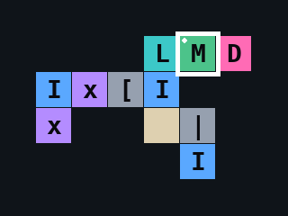

At steps 5–6 the burn outruns the shedding. A 12-cell body at step 6 burns about 2 of its store a tick but can drop only one cell a tick, so once the store falls below its cell count it runs dry before shedding reaches its insulation. Bodies that keep their insulation die "starved", not frozen.
- **A second wave in s4.** Starved deaths per 60 ticks went 142 (1.978M) → 212 → 303 → 1,184 (1.984M), 1.2% of all deaths, up from 0.1%. It's the world, not the speed round: the old code replays the same counts.
- **Who.** 98% die at steps 5–6, and 85% have insulation exactly matched to their step. Three in four are husks with no `C`: shed lookers (`LMD`, `LM`, `L`, about 2,000) and sprinter husks (`mMD`, about 420). Median 12 cells, age 29.
- **It's a change of label, not of hunger** (checked 2026-11-22, at 2.017M). Starved deaths at step 6 rose from 79 to 6,488 per 60 ticks between 1.978M and 2.017M, while frozen deaths there fell from 4,568 to 1,394. Deaths per step-6 body held at about 2.7 per 60 ticks throughout, and so did plants, meals per body and a child's store at birth.
  - **The step-6 lookers changed their layout.** The old plans (`CLMD+BIIMxxxx` and kin) hung an `I` at the end of a dangling stalk, and shedding only takes a cell that doesn't split the body, so that `I` went about third. Insulation crashed and the body froze at insulation 2 or 0.
  - The new plans (`CLMD+BIIMS[^sxxxx`, `CLMD+7BCIIMWxxxx` and kin) keep the `I` inside (`xMxI`) and carry plain cells on dangling tails. A hungry body sheds the tails first and runs dry with insulation 6 intact: 99% never shed a protection cell. At the same count of plain cells, old plans starved 1–4% of the time and new ones 73–87%, so it's the layout, not the cell count.
  - Three in four are husks because the `C` is a code cell and goes in the first sheds. 62% are children born in the window, nearly all to `CLMD`.
- **Step 6 is filling up.** It more than doubled since 2.0M (1,237 → 2,941 bodies, 118 → 258 tiles) while s4 holds at about 185k, which is why starved deaths keep rising (5.8% of deaths at 2.017M). Step 5's own spike at 1.984M went back down. Why step 6 is growing now is still open.

[A step-6 looker that sheds to `LMD` and starves 21 ticks later (2.0M)](http://lilg:8765/?climb=1&w=climber,diver,hunter&seed=4&bake=runs/bake/climb7-s4&t=2000000&pick=1218716775)

### Height sets the pace of life

- **Survival trades against births** across plans in every run (r −0.68 to −0.96, survival + births near 1.2–1.3). The axis is height. Step predicts survival at r −0.94 (s1) and −0.92 (s2). Fast forms only look short-lived because they live high, and within a step pace stops predicting survival.
- **Dividing starves the parent up high.** A parent keeps all its cells but only half its store, and the store burns 2^|step| per cell. Blocking DIVIDE for a random half raised survival from 0.45 to 0.59 in s1 (0.15 to 0.42 for fast forms at step 4) and from 0.24 to 0.38 in s2. It made no difference on steps 0–2.
- **Most children die young.** 65–88% of the children counted as births are dead by the end of the 200-tick window, so births overstate success. Median age halves with every step (s2: 359, 208, 98, 56 and 30 ticks at steps 2–6).
- **Why s2 dies four times faster.** It lives highest: 54% of it is at steps 5–6. Weight each body by 2^step and deaths per unit weight are the same in all four runs (0.10–0.12). Lookers aren't living above their insulation; 124k of 131k `CLDM` match it exactly, and children almost never land on a new step.
- **s4's famine** (1.835–1.891M) was a surge of lookers onto step 6: bodies there went 1,104 → 2,426 → 1,369, occupied tiles 91 → 215, and about 87% of the extra starvation was there, in shed lookers (`LMD`, `LM`, `L`).
- **s4's old-age bump at the same time** was a faster form taking over step 3, not famine stress. Age advances at a body's pace, so a fast body reaches old age in fewer ticks. Between 1.83M and 1.89M the slow single-`M` sprinter (`CmMD+BCIMxxxx`, pace 5.5–7) fell from about 2,260 to 180 at step 3, and the double-`M` form (`CmMD+BCIMMxxxxxx`, pace 10–12) rose from 2,120 to 4,140. Both have insulation 4, so at step 3 they rarely freeze and old age gets them. Old-age deaths at step 3 per 40 ticks went 477 → 754 and back to 483 by 1.984M as the slow form returned (about 1,550 at 1.94M).

| slow `CmMD+BCIMxxxx`, pace 6.2 | fast `CmMD+BCIMMxxxxxx`, pace 10.7 |
|---|---|
| 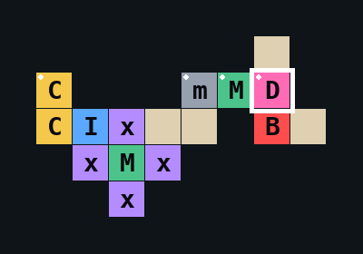 | 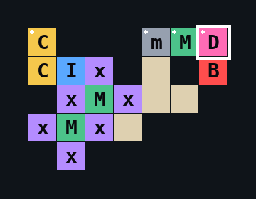 |

[The fast form in the viewer (1.9M)](http://lilg:8765/?climb=1&w=climber,diver,hunter&seed=4&bake=runs/bake/climb7-s4&t=1900000&pick=1162626754) · [the slow form](http://lilg:8765/?climb=1&w=climber,diver,hunter&seed=4&bake=runs/bake/climb7-s4&t=1900000&pick=1096233593)

### How runs break out, and why some stall

- **Each boom is one founding into one new meadow.** s1–s4 all broke upward with insulation 2. s1's two jumps (3.2M, 4.3M) were two separate foundings.
- **s7 went down instead**, with armored `C6SDTM+Kx` divers. Divers divide only south or east, so one near the bottom of step −1 drops its children straight into step −2: 1,453 of 1,529 entries into −2 were births there. Going up means walking about 100 rows through a step's edge, which has about a quarter of the plants of its middle.
- **s7 stalled** filling one meadow column (about a quarter of its tiles), fenced by a barren strip, and its children never go west.
- **s13 isn't missing a glyph.** It has had insulation-2 bodies and `x` throughout, but none reached step ±2 in 30k ticks. s3 looked the same at 3.0M and broke out 1.6M ticks later, so it's probably luck and a small pool of founders.

### The farthest travellers go east because the stack is empty

About 90% of the scans' farthest travellers go straight east. The table ranks by net distance, so it only catches bodies whose heading never changes, and that is usually east. Popping an empty stack gives 0, which is east. Rows that lost the instruction setting their heading (`CDM`, `CM`, `M`, `CD_M`…) go straight east forever, and the few west and south travellers are the same with another constant left on the stack (`CD2M`, `CMD5`). The main sprinter rows head every way about equally. Right after a meal a store at its cap reads as east, then north, west and south as it burns, but that's only about 1% of moves. The fastest sustained mover found so far is one of these: s4's `CMD+BCIIMMnxxxx`, a sprinter that lost its `m`, at 0.82 cells a tick net over 100+ ticks (35 bodies, 2.0M).

## Method and caveats

- **Body plan.** A body's plan is its non-fat cells, in the body's own frame (the origin moves with the body). Bodies with the same plan are counted as one form.
- **Census classes.** For the per-run charts, every body was classed by its code row (the frame's row 0, which the replays show is the row the IP runs) and its contents:
  - *giant*: 100+ cells;
  - *husk*: no `C`;
  - *looker*: an `L` in the row;
  - *scanner-grazer*: an `S` in the row;
  - *sprinter*: a `D` and an `M` without either;
  - *other*: anything else.
- **Behaviour.** The behaviour numbers cover the most common 80 plans in each run's newest checkpoint, plus the 12 biggest bodies' plans.
  - That covers a quarter of s1, s3 and s4, but only 4% of s2, whose plans vary too much (see the masts). The s2 looker numbers come from its most common masts.
  - The replays are 200–300 ticks: enough for a sprinter's life, a fraction of a grazer's.
- **Pictures.** Positions in the pictures are the body's own frame; up is up. The viewer links pick a body at a checkpoint that's kept for good (multiples of 100,000 ticks).
