# A field survey of the Climb

What lives in the four forever runs (seeds 1–4, rules 6), surveyed on 2026-11-10/11:

- **Census:** every living body, in 72 checkpoints from tick 0 to now.
- **Body plans:** a closer look at the most common plans at 33 of those checkpoints.
- **Behaviour:** the newest checkpoint of each run replayed for 200–300 ticks, following every body of the common plans (about 114,000 bodies) to see what it runs, how far it moves, whether it breeds, bites or is bitten, and how it dies.

Scripts and raw data are in the session scratchpad; the method is at the end.

## Reading a creature

Each picture is one body, a cell to a square, coloured by what the cell does, with its glyph on it. Beige squares are fat (`.`). A white dot marks a cell the body's instruction pointer (IP) actually ran during the replay.

The dots show the most useful fact in the survey: **in every common form, the IP runs only the top row.** That row is the program, a loop of four to seven glyphs. Everything below it is never executed. It is anatomy: cells that count only for what they add to the body's traits.
- `I` and `K` are insulation and armor.
- `M` off the code path still adds to speed.
- `B` gives a taste for meat and `C` for plants.
- `x` doubles its neighbours, and `n` makes them weightless.

The only exceptions are a handful of giants whose IP wanders off into their fat.

So a Climb creature is a short program on top of a body plan, and evolution works on both: the program decides what it does, the anatomy decides where it can live and how fast it goes.

## The big picture

Every run went the same way. For a long time a few thousand scanner-grazers held the middle steps. Then a new program appeared, opened the high steps, and the population jumped 10–30× in a few hundred thousand ticks. Each boom is a new form taking over: a speciation event, not just more of the same.

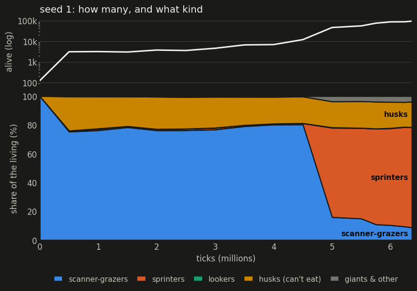

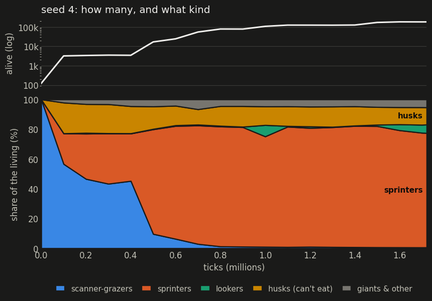

| run | quiet era | the boom | what took over | now |
|---|---|---|---|---|
| s1 | 0–4.5M, 3–12k bodies | 4.5M–5M | sprinters `CDmM` | 95k, 70% sprinters |
| s2 | 0–700k, ~2.5k | 700k–900k | lookers `CLDM`, masted | 221k, 68% lookers |
| s3 | 0–5M, ~3k | 5.5M–6M | sprinters `CMxDm`, then `CMDm` | 111k, 74% sprinters |
| s4 | 0–400k, ~3.5k | 400k–700k | sprinters `CmMmMD`, then `CxmMD`, `CmMD`; [lookers](#lookers-in-s4) `CLMD` since 1.5M | 185k at 1.835M: 73% sprinters, 10% lookers |

Through each quiet era two lineages shared the world: Climbers above sea level, Divers below. In s3 they were level for 4 million ticks (1,823 each at 4M). The boom forms swamped that balance, and each run is now practically one lineage: Climbers in s1, s2 and s3 (99.4–99.9%), and Divers in s4 (99.8%). A relict of the other lineage holds on in each, steadiest in s1, where about 500 Divers have lived below sea level all run long. The Hunters are extinct everywhere.

## The species

The names below are mine.

### Scanner-grazers: the founders' plan

| a climber (s3, 1M) | a diver (s3, 2M) |
|---|---|
| 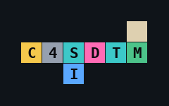 |  |

**Program `C 6 S D T M`** (or `C 4 S …`): collect; push 6; SCAN for the nearest thing of that kind (food), pushing where it is and whether it found one; divide; turn toward it; move. It's a seeker: it heads for food it can see.

**Anatomy:** one cell under the row.
- An `I` makes it a climber, living at step +1.
- A `K` makes it a diver, living at step −1.

This is the founders' plan with small edits. It held 60–80% of every run for its first 400k (s4) to 5M (s3) ticks.

**Life history:** a slow, long-lived plant eater.
- Pace about 1, which is one action a tick.
- Median age 800–1,200 ticks, and some live past 4,000.
- One cell of protection allows only one step out, so the grazers never left the middle steps.

[the climber in the viewer](http://lilg:8765/?climb=1&w=climber,diver,hunter&seed=3&bake=runs/bake/climb7-s3&t=1000000&pick=4756384) · [the diver](http://lilg:8765/?climb=1&w=climber,diver,hunter&seed=3&bake=runs/bake/climb7-s3&t=2000000&pick=9844246)

### Ladder grazers

**Program:** the same scanner, `C4SDTM`.

**Anatomy:** a row of chemistry, `x M x I`. Each `x` doubles the cells beside it, so the one `I` counts twice and the off-path `M` adds speed.

**Life history:**
- Insulation 2 takes it to step +2, and it's 2.7× the founders' pace.
- It moves ~130 cells in 300 ticks, against ~50 for the plain grazers.

It's the founders' plan tuned for one step higher. 2,258 of them live at step +2 in s1 now: a niche the sprinters overflew.

### Sprinters: the boom species, three times over

| s1 `CDmM` | s3 `CMDm` | s4 `CmMD` |
|---|---|---|
|  |  |  |

**Program `C D m M`**, in some order: collect; divide; push my max size; move. There's no SCAN and no TOWARD: the sprinter is blind. The direction it moves and divides comes from its max size (mod 4), so how full it is steers it, and every meal turns it.

**Anatomy:** the staircase. Diagonal steps of `x M x`, with an `I` near the top, sometimes a `B`, often an `n`.
- Each `M` sits between two `x`s, so the off-path `M`s count several times over. Move trait 26–34, pace 11–14: **ten times the founders' speed.**
- The same doubling lifts one or two `I`s to insulation 4, which is step 4.
- A `B` adds meat, so they eat both.

**Life history: live fast, breed, freeze.** In 300 ticks the average sprinter:
- moves 400–500 cells;
- divides 1.1–1.4 times;
- has a 78–90% chance of dying.

Median age is about 100–300 ticks, and three in four of the deaths are from cold, at the top of the range they can reach.

**Convergence.** The same form evolved separately in three runs, in the Climbers of s1 and s3 and in the Divers of s4: the scanner dropped from the program, the staircase grew below it. **s4's Divers came up out of the deep and are now sky creatures:** 14,550 sprinters of a single plan live at step 4, and nearly 90% of the run lives above sea level.

The cross shape that held s3 at 5.9M was the step before the staircase. It had the same program, with a single `x M x` step and `I` on top, insulation 2:

[a cross in the viewer (s3, 5.9M)](http://lilg:8765/?climb=1&w=climber,diver,hunter&seed=3&bake=runs/bake/climb7-s3&t=5900000&pick=51106260)

### Deep sprinters

| s3 (Climbers) | s4 (Divers) |
|---|---|
|  | 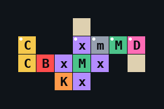 |

**Program and anatomy:** the sprinter program with `K` where the sky form has `I`, between `x`s: armor 4, at step −2.

**Origin:** in s3 it's Climbers that went down. 15,400 of s3's bodies live at step −2 now, in a colony separate from the sky.

**Life history:** slower and longer-lived than the sky sprinters.
- Pace 7–8.
- Median age 160–220 ticks.
- 40–56% die in 300 ticks, mostly crushed by the pressure.

### Lookers and their masts (s2)

| `CLDM` looker | `CTDM` | `C5:mMMD` crawler |
|---|---|---|
| 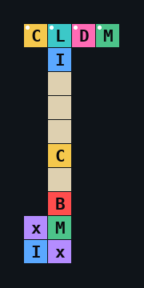 |  |  |

**Program `C L D M`:** collect; LOOK, which pushes the distance and the type of the first thing it sees; DIVIDE, which takes the type as its direction; MOVE, which takes the distance as its direction. What it sees steers it and places its child. 128,000 of s2's 221,000 bodies run exactly this.

**Anatomy:** a mast. The code row sits on top of a column 9–12 cells long, mostly fat, with the working cells hung along it: `I` near the top, then `C` and `B`, with `x M` / `I x` at the foot. 77% of s2's bodies have a mast. s2's "sprinters" (`CTDM`, `C5:mMMD`) wear masts too.

Because fat gaps of any length work, the masts vary endlessly. s2 has 92,000 distinct body plans among its 247,000 bodies, against 26,000–56,000 in the other runs.

**Life history:**
- Insulation 4–5 takes the lookers to steps 5 and 6, the highest anyone lives. 110,000 of s2's bodies are at steps 5–6.
- They are slow, pace about 2, and barely move: about 25 cells in 300 ticks.
- They breed fast (1.2 children a body in 200 ticks) and freeze young (median age 60–200).
- The crawler at step 2 lives ten times longer: median 780 ticks.

Below, the densest patch of s2: masts hanging side by side, and a row of `CLDM` heads packed in a line along the bottom.

#### Hungry lookers shed their row (s2)

*Found 2026-11-16.*

| `CLD` | `LD` | `L` |
|---|---|---|
|  |  | 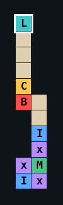 |

When hunger brings a body's max size below its cell count, it sheds a cell each tick. Fat goes first, then code, farthest from the IP first, and armor and insulation (with the `x`s beside them) last. The body has to stay in one piece.

A looker's fat is all inside its mast, where dropping a cell would cut the body in two, and its foot is `I` and `x`, which are kept till last. So the first cells a hungry looker can drop are the ends of its row:
- `CLDM` → `CLD`: the `M` goes first. Without it the looker can't move, but it can still look, eat and divide.
- `CLD` → `LD` or `CL`: then the `C` or the `D`. An `LD` can't eat: a `C` lower down the mast is off its IP's path.
- → `L`: a bare LOOK on a mast, which only looks.

**How common:** about 10,400 bodies, 4.6% of s2, at both 1.9M and 1.915M: `CLD` 4,100, `LD` 2,800, `L` 2,100, `CL` 1,500. In a 30-tick replay from 1.915M, 42,000 of the 131,000 `CLDM` shed their `M`, and not one body grew it back. They're young (median age 25–75), so most of the shed lookers die soon.

The ages and parents fit. A `CLD`'s children are often `CLDM`: the parent divided while it still had its `M` and shed it afterwards.

[A shed `CLD` in the viewer (1.9M)](http://lilg:8765/?climb=1&w=climber,diver,hunter&seed=2&bake=runs/bake/climb7-s2&t=1900000&pick=1735402645)

#### T-crawlers (s2)

*Found 2026-11-16.*

**Program `C : : T M M D`:** the crawler's row with a `T` where the crawler has its `m`. Where the crawler steers by how full it is, the T-crawler walks at random: `T` pushes a random direction and both `M`s take it. The mast hangs from the `T`, not from the `C`, which is why the README calls them T shapes. The second glyph varies (`Cm:TMMD`, `C::TMMD`, `Co:TMMD`), much as it does in the crawlers.

**Where they live:** one step above the crawlers. 98% of the T-crawlers are on step 3, against 95% of the crawlers on step 2. With insulation 3 and a heavier mast, they're slower (pace 1.8 against the crawler's 3.4), and die younger (median age 180 against 390).

**How common:** 11,800 bodies (5% of s2) at 1.9M and again at 1.91M, against 16,200 crawlers. They've been around since at least 1.0M, but in small numbers then.

**Crowding:** T-crawlers do worse beside their own row (z −3.2 in both s2 scans), and `CTDM` sprinters do worse beside them (−0.25 at z −2.4, then −0.50 at z −3.8). One to watch.

T-crawlers at step 3, where they're densest, with lookers' masts among them.

[A T-crawler in the viewer (1.9M)](http://lilg:8765/?climb=1&w=climber,diver,hunter&seed=2&bake=runs/bake/climb7-s2&t=1900000&pick=1752281385)

### Lookers in s4

*Found 2026-11-15.*

| s4 `CLMD` looker | s4 `CmMD` sprinter, its ancestor |
|---|---|
| 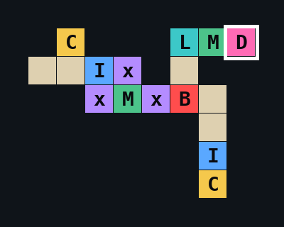 |  |

**Origin:** s4's Divers evolved looking too. s2's Climbers did it at about 700k, and s4's Divers at about 1.5M. The `CLMD` body is the s4 sprinter's staircase, with one glyph changed: the `m` (push my max size) became `L` (look). Its program is `C L M D`: collect; look; move toward the type of what it saw; divide at its distance. It's s2's `CLDM` with the last two swapped, and it grew no mast.

**The rise** (bodies with `L` in the code row):

| tick | 1.1M | 1.3M | 1.5M | 1.6M | 1.7M | 1.8M | 1.835M |
|---|---|---|---|---|---|---|---|
| lookers | 556 | 332 | 1,625 | 7,308 | 9,782 | 16,249 | 17,761 |
| at step 5 | 0 | 0 | 1,428 | 7,005 | 9,456 | 15,496 | 16,206 |
| at step 6 | 0 | 0 | 0 | 0 | 0 | 491 | 1,321 |

At 1.835M, 15,195 bodies run exactly `CLMD`.

**Where they live:**
- Sprinters took step 5 between 1.3M and 1.5M. Lookers arrived there soon after, and now they lead the way onto step 6: 1,321 lookers live at step 6 against 112 sprinters.
- Sprinters at step 5 are falling as the lookers rise, from 38,561 at 1.6M to 30,612 at 1.835M.

**How they differ from the sprinter:**
- They're slow: pace 3.1, against 8 for the step 5 sprinters.
- They're a little heavier (mass 23 vs 17).
- Their insulation is 5 at step 5, and the ones at step 6 have 6.
- Most eat both plants and meat. Several common plans have lost their spare `C` and eat only meat.

The scan also caught `CLMB` mutants (the `D` turned to `B`) biting their `CLMD` kin. One scan (1.85M) found that sprinters touching lookers do worse: 0.44 less survival plus children, at z −3.0, which is just at the bar. Lookers touching sprinters were unaffected. If this holds up in later scans, the lookers are crowding the sprinters out, not just outclimbing them.

*Lookers packed at step 5, s4 at 1.8M. Each body is its own colour. Many carry a second working row, `x M x B D T`.* [A looker in the viewer](http://lilg:8765/?climb=1&w=climber,diver,hunter&seed=4&bake=runs/bake/climb7-s4&t=1800000&pick=943101389)

### Giants

Every giant's IP runs a `G` (grow): in its code row, or below it, reached by a turn (`v`, `|`) that sends the IP down a column. That's how the giants' IPs leave the top row. Each pass of the loop adds a fat cell at the end of a line, in the direction on its stack, so a giant is a growth mutant. In s2, many giants have two `G`s and grow two threads at once (see [combs](#combs-s2) below). Giants are nearly all fat: 97–99% of their cells.

The direction decides the shape:
- **Poles** grow straight down or up. s3's record at 6.5M was 1,299 cells in a column 1,288 tall and 5 wide.
- **Threads** grow sideways. s4's biggest now is 1,184 cells in a 1,170 × 5 box.

| s4's thread, the code end | s3's pole, the code end |
|---|---|
|  |  |

**Life history:**
- Giants are sterile in practice. A DIVIDE needs a max size three times the cell count, and they never get there.
- Mass makes them glacial: s2's 1,447-cell giant acted about once every 50 ticks.
- They end the way that one did, cut by a single bite at a narrow point (see the [journal](journal.md)).
- They're rare, about 1% of a run at any time, but they set every size record.

[s3's pole in the viewer (6.5M)](http://lilg:8765/?climb=1&w=climber,diver,hunter&seed=3&bake=runs/bake/climb7-s3&t=6500000&pick=61967760)

#### Combs (s2)

*Found 2026-11-14.*

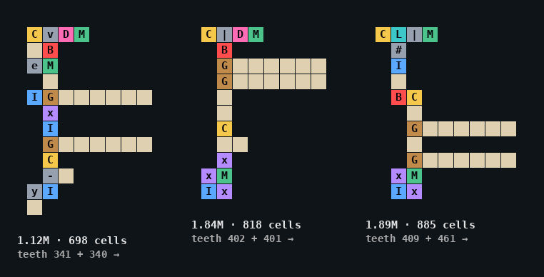

The code end of three s2 combs. Each "tooth" is a thread of fat, a few hundred cells long, cut short here (→).

**Anatomy:** a comb is a mast, as the lookers have, with two `G`s hung on it. Each `G` grows a thread sideways, so the body grows two threads side by side, like a comb with two teeth. The teeth sit next to each other, or up to 8 rows apart.

**How the IP reaches both `G`s:** the code row has a turn in it: `v` (go south), `^` (go north) or `|` (pop: 0 → south, else north). An IP runs only its own cells: it skips gaps and wraps to the far end of the body. So once it turns, it runs the whole mast, top to bottom or bottom to top, and passes both `G`s on every loop. Each loop adds one cell to each tooth, so the teeth stay about the same length (214 + 201, 341 + 340, 402 + 401).

The heads differ: sprinter heads (`CvDM`, `C|DM`, `C^DM`) and a looker head (`CL|M`). Since combs come with different heads, the form has probably evolved more than once.

**The biggest body today** (1.89M) is a comb: 885 cells, teeth 409 and 461 long and still growing.

**How common:** the comb is s2's main giant form. A two-`G` comb was s2's biggest body at 40% of the checkpoints from 945k on, and at least 14 different combs held the title since the first, at 870k. Two-tooth combs are rare elsewhere: 1% of the time in s3, and never in s1 or s4. Giants with one `G` grow a single thread or pole.

[A comb in the viewer (1.8M)](http://lilg:8765/?climb=1&w=climber,diver,hunter&seed=2&bake=runs/bake/climb7-s2&t=1800000&pick=1382784584)

### Husks

| s1 | s3 | s4 |
|---|---|---|
|  | 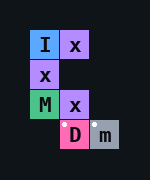 | 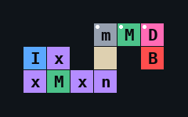 |

**What they are:** bodies with no `C`, which can't eat. They're what's left of a sprinter after the cold has taken its cells one at a time. Frozen cells go first, and a starving body sheds fat, then plain cells, then its protection last. So what remains is the insulated corner: the `I`, the `x`s around it, an `M` or two, and maybe the `D`.

**Life history:**
- Not one of them divided in the replays.
- All of them died within it, of cold.

**How common:** at any moment they're 12–18% of a sprinter run. In the grazer era 20–25% of every run were husks, mostly single cells (`S`, `D`, `$`). Those lasted far longer, median age 500–1,500 ticks, because one cell costs almost nothing to keep.

### Extinct: the Hunters

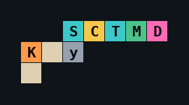

**At the start:** the third founder, a slow fat biter. Every run began with 41 of them.

**At the end:** by s4's 100k they had become plant eaters. The program was `S C T M D`, with no `B` left, and a `K` in the body, at step −1. They were gone from s2 by 100k and from s1 and s3 by 300k. s4's held out longest, peaking at 1,002 at 500k, and were gone by 1M.

[a late Hunter (s4, 100k)](http://lilg:8765/?climb=1&w=climber,diver,hunter&seed=4&bake=runs/bake/climb7-s4&t=100000&pick=233891)

## New finds

New forms and behaviours, as they turn up. Each gets a write-up in its section above.

| found | run | what | where |
|---|---|---|---|
| 2026-11-14 | s2 | Combs: giants with two `G`s on a mast, growing two threads at once | [Combs](#combs-s2) |
| 2026-11-14 | all | Vandals: `W` mutants that write fat or `@` into their kin | [Ecology scan](#what-the-ecology-scan-found) |
| 2026-11-14 | s2 | Steerers: `CTDW` mutants that write turn arrows into their own children | [Ecology scan](#what-the-ecology-scan-found) |
| 2026-11-14 | s4 | A sprinter hunting the other lineage's grazers | [Ecology scan](#what-the-ecology-scan-found) |
| 2026-11-14 | s2, s4 | Growers smother their neighbours | [Ecology scan](#what-the-ecology-scan-found) |
| 2026-11-14 | s2, s3, s4 | Husks do better beside the living (unexplained) | [Ecology scan](#what-the-ecology-scan-found) |
| 2026-11-15 | s4 | Lookers: s4's Divers evolved `CLMD`, which now leads the climb onto step 6 | [Lookers in s4](#lookers-in-s4) |
| 2026-11-15 | s3 | A second hunter, made by the same `D` → `]` mutation as s4's: it hunts the relict Divers | [Ecology scan](#what-the-ecology-scan-found) |
| 2026-11-16 | s2 | T-crawlers: the crawler with `T` for `m`, walking at random, one step higher (5% of s2) | [T-crawlers](#t-crawlers-s2) |
| 2026-11-16 | s2 | Hungry lookers shed their row from the ends (`CLDM` → `CLD` → `LD` → `L`): 4.6% of s2 | [Hungry lookers](#hungry-lookers-shed-their-row-s2) |

## How they interact

**Hardly anybody eats anybody.**
- **Death causes over each run's whole history:**

  | run | cold | pressure | old age | bitten to death |
  |---|---|---|---|---|
  | s1 | 92% | 1% | 6% | 0.01% |
  | s2 | 99.5% | 0.1% | 0.1% | 0.02% |
  | s3 | 82% | 9% | 8% | 0.01% |
  | s4 | 90% | 6% | 4% | 0.004% |

- **Why:** an automatic bite (`B` with nothing on the stack) never targets your own lineage, and each run is practically one lineage now (see [the big picture](#the-big-picture)), with a small relict of the other. In s4 the relict includes `C4SDTM` Climber grazers among the Divers. Meat-eating has become a trait for scavenging the dead, not for hunting.
- The [ecology scan](#what-the-ecology-scan-found) below finds the exceptions: rare mutants that bite or write into their own kin, and once a sprinter that hunted s4's other lineage.

**They crowd, and they pack.** 37–39% of bodies touch another body (56% in s2's mast forests), and almost always it's kin. Bodies can't overlap, so crowded ones settle into each other's gaps. Same-shaped bodies interlock: crosses nest in each other's notches, masts hang side by side, and `CLDM` heads line up in rows.

The rules give no reward for touching: there's no shared warmth and no shared food. So it's packing, not symbiosis. The one real effect of a neighbour is negative. A tile that's too crowded blocks DIVIDE, and the neighbour eats the same plants.

**The real enemy is the climate.** The sprinter strategy is a race:
- A sprinter breeds as fast as it can at the edge of the cold its anatomy can stand.
- Its children are copied with errors, and some come out with less insulation.
- The cold then takes them, and a population lives in balance with its frostbite.

In s1's replay, 22,600 of 30,400 tracked bodies died in 300 ticks and 17,300 were born.

**Scenes.** The densest patch of each run:
- s1's densest patch isn't sprinters at all. It's a colony of armored `C6SDTM / M K` grazers, tightly packed.
- s3's densest patch is the deep sprinter colony.
- s4's has a giant thread running through it, with sprinters packed in rows above.

| s1 | s3 | s4 |
|---|---|---|
|  |  |  |

Wider views: [s1](img/survey/scene-s1.png) · [s2](img/survey/scene-s2.png) · [s3](img/survey/scene-s3.png) · [s4](img/survey/scene-s4.png). Each body is its own colour and fat is darker; walls are grey, food is green dots and dead cells are brown.

### What the ecology scan found

*Found 2026-11-14,* with `dist/ecology.mjs` (see the README). It replays a run's newest checkpoint for 200 ticks, watching every bite, every write into another body, whose dead cells get eaten and who blocks whose moves. Then it compares bodies touching each kind of neighbour with bodies of the same kind alone on the same step. An earlier replay (above) followed only the common plans, so it missed what rare mutants do.

**Bites and writes come from rare mutants, and they hit kin.** A `B` with numbers on the stack bites a chosen cell, and that bite can hit kin.

| per 200 ticks | s1 | s2 | s3 | s4 |
|---|---|---|---|---|
| bites | 5 | 1,263 (69 kills) | 29 (3 kills) | 104 (13 kills) |
| writes into another body | 242, into 54 bodies | 7,325, into 1,304 bodies | 802, into 52 bodies | 851, into 124 bodies |
| deaths by running `@` | 138 | 1,318 | 171 | 507 |
| …that another body wrote | 2 | 33 | 2 | 2 |

- **Vandals.** In sprinters and lookers, a copy error can turn a code-row glyph into `W` (write): `CMWm`, `CMDW`, `CWD`. Such a mutant loses its divide or its move, and its loop writes into the nearest body instead, again and again, up to 112 times in 200 ticks. The nearest body is usually its own parent or child. Mostly it writes fat over the victim's code. Some write `@`, which kills whatever runs it.
- **Steerers (s2).** `CTDW` mutants write turn arrows (`>`, `<`, `^`) into their own children, rewriting the direction the child's code runs. It's the closest thing to one body controlling another so far, though nothing shows it helps the writer.
- **Hunters (s4, then s3).** Twice now, the same mutation has made a hunter out of a sprinter. Each time it hunted the relict of the other lineage.
  - **The mutation:** the `D` in the code row became `]` (turn right). Both hunters carry a `B` just below that slot, so the IP turns south straight onto it. An empty-stack bite never targets kin, so the bite lands on the nearest body of the other lineage.
  - **s4 (found 2026-11-14):** a Diver sprinter, `CmM]`, bit the relict Climbers' `C4SDTM` grazers 12 times in 200 ticks and killed 3.
  - **s3 (found 2026-11-15):** a deep Climber sprinter, `CMx]m` with armor 2, bit the relict Divers' `C4SDTMD` grazers 13 times at step −2 and killed 4.
  - **No `D`, no children:** a hunter can't divide, so it's a dead end. The s3 one was 799 ticks old, three times a sprinter's usual age. It's still the only predation between lineages the scans have found.

  

  *The s3 hunter: `C M x ] m`, with `= C B` below. At `]` the IP turns south onto the `B`. Next to it in the run (not shown) was an unmutated `C M x D m` deep sprinter, with a `D` where the hunter has `]`.*
- Most deaths by `@` are the dead body's own copy errors, not poisonings.

**Scavenging.** Of the dead cells eaten, 42–49% came from a body of another plan, 9–17% from the same plan, and the rest were already there when the replay began. Sprinters mostly eat the dead husks their own lineage keeps producing (`D`, `Dm`, `mMD`: no `C`, never move, all dead within 200 ticks).

**Who's good for whom.** Each test compares bodies touching a given kind of neighbour with bodies of their own kind alone on the same step. It measures survival plus children over the 200 ticks.
- **Crowding hurts.** In every run, bodies touching their own kind do worse: −0.06 to −0.26.
- **Growers smother their neighbours** (s2, s4). Mutants with `G` in the code row (`CLGM`, `CLDG`, `CGDM`, `CmGD`) grow fat into the space around them. Lookers and sprinters touching one do 0.3–0.5 worse, with z −13 to −19 in s2. In s2, growers are 2.6% of bodies but cause 7.5% of blocked moves.
- **Husks do better beside the living** (s2, s3, s4). Husks touching a looker or sprinter do 0.1–0.4 better, while the looker or sprinter is unaffected. This would be commensalism, but nothing in the rules explains it yet. It may be a confound, such as husks next to the living being younger.
- **Two grazers compete** (s1). `C6SDTM` grazers touching `C4SDTM` grazers do 0.22 worse; the reverse is neutral.

**Moving together.** Thousands of kin pairs move in step for a while. s3's `C4SDTM` grazers travel in pairs, touching for most of the replay and moving together up to 78 times in 200 ticks. Pairs from different lineages almost never do.

## Method and caveats

- **Body plan.** A body's plan is its non-fat cells, in the body's own frame (the origin moves with the body). Bodies with the same plan are counted as one form.
- **Census classes.** For the per-run charts, every body was classed by its code row (the frame's row 0, which the replays show is the row the IP runs) and its contents:
  - *giant*: 100+ cells;
  - *husk*: no `C`;
  - *looker*: an `L` in the row;
  - *scanner-grazer*: an `S` in the row;
  - *sprinter*: a `D` and an `M` without either;
  - *other*: anything else.
- **Behaviour.** The behaviour numbers cover the most common 80 plans in each run's newest checkpoint, plus the 12 biggest bodies' plans.
  - That covers a quarter of s1, s3 and s4, but only 4% of s2, whose plans vary too much (see the masts). The s2 looker numbers come from its most common masts.
  - The replays are 200–300 ticks: enough for a sprinter's life, a fraction of a grazer's.
- **Pictures.** Positions in the pictures are the body's own frame; up is up. The viewer links pick a body at a checkpoint that's kept for good (multiples of 100,000 ticks).
