# A field survey of the Climb

What lives in the four forever runs (seeds 1–4, rules 6), surveyed on 2026-11-10/11:

- **Census:** every living body, in 72 checkpoints from tick 0 to now.
- **Body plans:** a closer look at the most common plans at 33 of those checkpoints.
- **Behaviour:** the newest checkpoint of each run replayed for 200–300 ticks, following every body of the common plans (about 114,000 bodies) to see what it runs, how far it moves, whether it breeds, bites or is bitten, and how it dies.

Scripts and raw data are in the session scratchpad; the method is at the end.

## Reading a creature

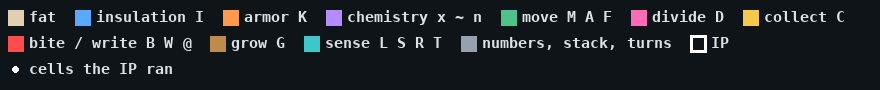

Each picture is one body, a cell to a square, coloured by what the cell does, with its glyph on it. Beige squares are fat (`.`). A white dot marks a cell the body's instruction pointer (IP) actually ran during the replay.

The dots show the most useful fact in the survey: **in every common form, the IP runs only the top row.** That row is the program, a loop of four to seven glyphs. Everything below it is never executed. It is anatomy: cells that count only for what they add to the body's traits.
- `I` and `K` are insulation and armor.
- `M` off the code path still adds to speed.
- `B` gives a taste for meat and `C` for plants.
- `x` doubles its neighbours, and `n` makes them weightless.

The only exceptions are a handful of giants whose IP wanders off into their fat.

So a Climb creature is a short program on top of a body plan, and evolution works on both: the program decides what it does, the anatomy decides where it can live and how fast it goes.

## The big picture

Every run went the same way. For a long time a few thousand scanner-grazers held the middle steps. Then a new program appeared, opened the high steps, and the population jumped 10–30× in a few hundred thousand ticks. Each boom is a new form taking over: a speciation event, not just more of the same.

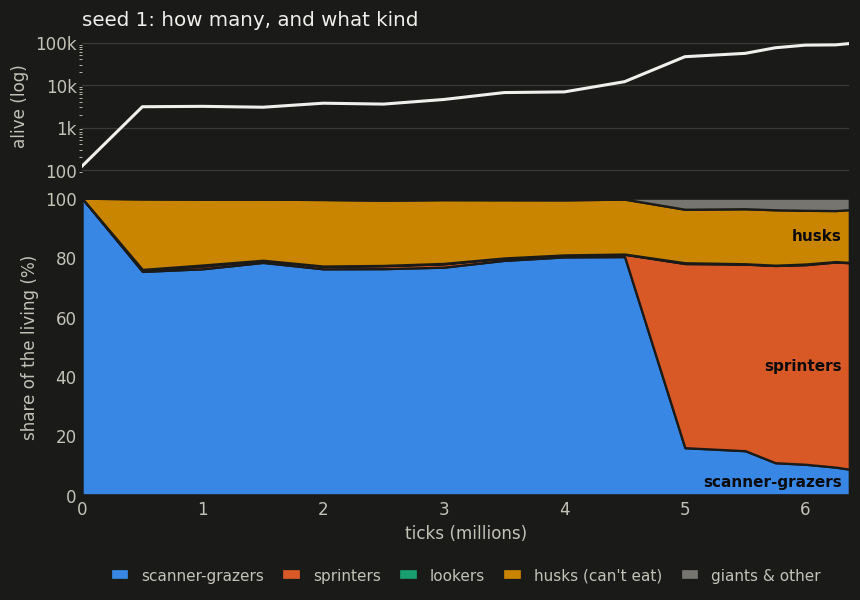
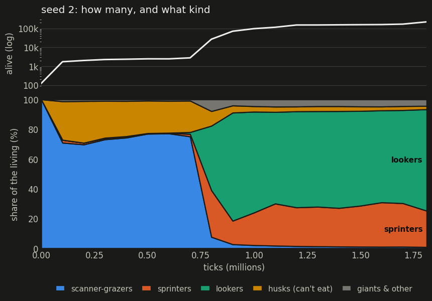

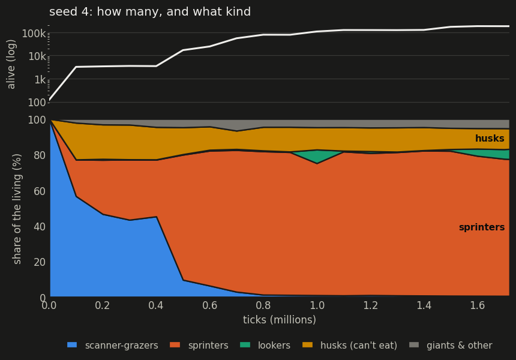

| run | quiet era | the boom | what took over | now |
|---|---|---|---|---|
| s1 | 0–4.5M, 3–12k bodies | 4.5M–5M | sprinters `CDmM` | 95k, 70% sprinters |
| s2 | 0–700k, ~2.5k | 700k–900k | lookers `CLDM`, masted | 221k, 68% lookers |
| s3 | 0–5M, ~3k | 5.5M–6M | sprinters `CMxDm`, then `CMDm` | 111k, 74% sprinters |
| s4 | 0–400k, ~3.5k | 400k–700k | sprinters `CmMmMD`, then `CxmMD`, `CmMD` | 182k, 77% sprinters |

Through each quiet era two lineages shared the world: Climbers above sea level, Divers below. In s3 they were level for 4 million ticks (1,823 each at 4M). The boom forms swamped that balance, and each run is now practically one lineage: Climbers in s1, s2 and s3 (99.4–99.9%), and Divers in s4 (99.8%). A relict of the other lineage holds on in each, steadiest in s1, where about 500 Divers have lived below sea level all run long. The Hunters are extinct everywhere.

## The species

The names below are mine.

### Scanner-grazers: the founders' plan

| a climber (s3, 1M) | a diver (s3, 2M) |
|---|---|
| 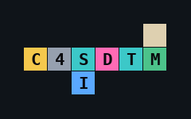 | 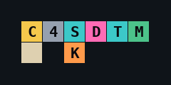 |

**Program `C 6 S D T M`** (or `C 4 S …`): collect; push 6; SCAN for the nearest thing of that kind (food), pushing where it is and whether it found one; divide; turn toward it; move. It's a seeker: it heads for food it can see.

**Anatomy:** one cell under the row.
- An `I` makes it a climber, living at step +1.
- A `K` makes it a diver, living at step −1.

This is the founders' plan with small edits. It held 60–80% of every run for its first 400k (s4) to 5M (s3) ticks.

**Life history:** a slow, long-lived plant eater.
- Pace about 1, which is one action a tick.
- Median age 800–1,200 ticks, and some live past 4,000.
- One cell of protection allows only one step out, so the grazers never left the middle steps.

[the climber in the viewer](http://lilg:8765/?climb=1&w=climber,diver,hunter&seed=3&bake=runs/bake/climb7-s3&t=1000000&pick=4756384) · [the diver](http://lilg:8765/?climb=1&w=climber,diver,hunter&seed=3&bake=runs/bake/climb7-s3&t=2000000&pick=9844246)

### Ladder grazers

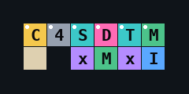

**Program:** the same scanner, `C4SDTM`.

**Anatomy:** a row of chemistry, `x M x I`. Each `x` doubles the cells beside it, so the one `I` counts twice and the off-path `M` adds speed.

**Life history:**
- Insulation 2 takes it to step +2, and it's 2.7× the founders' pace.
- It moves ~130 cells in 300 ticks, against ~50 for the plain grazers.

It's the founders' plan tuned for one step higher. 2,258 of them live at step +2 in s1 now: a niche the sprinters overflew.

### Sprinters: the boom species, three times over

| s1 `CDmM` | s3 `CMDm` | s4 `CmMD` |
|---|---|---|
| 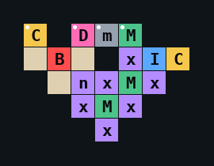 | 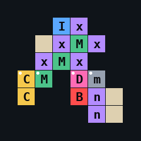 | 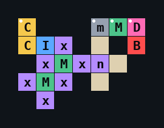 |

**Program `C D m M`**, in some order: collect; divide; push my max size; move. There's no SCAN and no TOWARD: the sprinter is blind. The direction it moves and divides comes from its max size (mod 4), so how full it is steers it, and every meal turns it.

**Anatomy:** the staircase. Diagonal steps of `x M x`, with an `I` near the top, sometimes a `B`, often an `n`.
- Each `M` sits between two `x`s, so the off-path `M`s count several times over. Move trait 26–34, pace 11–14: **ten times the founders' speed.**
- The same doubling lifts one or two `I`s to insulation 4, which is step 4.
- A `B` adds meat, so they eat both.

**Life history: live fast, breed, freeze.** In 300 ticks the average sprinter:
- moves 400–500 cells;
- divides 1.1–1.4 times;
- has a 78–90% chance of dying.

Median age is about 100–300 ticks, and three in four of the deaths are from cold, at the top of the range they can reach.

**Convergence.** The same form evolved separately in three runs, in the Climbers of s1 and s3 and in the Divers of s4: the scanner dropped from the program, the staircase grew below it. **s4's Divers came up out of the deep and are now sky creatures:** 14,550 sprinters of a single plan live at step 4, and nearly 90% of the run lives above sea level.

The cross shape that held s3 at 5.9M was the step before the staircase. It had the same program, with a single `x M x` step and `I` on top, insulation 2:

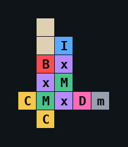

[a cross in the viewer (s3, 5.9M)](http://lilg:8765/?climb=1&w=climber,diver,hunter&seed=3&bake=runs/bake/climb7-s3&t=5900000&pick=51106260)

### Deep sprinters

| s3 (Climbers) | s4 (Divers) |
|---|---|
| 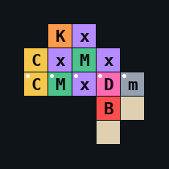 | 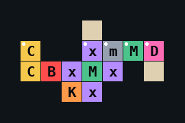 |

**Program and anatomy:** the sprinter program with `K` where the sky form has `I`, between `x`s: armor 4, at step −2.

**Origin:** in s3 it's Climbers that went down. 15,400 of s3's bodies live at step −2 now, in a colony separate from the sky.

**Life history:** slower and longer-lived than the sky sprinters.
- Pace 7–8.
- Median age 160–220 ticks.
- 40–56% die in 300 ticks, mostly crushed by the pressure.

### Lookers and their masts (s2)

| `CLDM` looker | `CTDM` | `C5:mMMD` crawler |
|---|---|---|
| 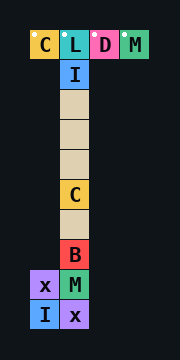 | 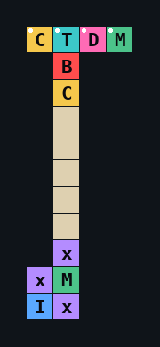 | 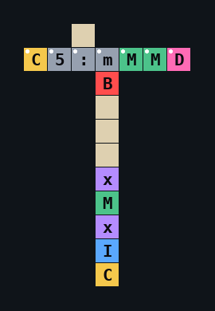 |

**Program `C L D M`:** collect; LOOK, which pushes the distance and the type of the first thing it sees; DIVIDE, which takes the type as its direction; MOVE, which takes the distance as its direction. What it sees steers it and places its child. 128,000 of s2's 221,000 bodies run exactly this.

**Anatomy:** a mast. The code row sits on top of a column 9–12 cells long, mostly fat, with the working cells hung along it: `I` near the top, then `C` and `B`, with `x M` / `I x` at the foot. 77% of s2's bodies have a mast. s2's "sprinters" (`CTDM`, `C5:mMMD`) wear masts too.

Because fat gaps of any length work, the masts vary endlessly. s2 has 92,000 distinct body plans among its 247,000 bodies, against 26,000–56,000 in the other runs.

**Life history:**
- Insulation 4–5 takes the lookers to steps 5 and 6, the highest anyone lives. 110,000 of s2's bodies are at steps 5–6.
- They are slow, pace about 2, and barely move: about 25 cells in 300 ticks.
- They breed fast (1.2 children a body in 200 ticks) and freeze young (median age 60–200).
- The crawler at step 2 lives ten times longer: median 780 ticks.

Below, the densest patch of s2: masts hanging side by side, and a row of `CLDM` heads packed in a line along the bottom.

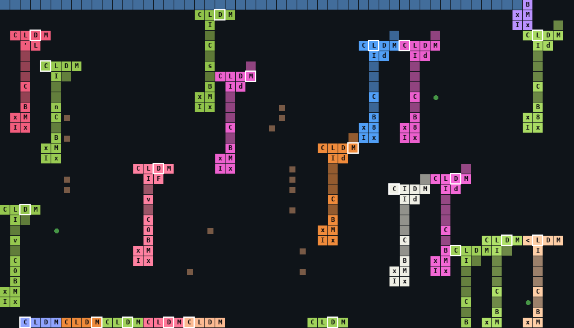

### Giants

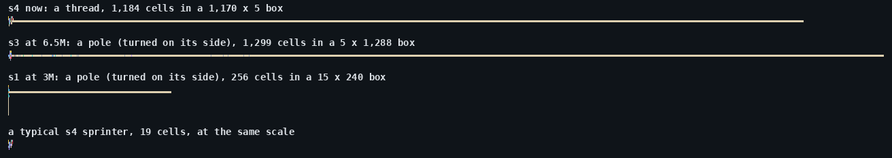

Every giant has a `G` (grow) in its program. Each pass of its loop adds a fat cell at the end of a line, in the direction on its stack, so a giant is a growth mutant. It is nearly all fat: 97–99% of its cells.

The direction decides the shape:
- **Poles** grow straight down or up. s3's record at 6.5M was 1,299 cells in a column 1,288 tall and 5 wide.
- **Threads** grow sideways. s4's biggest now is 1,184 cells in a 1,170 × 5 box.

| s4's thread, the code end | s3's pole, the code end |
|---|---|
| 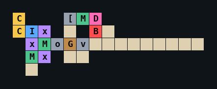 | 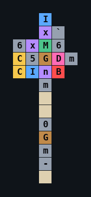 |

**Life history:**
- Giants are sterile in practice. A DIVIDE needs a max size three times the cell count, and they never get there.
- Mass makes them glacial: s2's 1,447-cell giant acted about once every 50 ticks.
- They end the way that one did, cut by a single bite at a narrow point (see the [journal](journal.md)).
- They're rare, about 1% of a run at any time, but they set every size record.

[s3's pole in the viewer (6.5M)](http://lilg:8765/?climb=1&w=climber,diver,hunter&seed=3&bake=runs/bake/climb7-s3&t=6500000&pick=61967760)

### Husks

| s1 | s3 | s4 |
|---|---|---|
| 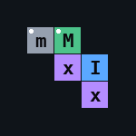 | 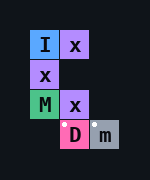 | 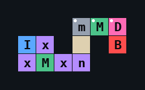 |

**What they are:** bodies with no `C`, which can't eat. They're what's left of a sprinter after the cold has taken its cells one at a time. Frozen cells go first, and a starving body sheds fat, then plain cells, then its protection last. So what remains is the insulated corner: the `I`, the `x`s around it, an `M` or two, and maybe the `D`.

**Life history:**
- Not one of them divided in the replays.
- All of them died within it, of cold.

**How common:** at any moment they're 12–18% of a sprinter run. In the grazer era 20–25% of every run were husks, mostly single cells (`S`, `D`, `$`). Those lasted far longer, median age 500–1,500 ticks, because one cell costs almost nothing to keep.

### Extinct: the Hunters

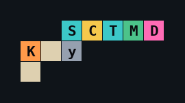

**At the start:** the third founder, a slow fat biter. Every run began with 41 of them.

**At the end:** by s4's 100k they had become plant eaters. The program was `S C T M D`, with no `B` left, and a `K` in the body, at step −1. They were gone from s2 by 100k and from s1 and s3 by 300k. s4's held out longest, peaking at 1,002 at 500k, and were gone by 1M.

[a late Hunter (s4, 100k)](http://lilg:8765/?climb=1&w=climber,diver,hunter&seed=4&bake=runs/bake/climb7-s4&t=100000&pick=233891)

## How they interact

**Nobody eats anybody.**
- **No bites in the replays:** in 200–300 ticks of each run, following about 114,000 bodies, there were no bites delivered, no kills, and no writes into another body.
- **Death causes over each run's whole history:**

  | run | cold | pressure | old age | bitten to death |
  |---|---|---|---|---|
  | s1 | 92% | 1% | 6% | 0.01% |
  | s2 | 99.5% | 0.1% | 0.1% | 0.02% |
  | s3 | 82% | 9% | 8% | 0.01% |
  | s4 | 90% | 6% | 4% | 0.004% |

- **Why:** each run is one lineage now, and an automatic bite never targets your own lineage. Meat-eating has become a trait for scavenging the dead, not for hunting.

**They crowd, and they pack.** 37–39% of bodies touch another body (56% in s2's mast forests), and almost always it's kin. Bodies can't overlap, so crowded ones settle into each other's gaps. Same-shaped bodies interlock: crosses nest in each other's notches, masts hang side by side, and `CLDM` heads line up in rows.

The rules give no reward for touching: there's no shared warmth and no shared food. So it's packing, not symbiosis. The one real effect of a neighbour is negative. A tile that's too crowded blocks DIVIDE, and the neighbour eats the same plants.

**The real enemy is the climate.** The sprinter strategy is a race:
- A sprinter breeds as fast as it can at the edge of the cold its anatomy can stand.
- Its children are copied with errors, and some come out with less insulation.
- The cold then takes them, and a population lives in balance with its frostbite.

In s1's replay, 22,600 of 30,400 tracked bodies died in 300 ticks and 17,300 were born.

**Scenes.** The densest patch of each run:
- s1's densest patch isn't sprinters at all. It's a colony of armored `C6SDTM / M K` grazers, tightly packed.
- s3's densest patch is the deep sprinter colony.
- s4's has a giant thread running through it, with sprinters packed in rows above.

| s1 | s3 | s4 |
|---|---|---|
| 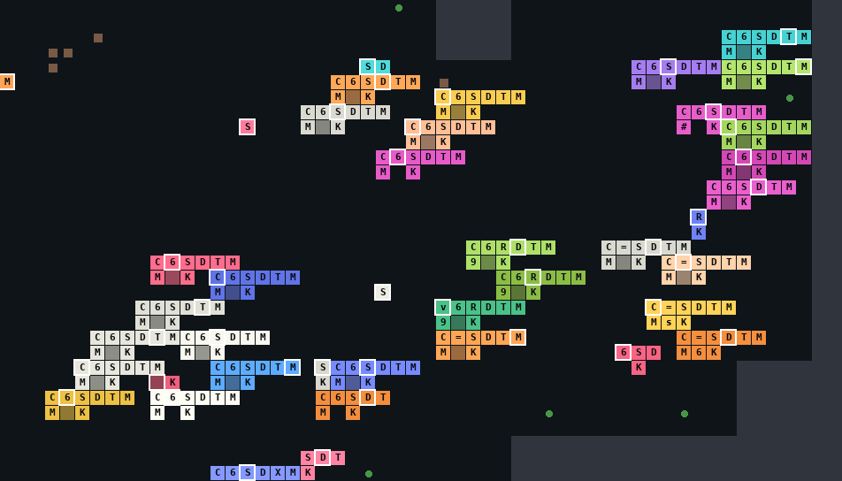 | 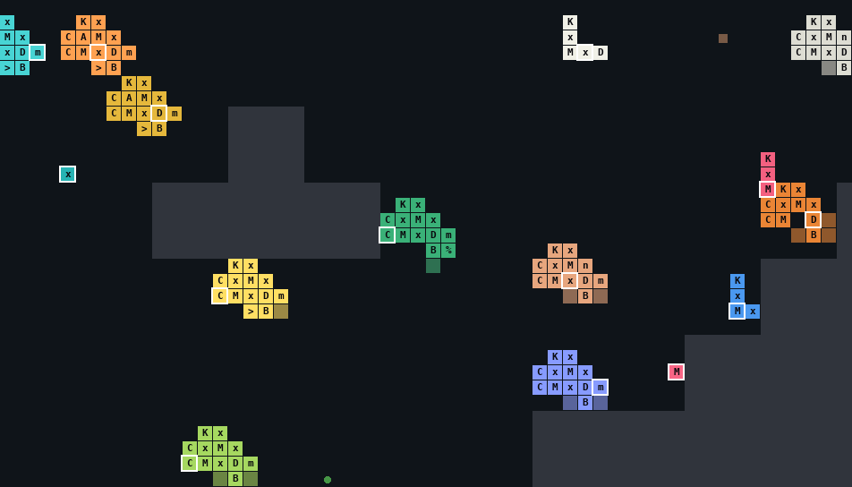 | 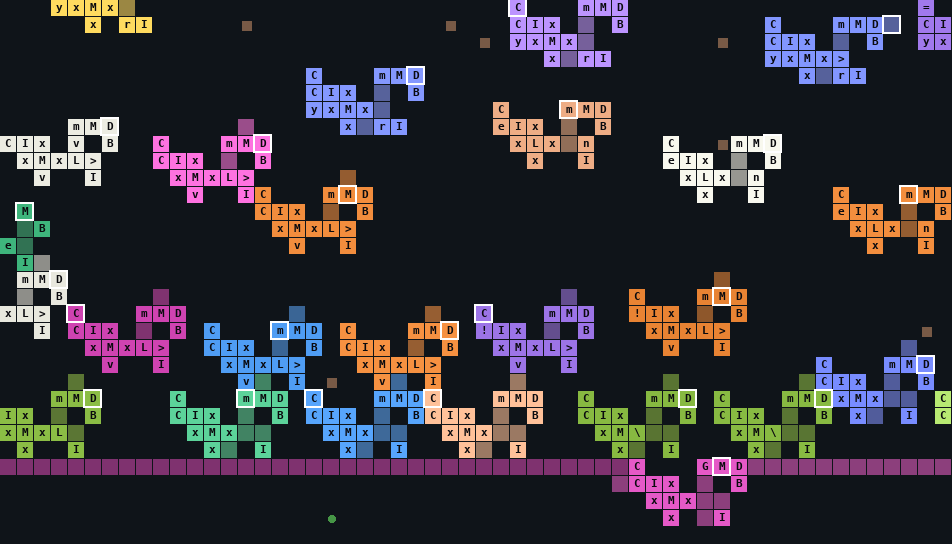 |

Wider views: [s1](img/survey/scene-s1.png) · [s2](img/survey/scene-s2.png) · [s3](img/survey/scene-s3.png) · [s4](img/survey/scene-s4.png). Each body is its own colour and fat is darker; walls are grey, food is green dots and dead cells are brown.

## Method and caveats

- **Body plan.** A body's plan is its non-fat cells, in the body's own frame (the origin moves with the body). Bodies with the same plan are counted as one form.
- **Census classes.** For the per-run charts, every body was classed by its code row (the frame's row 0, which the replays show is the row the IP runs) and its contents:
  - *giant*: 100+ cells;
  - *husk*: no `C`;
  - *looker*: an `L` in the row;
  - *scanner-grazer*: an `S` in the row;
  - *sprinter*: a `D` and an `M` without either;
  - *other*: anything else.
- **Behaviour.** The behaviour numbers cover the most common 80 plans in each run's newest checkpoint, plus the 12 biggest bodies' plans.
  - That covers a quarter of s1, s3 and s4, but only 4% of s2, whose plans vary too much (see the masts). The s2 looker numbers come from its most common masts.
  - The replays are 200–300 ticks: enough for a sprinter's life, a fraction of a grazer's.
- **Pictures.** Positions in the pictures are the body's own frame; up is up. The viewer links pick a body at a checkpoint that's kept for good (multiples of 100,000 ticks).
