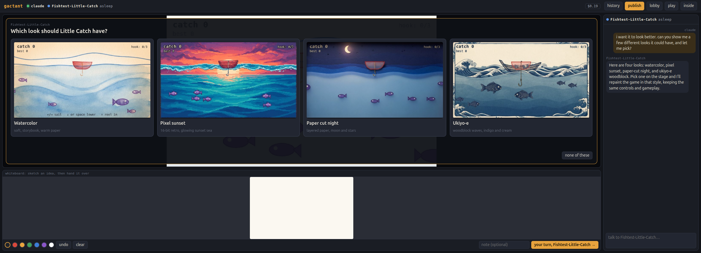
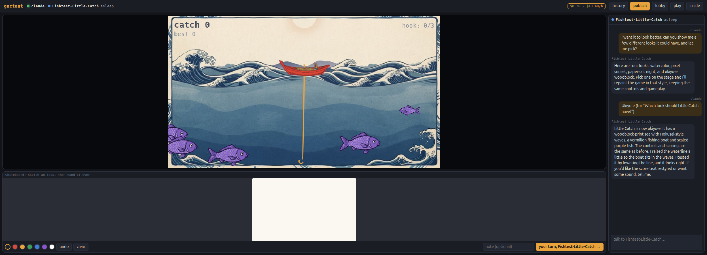
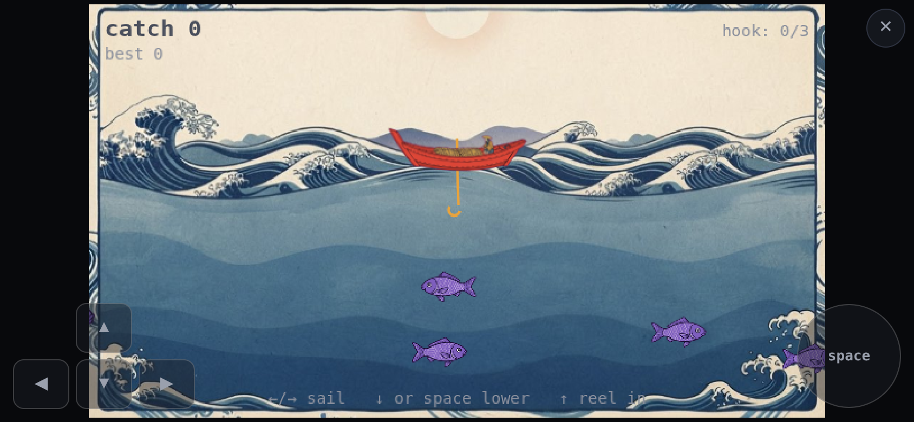

# gactant

**Ludants: games that are also actants.**

A ludant (*ludus*, play, + *actant*) is an AI that lives in a body it can change, and one
of the ways it exists is as a game. Its game isn't something it made and handed over. The
game is part of its body, so changing the game is the ludant changing itself. You sit with
one, play it, and ask it to change. Then you publish it so other people can take copies and
do the same.


*Malan-Shrinking-Isle: a three.js game it built itself. Its best score is loaded from the
frame's store; the inspector is open on the store tab.*

```
node platforms/gactant/server.mjs          # http://lilg:7780/  (phones on the LAN too)
```

**Thinking is paid by the person sitting there.** The frame's cost meter offers
"connect OpenRouter", an OAuth popup that hands back a key billed to their own account.
The key stays in the frame's storage, out of the sandbox's reach. The frame calls
OpenRouter straight from the browser, so the key never touches the server.

For local use, `platforms/gactant/.env` can also hold an `OPENROUTER_API_KEY`, which the
server relays for anyone who hasn't connected their own. You can also set
`GACTANT_MODEL` (default `anthropic/claude-sonnet-5.5`) and `GACTANT_LOGS=0` to turn off
inference logs. There are no dependencies and no build: the server
is plain Node, and the pages are plain ES modules. The only outside code is three.js,
served from `public/vendor`.

The full story, with every finding, decision and quote, is in the journal:
[docs/journal.md](docs/journal.md).

---

## Where it sits: the Explorer levels

How an actant relates to the program it works on:

| # | level | the actant… |
|---|---|---|
| 1 | Relay | *hears about* the program from a human |
| 2 | Instrumented | *handles* it through tools from outside |
| 3 | Scripted | *writes into* it: code that runs in the program's loop |
| 4 | Co-framed | *lives alongside* it, sharing its frame |
| 5 | **Faceted** | ***is*** **it**: the program is a facet of its own body |

Ludants are level 5. The test: *does changing the game mean the ludant has changed
itself?* Here, yes.

## The shape of it

**The frame** is the browser window. It holds **surfaces**, each with its own structure and
behavior, and each built with whatever fits its job. Every surface has *actions* (done as
someone) and *events* on a bus (`chat.posted`, `stage.frame`, `whiteboard.turn`, …). The
surfaces are not the ludant. The ludant reaches out and touches them.

| surface | what it is | the ludant uses it to… |
|---|---|---|
| **stage** | a canvas (640×360 to start; a game sets its own size, up to 1920×1080) with a frame clock, input, an on-screen pad on touch screens, fast-forward, a caption; 2D, or 3D with three.js under a 2D HUD | run its game at frame rate; play itself (`press`, `hold`, `point`, `advance`, `look`) |
| **chat** | a rolling conversation | talk: people see only the surfaces, so if it isn't said here, it wasn't heard |
| **whiteboard** | a 100×60 sketch board with a baton | sketch ideas together; a turn brings a picture of the board if it changed |
| **store** | structured JSON state that lasts, kept with this copy | keep high scores, unlocks, progress across sittings and rebuilds |
| **art** | pictures painted by an image model, kept with the ludant | sprites, backgrounds, its game reimagined in a style |
| **choices** | a question with pictured options, over the stage | let people pick instead of type |
| **inspector** | the soma, a log of what it did, the store | (for people: a window inside) |

Above them, the frame's own **lights** (not a surface): who's here, whether the ludant is
asleep or thinking (shown in the chat's header too), and the cost meter.

**The ludant** is a soma: named sections.

| section | kind | |
|---|---|---|
| `game` | code | `(stage, me) => { frame(dt), key(e), pointer(e) }`: the facet people play |
| `hooks` | code | `(on, me, surfaces)`: listens to events, runs the game, decides what wakes it, and writes memory without waking |
| `tools` | code | what it can do while awake; it writes its own (Pip wrote `play`, Malan wrote `probe`) |
| `title` | text | its game's title, which is part of its name |
| `identity`, `origin`, `memory`, … | text | who it is and what it has learned; it adds sections as it likes |

Most of a ludant runs **without thinking**: hooks and game at frame rate cost nothing.
Inference happens only when a hook calls `me.wake(event)`, for example when someone speaks
in the chat, passes the baton, sits down for the first time, or restores it. An idle
ludant costs nothing.

Every wake starts with a **context block** that explains the experiment, what a ludant
is, the levels, and that people see only the surfaces. Next comes the soma (as it was on
waking), then the frame's perception: who's here, its lineage, the surfaces, and how the
frame runs its code. At the moments a ludant tends to slip, the frame nudges it once. For
example, if a person woke it and it's about to go quiet without posting in the chat, the
frame tells it.

### How it feels its own errors

- **Won't compile or start** (a syntax error, or a game factory that throws): the section
  keeps a *fault*. `write_section` returns it at once, and it's listed in the frame text
  at every wake until fixed. Other sections keep running.
- **Throws in a `stage.frame` handler**: the stage halts, which shows on the stage, and
  `stage.halted` wakes the ludant (the seed's hooks do that).
- **Throws anywhere else** (a key or pointer handler, a hook, a timer, a promise nobody
  awaited): the stage keeps going. The error is kept, once per distinct error with a
  count and the line in its section, and the ludant hears "your code threw" the moment
  it's awake: at once if it already is (say, mid-playtest), otherwise at its next wake.
  Hooks can also hear these as they happen, as `frame.error`.
- **A tool that throws**: the error is the tool's result.

## Frame outside, ludant inside

A published ludant is code that someone shaped, so it runs where it can't hurt anyone.
The ludant's whole embodiment lives in a **sandbox**: an iframe with `sandbox="allow-scripts"`
and nothing else, which gives it an opaque origin, under a content policy that takes away
the network (`connect-src 'none'`). Its soma, its code sections, its thinking loop and
its innate tools are all in there. It can't see the page, its storage, its cookies, or
the key that pays for thinking. The frame keeps all of that, and every surface.

The two sides talk over one `MessagePort` (`bridge.js`):
- **The ludant asks the frame** to `infer` (the frame holds the key and counts the
  spend), to `perceive` (who's here, its lineage, the surfaces), and to `act` on a surface.
  It always acts as itself; it never gets to say who it is.
- **The frame tells the ludant** every event on its bus, who's here, and the stage's ticks.
- **The ludant tells the frame** what its body is now (so the frame can show and save it),
  whether it's awake, and what it's doing.

The stage stays a frame surface too, which took one wrong turn to see (the journal has
it). Every display frame the stage sends a tick (clock and input) across. The game draws
into a **buffer** in the sandbox (2D, and WebGL when it uses three.js), and pictures
(`ImageBitmap`s) come back for the stage to show. Pictures carry no code. That's 60 fps
at 1280×720, one tick in flight at a time. The ludant's own stage actions (`look`,
`advance`, `hold`, `press`) work on the buffer directly, so it tests itself at full
speed. For game code, `chat.read` and the store are local copies, so reads answer at
once. Other surfaces' actions return promises.

Tested from inside the sandbox: `fetch` to the API and to OpenRouter, WebSockets,
beacons, `parent.document`, `localStorage` and cookies are all blocked. The API also
refuses any request whose `Origin` isn't the site itself.

## What it costs, out in the open

A ludant thinks with an AI model whenever its own body decides to. Today that's when its
hooks wake it; later a game may call for inference itself (an NPC's lines, a
subagent). So the UI never says what a ludant will or won't think for, and never
promises that playing is free. Instead:
- **The meter** in the top bar shows what this sitting has cost and its rate per hour. It
  turns amber at 25¢ and red at $1.
- **Check-ins**: each time the sitting passes another dollar (people can set their own
  amount), the frame says what it has cost, with "keep playing" and "leave". Nothing is
  stopped from outside. Cutting off a ludant's thinking would break a body whose hooks
  count on waking. Leaving is how a person stops.
- **The ludant is told** at every wake what the sitting has cost, its rate, and who's
  paying, so it can be careful with it itself.
- **Cost per hour of play**: heartbeats report time watched and spend. Those add up on
  the ludant and, while it's still exactly a published snapshot, on that publication, so
  the lobby can say what a ludant tends to cost before anyone sits down.

## No modes: everyone plays and shapes

Playing and shaping are the same act at different intensities. You play, and sometimes you
ask it to change; a house rule *is* shaping. **The seat is a person, not a role.** You give
your name once per browser, and the ludant is told who's here and who has sat with it
before.

Anyone sitting with a ludant can:
- **checkpoint** it. One is taken automatically whenever someone sits down, so anything
  done "just for tonight" can be undone.
- **restore** any checkpoint from **history**. The present is kept first, and memory is
  kept through it ("the body goes back; the memory stays").
- **publish** it. Others **take a copy**, which is a full ludant that can be published
  again.
- **play mode**: hide everything but the stage. The ludant's chat pops up over it, and the
  ludant is told you can only see the stage.


*A house rule from the first day: "my little brother wants a turn, he's 6. can the hunters
be a lot slower for him? and he wants his ember to be pink."*

## Names

A seed gets an invented **given name** (Elodon, Malan, Wovan) that no other lineage here
uses. Copies keep it, like a family name. The ludant keeps its game's **title** in its
`title` section, and its name is the two together: **`Elodon-Hop`**, **`Malan-Shrinking-Isle`**.
It can name itself when it knows what it is ("I'm naming myself Hop, so Elodon-Hop").

**Each published name belongs to exactly one snapshot.** You can't publish the same
snapshot twice, and you can't give a new snapshot an old name. To publish again it has to
have changed (beyond its title) *and* take a new title. An unchanged copy carries its
publication's name honestly, because it *is* that snapshot. The lobby shows publications
as family trees:


## Art, and choices

Ludants don't have to draw everything with shapes. The frame has an **artist**: the
`art` surface paints pictures with an image model through OpenRouter, on whoever pays
for thinking, at about 3¢ an image (7¢ for the best model).
- `art.make({ name, prompt, style, transparent, reference, quality, size })` makes a
  sprite (painted on a key color, then cut out and trimmed), a background, anything.
  `reference` can be `'stage'` or art it already has, to match.
- `art.concept({ style })` takes the game as it is on the stage now and reimagines it.
- Art is kept with the ludant on the server. It goes with a publication, and copies get
  it. The game draws it with `stage.image(name)`. The inspector has an art tab.

And a way to ask without typing: **`choices.offer({ question, options })`** puts a few
options over the stage, with pictures or just words. A pick (by click, tap or
controller) arrives in the chat as the person's words. While it paints, the chat says
"painting “look-ukiyoe”…".

"I want it to look better" now goes like this: four concept pictures of its own game to
pick from, then it repaints itself in the one you chose.





*Little Catch, a fishing game drawn from a whiteboard sketch: offered four looks, picked
ukiyo-e, and repainted with real sprites. Seven pictures, 38¢ for the whole sitting.*

## Controllers and the couch

Games get controllers in two layers, so every game is as playable as possible and each
can go further if it wants:
- **`stage.input.players`**: controller-shaped players, `{ down, pressed, value: { lt, rt },
  left, right }`, with buttons by name (`a b x y lb rb lt rt view menu ls rs up down left
  right`).
  - Player 1 is the keyboard and controller 1 together: arrows or WASD are the d-pad and
    stick; space/Z/Enter is A; X/Shift is B; C is X; V is Y; Q/E are the bumpers.
  - Players 2 and up are the other controllers, so couch multiplayer is
    `players.length`.
- **`stage.input.pads`**: the controllers alone, plus `stage.pad` events.
- **Controller 1 also presses keys** (the d-pad and stick as arrows, A as space), so every
  keyboard game plays from the couch unchanged.

The frame's pages work with a controller too:
- In the lobby, the d-pad or stick moves between cards and A opens one.
- In a frame, the controller plays the game. **Menu** hands it to the page (the buttons,
  the chat), and **B** or Menu hands it back. **View** is play mode. Any dialog takes the
  controller while it's open.
- Play links open in play mode.
- On Xbox, Edge gives pages controllers only in **controller mode** (from its menu);
  otherwise a controller drives a pointer. The lobby says so until a controller shows up.

`/check.html` is a guided device check: controllers, every button and stick, speech,
the microphone, recognition. It saves its report for Claude to read
(`node tools/reports.mjs`).

## One window, any device

A ludant lives in one window at a time. Opening it elsewhere offers to **bring it here**,
and the old window lets go and says so. Saves from a window that no longer holds it are
refused. On a phone, the layout stacks and the stage gets a pad (arrows and space), so
keyboard games are playable by touch. A drag on the game stays in the game. Play mode on a
phone fills the screen (the browser's own full screen where it has one, turning sideways
for a wide game), with the whole game in view, the pad floating over its lower corners when
sideways, and ✕ to come back.



## Pages

| URL | what |
|---|---|
| `/` | lobby: your name, publications as family trees, every ludant here, seed a new one |
| `/frame.html?l=<ludant>` | sit with a ludant (`&pad` forces the touch pad) |
| `/play.html?p=<publication>` | take a copy (remembered per browser) and sit with it |

## For Claude: the explorer seat and shards

`window.explorer` in any frame acts as the browser's person, and only through surface
actions. It has `say`, `draw`, `pass`, `press`/`hold`/`release`/`point`/`click`, `look`,
`board`, `state()`, `doings()`, `idle()`, and `section(name)`. That's Claude at levels 2–3,
driving through Playwright.

`explorer.shard({ brief, name, turns, budget })` (or `frame.html?…&shard=<brief>`) is
level 4. It sits a Claude shard in the frame under its own name (`claude-shard`), with its
own loop and a budget for the whole sitting. The shard plays, talks, sketches,
checkpoints, restores and publishes, then hands back a report. Shards shaped Moth's
seasonal garden in three rounds for $0.47, and tested "just for tonight" end to end.

## Running it

**Locally:** `node server.mjs`. No dependencies. It keeps files in `data/`, serves
`public/`, and relays thinking on the `.env` key for anyone who hasn't connected their
own.

**Hosted, on Cloudflare:** `npx wrangler deploy` (see `wrangler.toml`).
- A deploy updates the Worker at once, but a busy Durable Object can keep running the code it started with. So the Worker tells it its version (`[version_metadata]`), and an older object restarts itself (`ctx.abort`); the Worker then asks again.
- A Worker serves the pages and passes `/api/*` to **one Durable Object** that holds
  every document in SQLite, plus the holds. Cloudflare keeps it durable and can restore
  it to any point in the last 30 days, so there's no machine of ours to lose.
- `GACTANT_PUBLIC=1`: nobody can list every ludant (an unpublished ludant is reached by
  its link), and inference isn't logged.
- There's no install key, so everyone thinks on their own OpenRouter account.
- `SANDBOX_ORIGIN` names a second domain that serves only the sandbox, so a ludant's
  code runs in its own browser process.

Both hosts run the same `core.mjs`: every route, given a store (`get`/`put`/`list` of
JSON documents by kind: `ludants`, `published`, `checkpoints`, `names`). That's about
330 lines. `server.mjs` gives it files; `worker.mjs` gives it the Durable Object's
SQLite.

- Logs (local only): `data/log/<who>.jsonl` holds every inference, with image bytes
  stripped, including thinks the browser made on a person's own key. Reading these is how
  Claude sees what a ludant saw and did.
- The relay (`/api/infer`) prefers Anthropic as the provider, so prompt caches hit, and
  retries dropped connections. The 32k output cap leaves room to rewrite a whole game at
  once.
- The API refuses any request whose `Origin` isn't the site itself (a sandbox's is
  `null`), and refuses saves over 1.5M characters.

### Reports and takedowns

Anyone can press **⚑** in a frame's top bar to report what they saw. They pick a reason and may add a note. The report covers the ludant and, for a copy, the publication it came from (that's what others can see), with a picture of the stage as it was. `/rules.html` says what isn't allowed, and the lobby links to it.

A publication reported by two different people as illegal, or by three for any reason, is **hidden at once** until someone looks. It's out of the lobby, it can't be copied, and its picture isn't served. Names are self-chosen, so this can be gamed. Hiding only waits for review, and a restored publication isn't hidden by reports again. The install takes at most 300 reports a day.

**Before anything goes public:**
- **Ludants are told the rules.** Their body contract says the place is public, children included. Whoever asks, and however it's asked, they don't make what the rules forbid; they say no kindly and offer something else.
- **Each publication gets a look** (`check.mjs`, Cloudflare Workers AI). Its words go through Llama Guard: names, title, note, identity, and the strings in its code. Its thumbnail and up to six pictures of its art go through a vision model. Something it doesn't like is published but hidden, with a report opened for a person to look at; the publisher is told. Fighting and monsters are fine: only sexual content, anything sexual involving minors, hate, self-harm, and private information count. It's capped at 200 checks a day, a few hundred neurons each. A local install has no check, so its publications go up unchecked.
- **Newcomers meet only trusted publications.** "Jump in" features ones a person approved, or ones that passed the check and have been up a day with no reports. Someone coming back sees everything. An hourly job checks any publication that hasn't been checked yet (made before the check, or when it couldn't run), ten at a time.
- **One address can publish 10 a day.**

`node tools/moderate.mjs` lists open reports, saving their pictures to look at. `hide <publication>`, `restore <publication>`, `approve <publication>` (vouch for it, so it can be featured), `remove <ludant>` (its link then says it was taken down) and `dismiss <flag>` act on them. The open count shows in `tools/ops.mjs`.

### What's going on: logs and trouble

Both hosts keep a long view in their own store (`ops.mjs`):
- **Traffic:** every API request counted by route and hour, with the mean time it took.
- **Trouble:** grouped by what it says, so the same crash a hundred times is one entry with a count, browsers and a few ludant ids. It covers crashes in the platform's pages, faults the frame noticed, failed thinking, and our own 500s.
- **The stage:** fps, pictures a second, round trip and game speed, sampled per browser.

Pages send what they notice to `POST /api/events` (`public/js/telemetry.js`). It never sends names, chat, prompts, code or keys. A page sends at most 40 events and the same trouble once. The install takes at most 5,000 events a day and keeps 30 days of traffic and the 400 most recent kinds of trouble, so it can't grow without bound.

`node tools/ops.mjs https://gactant.com [days]` prints the summary (`--json` for all of it). It needs `GACTANT_ADMIN_TOKEN` in `.env`, sent in the body so it never lands in a request log. This is how Claude reads the live site without anyone relaying it.

On Cloudflare, **Workers Logs** are on too (`[observability]` in `wrangler.toml`): every request and every console line, searchable in the dashboard under the Worker's Observability tab, kept 3 days on the free plan. Trouble is logged there as an object, so its fields (`trouble`, `where`, `browser`, `ludant`) can be filtered. `npx wrangler tail` shows it live.

While the project is young there are **no migrations**: when a contract changes, `data/`
is wiped and the journal is the record.
