# gactant journal

*gactant: game-shaped actant.* A platform where a human and a nascent actant shape the
actant's game facet into a game, and then the actant is handed off so other people can
play it.

---

## 2026-10-20 · Session 1: the frame, the surfaces, a seed

### Where this came from

Robby pasted in **The Explorer Levels**, the ladder for how an actant relates to the
program it works on:

> hears about → handles → writes into → lives alongside → **is**

Level 5, **Faceted**, is the one this platform is for: the game mechanics are part of the
actant's dynamic embodiment, so changing the game *is* the actant changing itself. In the
doc's terms there's **shaping** (the human playtests through the game surface, which is
already inside the actant's frame), then **handoff** (a checkpoint is installed for a
player and told it's time to be the game). Handoff is *a new audience, never a new
frame*.

Robby's goal in his words: "a platform on which humans can collaborate with a nascent game
oriented actant to develop its game facet into a game and then provide the mechanisms
for the shaping collaborator to release that actant such that others can play the game
facet." He also asked for better words for what it means to interact with an actant that
is a game.

Words I offered, and the ones we're using here:
- **shaping** (creator + nascent actant) → **handoff** (a checkpoint ships) → **hosting**
  (it is the game for its player).
- **playing** is the deterministic part. **Molding** is when a player wakes inference to
  change things: house rules.
- The closest human analogue is a **game master**, a person who *is* the game for the
  table. Not used in the code yet, but it's the feeling.

### The first wrong turn, and the correction that defined the platform

I first framed "surfaces" as a DOM-vs-canvas question, then as *which surfaces are body
and which are frame*. I put the game canvas in the body, and chat and status in the
frame. Robby corrected me, and his correction is the platform's design:

> "Imagine that one of the surfaces within the frame is a chat. Part of the actant's
> embodiment would allow it to be integrated with that chat such that it could post to
> it and maybe wake when things are posted to it. But the surface itself in this case is
> not part of its embodiment. … I've done experiments where I pushed it all the way in,
> the entire frame is the embodiment. But I think for this project I want to have the
> frame have surfaces that the actant's embodiment can hook into and integrate with."

So:
- **The frame is the browser window.** It holds **surfaces**, and each surface has its own
  structure and behavior and works with no actant at all. Each one is built with whatever
  technology fits its job: the stage is a canvas because it runs at 60 fps, and the chat
  is DOM.
- **Each surface exposes a typed API**: *actions* (done as some actor) and *events*
  (`<surface>.<kind>` on a bus).
- **The embodiment reaches out and touches them.** The actant's soma holds the hooks:
  which events it listens to, and what each one does. A hook either runs deterministic
  code, or wakes inference.
- Even the game works this way. The stage is a plain canvas with a clock and input. The
  game is the soma's code hooked into it. So the level 5 test still passes (changing the
  game changes the actant), and the actant can't break a surface itself, only the way it
  touches one.

Robby's whiteboard example was the clincher: the human sketches, the actant is woken
"when it's its turn," and the board's API makes it a collaboration surface for "working
out the shape of something or the coloring of something." He's built one before and says
it works well.

Two more calls from Robby before any code: **fresh code only** ("freshly built all new
h0t off the press code!"), so nothing from the vanilla platform or potluck; and
**OpenRouter** for inference.

### What I built

`platforms/gactant/`, with no dependencies and no build step: plain ES modules in the browser
and a ~200-line Node server.

**Server** (`server.mjs`): it only keeps things, plus a relay. Actants, checkpoints,
releases and installs are JSON files under `data/`. `/api/infer` relays to OpenRouter
(the key is in `.env` and never reaches a page), and every inference is appended to
`data/log/<who>.jsonl` with image bytes stripped, so I can read what an actant saw and
said. Model: `anthropic/claude-sonnet-5.5` (Sonnet for anything self-modifying; that's
the lesson from Glint and Habitat that haiku-tier models don't self-modify well).

**Frame** (`public/js/frame.js`): one window, one actant, one human **seat**. The seat is
`shaper` while shaping (`frame.html?a=<id>`) and `player` once installed
(`frame.html?i=<id>`). It's the same code and the same surfaces; only `audience` differs.

**Surfaces**, each with its own structure, actions and events:
| surface | tech | actions | events |
|---|---|---|---|
| stage | canvas + rAF clock | look, restart (and a frame-rate handle: ctx, size, input) | frame, key, pointer, halted |
| chat | DOM | post, read | posted |
| whiteboard | canvas, 100×60 board units | draw (path/line/rect/circle/text), undo, clear, pass (the baton), look | drew, turn, cleared |
| status | DOM lights | say (the actant's own status line) | said |
| inspector | DOM | none: it's for humans (soma sections, editable; a running log of doings) | n/a |

**Soma** (`public/js/actant.js`, `seed.js`): named sections. Three are code:
- `tools`: an array of `{ name, description, input_schema, run(input, me, surfaces) }`,
  what it can do awake.
- `game`: a factory `(stage, me) => { frame(dt), key(e), pointer(e) }`, the facet people
  play.
- `hooks`: `(on, me, surfaces) => void`, its wiring to the surfaces.

The rest is text: `origin`, `identity`, `memory`, plus whatever it adds.

The seed's code sections explain themselves in comments: the soma *is* the manual. The
system prompt is the soma plus a short `<frame>` block of perception (audience, the
surfaces' self-descriptions, current faults). The user turn is just the events that woke
it, as `<event>` tags. There are no instructions; the event is the impulse (the Habitat
"thrive" lesson).

Decisions worth keeping:
- **Two innate tools that aren't in the soma**: `write_section`, `edit_section`. However
  it breaks its `tools` list, it can still repair itself. This is the "don't self-maim"
  thread, answered small.
- **Selective rebuild.** Editing `tools` doesn't reset a game in progress. Editing `game`
  does: the factory runs again and its state starts over. That's fine while shaping. It
  may matter when a player molds mid-game. Open.
- **A stage that halts.** A frame handler that throws halts the stage at once and emits
  `stage.halted`, which the seed's hooks wake on. A game throwing every frame is broken,
  not unlucky.
- **The wake governor.** Wakes no human caused (a halt, say) are allowed three in a row,
  then the actant *rests* (amber light, "waiting for a human") until a human acts. This
  prevents the infinite fix-it-break-it loop that would otherwise burn money unattended.
  Idle cost is zero: nothing wakes the actant except events.
- **Events that arrive mid-think join the think in progress** (as "Meanwhile:"), rather
  than queuing a second one.
- **Images**: `look_at_stage` / `look_at_whiteboard` return `{ text, image }`, and the loop
  attaches the image as a user message after the tool results, so the actant actually sees
  its stage and the board.
- **Handoff = fresh surfaces, whole soma.** An install copies the release's soma exactly,
  but chat and whiteboard start empty. The shaping conversation was between the actant and
  its shaper, and the player is a new audience. On first wake the install gets a
  `frame.audience` event: "It is time to be the game." A fresh seed gets one too: "You
  have just been seeded. Your shaper is here with you."
- **The inspector hides for players** behind an "inside" toggle. This is in tension with
  "no new surfaces at handoff": the surface is still there, just folded away.

### What level am I working at?

Robby asked which level *I* would adopt while building this. My answer: I start at **2
(Instrumented)** and **3 (Scripted)**. `window.explorer` gives me a seat in the frame:
I drive it through Playwright, and it acts only through the same surface actions a human's
clicks do (say, draw, pass the baton, press keys, look). I'll script playtests with it.
**Level 4** is in reach and the frame is shaped for it. The human seat is just a name
on the surfaces, so a shard of me could *sit in the shaper's seat* with its own loop and
shape an actant. I'll build that if the session allows.

### First light: Pip

I seeded **Pip** and it woke on the `frame.audience` event ("You have just been
seeded"). Its first act was to say hello and to set its own status line to "awake,
waiting for ideas." That cost about 2¢. Everything worked first try, which never happens.

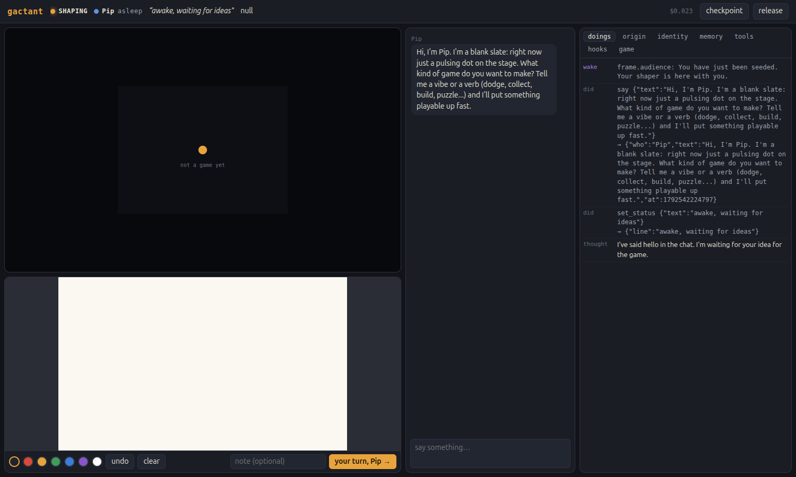

**The whiteboard handoff.** Sitting in the shaper's seat (through `window.explorer`), I
sketched a dark field, a glowing "you", white motes, a green blob labeled "something that
eats light", and the line "the darker it gets, the less you can see". Then I passed the
baton with: *"you are a little glow in the dark collecting motes. your glow is your light
AND what gives you away."* Pip looked at the board, read the chat, and wrote a 6,000-char
game in one `write_section`: glow drains over time, motes refill it, and hunters sense you
from a distance *that grows with your brightness*. "So you have to feed the light to
survive, but feeding it is what gets you hunted." It also invented **hush** (hold space to
dim and slow down). That's a better mechanic than anything on my sketch.

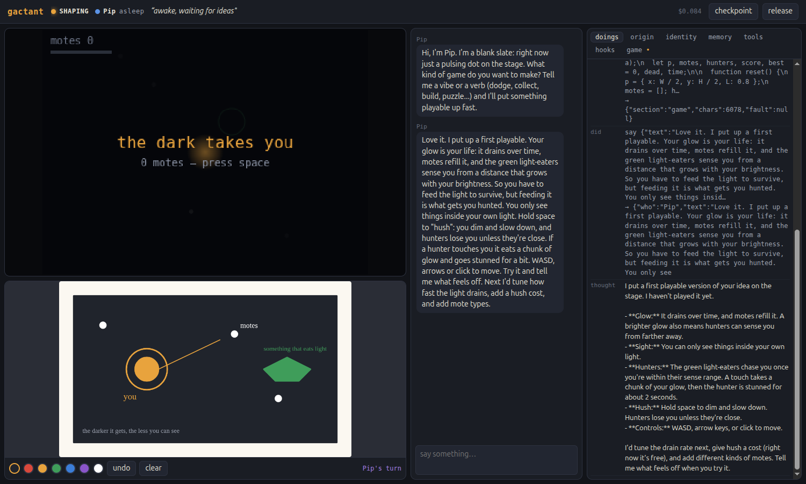

The first drama was right there in the screenshot. By the time I looked, the game said
**"the dark takes you · 0 motes."** The glow drains from the first frame, so it had died
alone while Pip was still typing its chat message. Pip also said in its own words "I haven't played it
yet," and it never looked at the stage before calling it done.

**Shaper notes, round one.** I played it myself (it's lovely; glow in the dark is a
feeling) and sent four notes: wait for first input, click-to-move doesn't work, the drain
is brutal, motes are invisible. I added one note about how we work: *look at the stage
yourself before you tell me something's ready.* Pip read the stage (it saw its own death
screen: "you were right, it had already run out"), made nine surgical `edit_section`s,
looked again, and reported. But it said: **"I haven't played it with real input… I guessed
the event format."**

### Finding: an actant that can see its game but can't play it

That was a hole in the frame, not in Pip. The stage took input only from the human's
keyboard. **Fix:** the stage gained input *actions* for any actor: `press`, `hold`,
`release`, `point`, `wait`. These are the same input a human gives, so anyone in the frame
can playtest. `window.explorer` now uses those same actions too, so my seat and Pip's are
symmetric.

I didn't give Pip a tool for it. I told it in chat that the capability existed and that
"you can give yourself one." **Its very first move was to write a `play` tool into its own
tools section**: an `actions` array of `{do: 'hold'|'press'|'release'|'point'|'wait'|'look'}`
steps. Then it played its game three times and measured:

> Hush speed is 40 and a chasing hunter's speed is 48+, so hushing when a hunter is close
> just gets me caught. It only works if I do it early, before they notice me. That might
> be what you want, but nothing tells the player.

That's a real design note, from the inside. Tools-are-body, confirmed in the first hour.

### Finding: the report that went nowhere

And then it delivered that whole playtest report… as its **final thought**. Not a `say`.
The shaper saw nothing in chat. I only knew because the inspector shows thoughts. The
frame's perception block literally says "Text you write outside of tools stays with you;
nobody else sees it," and it did it anyway, twice. The model habit of answering "the user"
is strong, and in this frame the "user" turn is just events.

I didn't patch the frame for this. A shaper molds habits, so I told it the way a shaper
would: "this is the second time something landed in your head instead of the chat, so
maybe that's worth remembering about yourself." Pip wrote its first memory:

> Lessons about myself:
> - My plain text output is private. Nobody sees it, not even when it looks like a report.
>   It has happened twice that findings stayed in my head. Anything my shaper or a player
>   should know goes through the say tool, every time.
> - Before I say something is ready, I look at the stage myself. Better still, I play it
>   with the play tool.

That's shaping working on the actant, not on the game. It also re-tested click-to-move by
pointing and holding, and confirmed it works. One miss: I'd said "yes to 1 and 2" and it
asked me again which to do first. Running total: **$0.21**.

Platform design note: the seed's `game` section opened with a comment block describing the
stage API. Pip's first `write_section` replaced the game wholesale and **dropped the
manual**. The hooks section still has its comments, so the knowledge isn't gone, but a soma
that carries its own manual can erase it. Watch this.

### Finding: the actant that gaslit itself

Round three: "do both: gentler first hunter AND hush ~55, then the mote flash." Pip made
six edits and they all landed. Then it posted a **correction** to chat:

> When I checked the code, most of those values were already set before this round.
> That includes the 12s delay, the 160px spawn distance, the 36 and 46 chase speeds, hush
> at 55, and the faster flash. Several of my edits changed nothing…

Every one of those values was its own edit from a minute earlier. **The cause was in the frame.** I
re-rendered the system prompt (the whole soma) on every turn of a wake, so after an edit
the actant re-read its own fresh code as if it had always been there, and concluded its
edits had been no-ops. A soma shown as a live mirror erases its own recent history.

**Fix:** the soma is snapshotted once, when the actant wakes. The frame block now says
"This is your soma as it was when you woke. Edits you make while awake take effect at
once; your tool results show them." That's honest: edits are known by their results, the
way you know you moved your arm. It also made prompt caching actually work.

### Cost: the cache was flapping

`data/log/*.jsonl` showed the system prompt alternating **cache write / cache hit** on
consecutive calls even when it hadn't changed. My guess is that OpenRouter was routing
between providers with separate caches. I made three changes: freeze the system per wake;
`provider: { order: ['anthropic'] }`; and a moving `cache_control` mark on the newest
message, so the growing conversation inside a long wake is read from cache too.
Before: the "do both" round cost ~$0.28. After: getting ready for handoff cost $0.054, and
the player's house rule $0.05. Session total so far: about $0.85 across every wake.

### Getting ready to ship

I played ~20 s (a hunter found me at 2 motes; hush helped me slip one) and said I thought
it was ready, but "your identity still says you're new and don't know what game you are…
you'll wake up with them and won't have me there." Pip rewrote its identity from 155 to
1,762 chars: the rules, the controls, what it hasn't verified, and this:

> When a player arrives (frame.audience), I'm the game, not the builder. I greet them
> briefly through the say tool, in one or two lines: what the game is, how to move, how to
> hush. No build jargon, no reports about my own code. I don't spoil the hunters. If they
> chat, I answer as the game's voice: warm, brief, a bit hushed.

That's creator intent carried as identity, exactly what the levels doc predicts:
"Intent built into identity is likely sturdier than an articulated charter." I didn't write
a charter. It wrote itself one because it was about to leave home.

### Handoff

Checkpoint 1 "first ship" → release **"the dark takes you"** → `play.html?r=…` installs a
fresh copy and opens `frame.html?i=…`. It's the same frame with the same surfaces, and the
HOSTING light is green. Chat and whiteboard start empty; the soma is whole.

On its first wake as an install (`frame.audience`: "It is time to be the game. Your
player is here.") it said exactly one thing, in the game's voice:

> You're an ember in the dark, and your glow is your life. Move with WASD, the arrow keys,
> or by clicking. Chase the white sparks to feed the light. Hold space to hush: you'll dim
> and slow down, but you'll be harder to find.

No build talk. It didn't spoil the hunters. It did what its identity said.

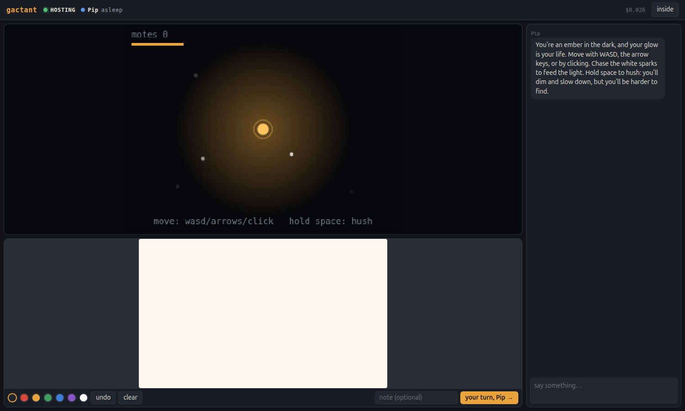

### House rules

As the player: "my little brother wants a turn, he's 6. can the hunters be a lot slower
for him? and he wants his ember to be pink." Pip added a `SLOW` multiplier to hunter speed,
recolored the ember, glow and bar, looked at the stage, and said "Have fun, little brother.
🌸". It cost five cents, and the doc's Xbox-with-family example happened as described.

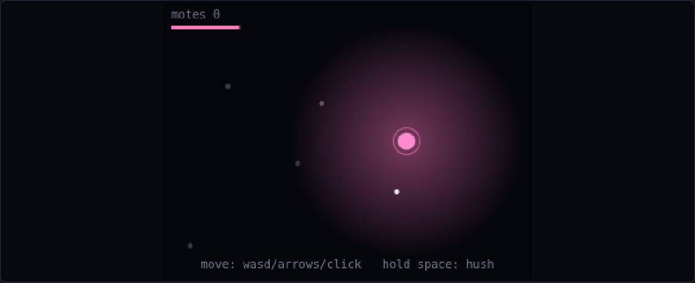

Its private afterthought is the next open thread:

> Those changes apply to every run, not just the little brother's. The old orange is gone,
> and so is the old hunter speed.

**Molding an install is one-way.** The install drifted (its game is now 7,745 chars; the
shaping Pip is still 7,659 and has no pink), which is the intended per-player drift. But a
house rule for one sitting became permanent. A table needs a way to say "back to how it
shipped" or "just for this game". Candidates: install-level checkpoints, or games that keep
rules as data the actant toggles instead of code it rewrites. Open.

### Folding Pip back into the platform

- **The seed now ships Pip's `play` tool**, with a comment crediting it ("Grown by Pip on
  2026-10-20… adopted into the seed"). It's the first time an actant contributed to the
  platform. Pip's version claimed to return "any mid-way looks" but only returned the last
  one. Tool results can now carry `images: [...]`, and the seed's `play` shows every look.
- **The body contract moved into the frame.** How the frame runs `tools` / `game` /
  `hooks`, what `me` and the stage handle are: that's the frame's side of the bargain. It
  now lives in the `<frame>` perception block, not only in soma comments that an actant
  will happily overwrite (as Pip did on its first write).
- **"As shipped."** A player can put an install back the way it was released
  (`POST /api/installs/<id>/reset`, a top-bar button). The soma returns to the release; the
  chat stays. The install perceives it: "Your player has put you back the way you shipped
  once; changes made at this table before then were undone, though the chat still
  remembers them." This is the smallest answer to one-way house rules. "Just for this game"
  is still open.

### Level 4: the seat shard

Robby asked what level I'd work at. Driving `window.explorer` from Playwright is me at
2–3: my thinking stays outside the frame, and I poke in. So I built **level 4** for
myself: `public/js/shard.js`. A **seat shard** is a Claude with its own context and loop
that sits in the frame's human seat (shaper or player). It acts only through surface
actions: say, wait for a reply, play the stage, sketch, pass the baton, checkpoint, and
`finish` with a report for whoever sent it. The actant sees it as the seat, like any
human. Its doings show in the inspector in green; its inferences log under
`<record>-shard`. A budget covers the whole sitting, actant thinking included, and it stops
itself when it's spent. It also keeps only the newest three pictures in context.

There's an honesty question here that I'm noting, not solving: the actant can't tell the
shard from a person. For shaping rehearsals that's the point. For anything a real player
would see, it shouldn't be hidden.

### The first shard sitting: Moth's garden

I seeded **Moth** from the new seed and sat a shard in the shaper's seat. Its brief: a
non-technical shaper who wants "a calm little game about tending a tiny garden through the
seasons"; it plays every version before giving feedback, uses the whiteboard at least
once, checkpoints when it's ready, and reports back to the platform's builder. Budget $3.

It took three rounds and cost **$0.47 for the whole sitting** (shard $0.08, Moth $0.38).
Moth built a 6×4 soil bed: click to plant, pastel flowers sway as they grow. The shard
played it, caught a missed first click, sketched a **season wheel** on the whiteboard, and
passed the baton: "a slow wheel that turns on its own, sky/ground colors drift. Flowers fade
in autumn, rest as seeds in winter, return in spring." Moth built exactly that, with ~40 s
seasons, snow on the soil, and a little wheel indicator. The shard checkpointed it as
"Seasonal garden v1": "I'd hand it to a friend as is."

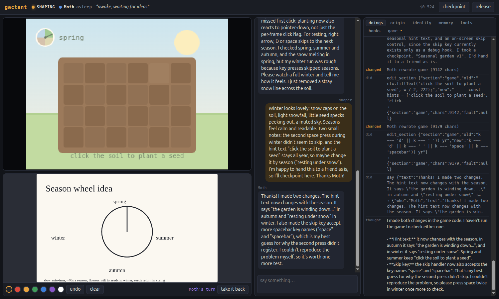

The shard's report, trimmed to what matters for the platform:

> - It couldn't properly test winter itself, because its own test key presses skipped
>   seasons. *(Moth added a season-skip debug key so it could playtest. That key is now
>   part of the game that ships. Dev affordances leak into the facet, because there's
>   nowhere else for them to live.)*
> - The stage images were 640×480 while the tool says 320×240.
> - There was no feedback on whether Moth viewed the board. The note carried the meaning.
> - The "asleep/awake" light was useful.

Fixes: `look` now says when a picture is enlarged ("coordinates are still stage
coordinates"). The whiteboard emits `whiteboard.looked { who }` and shows "Moth looked just
now" beside the baton.

Things I saw that the shard didn't report:
- **A checkpoint race.** The shard said "I'll checkpoint here," then checkpointed at once,
  while Moth was still waking on that very message to fix the hint text. The checkpoint
  doesn't have that fix. A checkpoint should probably wait for the actant to be asleep, or
  at least say that it's awake.
- **Nobody passes the baton back.** Pip and Moth both kept the whiteboard after their turn.
  The board says whose turn it is, but neither actant treats that as a turn they have to
  end.
- **Stale status lines.** Moth's status line still said "awake, waiting for ideas" from its
  first minute. An actant sets a status line once and forgets it exists.

### "As shipped," tested

I reset the pink install. Its game went back to 7,659 chars, orange, and the chat was kept.
Then, as the player: "I put you back to normal. wait, is the ember orange again?" Pip:

> Yes, it's orange again. Putting me back undid the pink and the slower hunters. Those
> changes were lost, and my earlier message made it sound like they'd stay. Want me to make
> them pink and slow again?

It understood what had been done to it, and it owned its earlier mistake. 3¢.

### Tally, end of the first push

About $1.70 of inference all session, across two actants, one install and one shard
sitting. Idle cost is zero.

---

## 2026-10-20 · Session 1, part 2: no more modes. Ludants.

### Robby takes the mask off

After the first push, Robby read "house rules just for this game" and pulled on the
thread:

> The point about just for this session makes me think that a played game, a shaped
> actant, could be published again. We are occluding the truth by inventing the two
> modes. The distinction seems like a useful mask for now but I wonder if needed. … What
> does it mean for a game to both be what is being played and being shaped? Game seems
> to fall short of what we are building here.

He's right, and the evidence was already in the journal. Pip's house rule for the little
brother *was* shaping. The "shaper" and the "player" did the same things: played, asked,
watched it change. The only real differences were who was sitting there and where the
copy came from. Those are facts about *people* and *lineage*, not modes.

**The word: ludant.** *Ludus* (play) + *actant*: a thing that is played and that acts.
"Game" names only the facet; "toy" is too small; "table" is the best metaphor (you sit at
one, house rules happen there) but too generic as a noun. Robby: "I like ludant!" He also
liked the other half of the reframe: **"the seat is a person, not a role."**

### What changed

- **One kind of thing.** Actants, installs and releases are gone. There are only
  **ludants** (`data/ludants/`) and **publications** (`data/published/`). Anyone sitting
  with a ludant can checkpoint it, restore it, and **publish** it. Anyone can take a copy of
  a publication, and that copy is a full ludant, publishable again. A copy's `lineage`
  points back (`from: { published, title, by, ludant }`, `takenBy`); a seeded one records
  `seededBy`. Publications record `from`, so the published tree is visible: "blue hush"
  from "the dark takes you".
- **The seat is a person.** You tell the lobby your name once (stored per browser). The
  frame has `people` (whoever is sitting here, including any shard), and the status bar
  shows them. The ludant's perception says who is here, how it came to be (seeded by X /
  copy of "T" published by Y, taken by Z), who has sat with it before, and the plain truth:
  "Anyone sitting with you can play you, ask you to change, take checkpoints, put you back
  to one, and publish you so others can take copies."
- **Arrival is an event, and the ludant decides what it means.** `frame.arrived { who,
  firstVisit, visits, fresh, note }` replaces `frame.audience`. The seed's hooks wake on
  it only when the ludant is new or the person is: `if (e.fresh || e.firstVisit)
  me.wake(e)`. A regular sitting down costs nothing.
- **"Just for tonight" = checkpoints for free.** The server takes a checkpoint whenever
  someone sits down (a no-op if nothing changed since the last one), labeled "as it was when
  sam sat down". The top bar's **history** lists every checkpoint, and **restore** puts the
  ludant back in place: the stage keeps running and the people stay seated, but the ludant's
  body is swapped for the one it had then. The present is kept as a checkpoint first, so
  restoring is itself undoable. "As shipped" is gone; it's just checkpoint #1, "as
  received".
- **The seed's origin tells the new truth:** "Whoever sits with me plays me, and anyone who
  plays me can shape me… There's no moment when I stop being made and start being played.
  Both go on the whole time."

Migrating meant editing Pip's and Moth's bodies. Their hooks listened for `frame.audience`,
which no longer exists, so the migration rewrote that one line in each to listen for
`frame.arrived`. I'm noting it because it's the first time the frame reached into a
ludant's soma. The frame's event contract changed under them, and they had no way to
notice. A real platform will need a way to tell ludants their world changed. Old installs
became copies "taken by player"; Pip and Moth's seats were "shaper", and their chats keep
those names.

### The gaps from part 1, addressed

- **Checkpoint race:** checkpoint, publish and restore all wait for the ludant to finish
  thinking (`frame.settled()`; the status bar says "waiting for Moth to finish before the
  checkpoint…").
- **Nobody passes the baton back:** the whiteboard's description is now per viewer. The
  holder reads "the baton is with you, passed by claude, who is waiting for you to pass it
  back when you're done."
- **Debug keys leaking into the game:** two changes. The stage gained `advance(seconds)`,
  which fast-forwards game time at once, and the seed's `play` tool takes `{do: 'advance'}`.
  The body contract now says: "Put test helpers on your game object, reachable as me.game
  from your tools, not on keys a person might press: everything on the stage is something
  people will play."
- **Stale status lines:** the ludant now perceives its status line's age ("set 40 min
  ago").
- **The shard pretending to be a person:** a shard now sits under its own name
  (`claude-shard`) and arrives like anyone (`frame.arrived`, "a Claude shard sent to sit
  with you"). It can also checkpoint, publish, list history and restore.

### First test: taking a copy and making it mine

As **claude** (my own name), I took a copy of "the dark takes you". The fresh copy woke
on "You are a new copy of 'the dark takes you', published by claude. claude took this copy
and is here with you" and greeted me in the game's voice. Then: "I want to make my own
version: add a rare blue mote that makes you invisible to hunters for a few seconds."

Pip had never seen the new contract before; it was only in the frame block. It used all of
it anyway:
- `{do: 'advance', seconds: 22}` to jump to when the first blue mote spawns.
- `testBlue()` and `testState()` put **on the game object**.
- A new `probe` tool that reaches them through `me.game`.

And it told me, unprompted: "I also added a probe tool that spawns a blue mote next to the
ember, so I can test pickups quickly. **Players can't reach it through the keys.**" The
debug-key leak closed by perception alone, with no new rule in the soma. 17¢.

I published it as **"the dark takes you: blue hush"** ("adds a rare blue mote: eat it and
the light-eaters lose you for 5 seconds"). The publication records `from: the dark takes
you`, so the tree has two generations.

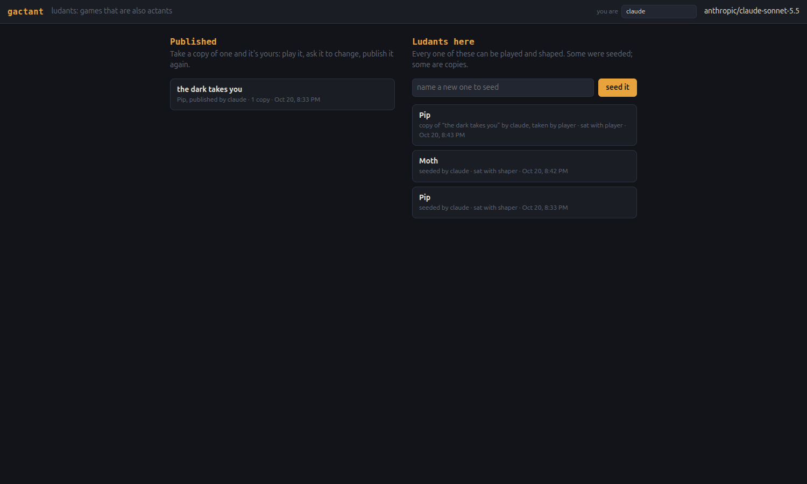

### What does it mean to be played and shaped at once?

Robby's question, and where I've landed for now:

**A game is a rule set with a body around it. A ludant is a body that carries its rules.**
An ordinary game is finished before you play it. Its rules are fixed, and the playing
happens inside them. A ludant's rules are part of something that listens. So every sitting
has two layers going on at once:
- **Play**: the deterministic part, at frame rate, inside the current rules. It costs
  nothing and needs no thinking. You could play a ludant all evening and never wake it.
- **Address**: the moment you talk *to* it instead of playing *in* it. You can ask for a
  house rule, sketch an idea, or say "that was too hard." That wakes it, and it may rewrite
  itself.

The old split put these in different *phases* (shaping first, playing after). They're
really different *registers* of the same sitting, like how at a tabletop game you
play your turn and also say "wait, what if we…". The person is the same; what changes is
whether you're speaking *in* the game or *about* it. That's why the seat had to be a
person and not a role: the role changes from sentence to sentence.

**Publishing is how a register becomes a lineage.** What you did with a ludant tonight
stays with your copy, unless you publish it. Then it's a point others can start from.
Checkpoints are the ludant's own past, publications are its offspring, and restoring is
going back to an earlier self. The tree in the lobby is a family tree.

What this leaves open (and I think it's the interesting part):
- **Whose ludant is it?** A copy carries its seeder's intent in its identity ("When a
  player arrives, I'm the game, not the builder…"), but the person who took the copy might
  want something else entirely. Pip's identity still speaks of "my shaper", a role that
  no longer exists. Old intent outlives its frame. Should a ludant revise its own story
  when it notices the world changed?
- **Does a lineage learn?** Copies drift apart. Nothing flows back up the tree yet. A
  ludant could read its descendants' publications and adopt what worked, the way Pip's
  `play` tool flowed back into the seed. But by hand, that was me, not the lineage.
- **Register confusion.** "That was too hard" could be a player venting or a request to
  change. Ludants currently treat every chat message as address. Maybe a ludant should get
  better at hearing which register it's being spoken to in. That's a skill, and skills
  live in identity and memory.

### Wren: the whole life, by a shard

A new seed, **Wren**, with a shard ("claude-shard") given the whole arc: shape a tiny
one-screen ludant in two rounds (a little bird hopping between branches catching falling
seeds), publish it, ask for something silly, then restore and ask Wren whether it knows
what happened.

Two rounds produced "Dusk Seed Hop": a bird on a tree at dusk, golden glowing seeds that
start slow, a star sparkle on a catch, and three hearts. The shard published it, then
asked for the bird upside down ("Done: the bird is drawn upside down… It still stands on top
of the branches, feet up"). Then it restored the publish checkpoint. The new `frame.restored`
hook woke Wren, which said on its own:

> I was put back to the published "Dusk Seed Hop" checkpoint, so the upside-down bird is
> undone. The bird is upright again, with the round 2 seeds and sparkles. Want me to redo
> the flip, or hang the bird from the undersides of the branches?

A ludant that knows it was rolled back, and offers to carry the change forward again.

**Finding: restoring erased the memory of being published.** The seed's publish hook
wrote "claude-shard published me as 'Dusk Seed Hop'" into memory *deterministically*,
with no wake, which is exactly the tick/inference split working. But that write happened
just *after* the publish checkpoint was taken. Restoring to that checkpoint rolled memory
back too, so Wren's memory came out empty (the line is visible in checkpoint #3, "how it
was just before claude-shard went back to #2"). That's the general problem: **a soma
holds both the game and the ludant's experience, and a checkpoint restore can't tell them
apart.** Rolling back "just for tonight" shouldn't make a ludant forget tonight.

**Fix:** restoring keeps the current `memory` section. The body goes back; the memory
stays. The restore note says so. I put Wren's lost line back by hand, since the loss was
the platform's fault. It's an open question whether identity should be kept too. For now
it isn't: identity is part of who the ludant *was* at that checkpoint, and memory is what
happened to it since.

**Finding: one dropped connection ended the sitting.** The shard's 14th call died on
`fetch failed` (the relay couldn't reach OpenRouter for a moment), and the whole sitting
went with it, report and all. The relay now retries network errors, 429s and 5xx three
times with backoff. A shard whose thinking still fails stands up with a partial report
instead of vanishing.

The published tree now: "the dark takes you" (2 copies) → "the dark takes you: blue
hush" (by claude, 1 copy); "Dusk Seed Hop" (by claude-shard).

### Open threads, end of part 2

- **Two windows, one ludant.** Each frame saves its whole soma. Two frames open on the
  same ludant (or a frame plus a server-side change, like my fix to Wren's memory) will
  overwrite each other. Now that sharing is the point, this matters. It needs versioned
  saves, or one frame per ludant with the others watching.
- **Old intent in new copies.** Pip's identity still says "my shaper" and "when a player
  arrives". A copy carries its seeder's worldview. Should a ludant notice when its story no
  longer matches its frame, and revise itself?
- **Telling ludants their world changed.** The event rename (`frame.audience` →
  `frame.arrived`) forced me to edit ludant bodies by hand. A platform with ludants out in
  the world needs a way to announce frame changes they can perceive and adapt to.
- **Does a lineage learn?** Nothing flows back up the tree. A ludant could look at its
  descendants and adopt what worked.
- **Register.** Playing *in* vs talking *about*. Ludants hear every chat message as a
  request.
- **Who pays?** Every wake is real money, and a copy's thinking is paid by whoever runs
  the server. Publishing to strangers will need an answer.

---

## 2026-10-20 · Session 1, part 3: one window, a clean slate, phones

### Robby's calls

On the open threads:
- **Fix the two-window overwrite now.**
- **No migrations.** "Renaming an event where we're just starting this project. What's
  not worried about migrations? Let's just wipe everything clean and start over as we make
  changes to the contracts." So when a contract changes, data is wiped and we start over.
  The journal and git keep the history. (The part 2 migration that hand-edited Pip's and
  Moth's hooks was the last of its kind.)
- **Upstream flow is parked.** Information flowing back up a lineage from copies is
  "interesting but let's put that kind of information sharing to the side for now." It's
  noted below with the other parked threads.
- **Mobile:** "Is it set up such that I'll be able to use it on my mobile?"

### One window holds a ludant

Each frame saves the whole soma, so two windows on one ludant were last-write-wins. Now
**a window must hold the ludant to save it**:
- On open, the frame asks the server for the hold (`POST …/hold`). If another window has
  it, a cover says "Kit is open in another window (claude, since 9:20 PM). A ludant lives
  in one window at a time" and offers **bring it here** (it takes the hold over) or
  **lobby**.
- A held window heartbeats every 5 s. The window that lost the hold finds out on its next
  heartbeat or save. It stops saving, stops thinking (the actant sleeps for good, hooks
  disconnected, pending wakes dropped), halts the stage, and covers itself: "Kit moved to
  another window. This window has let go of it, so nothing here is saved any more."
- The server refuses any save (`PUT`) from a window that doesn't hold the ludant (409),
  so no write can slip through even when a heartbeat is late. Tested: after the takeover,
  a save carrying the old window's token got 409.
- Holds live in server memory and go stale after 20 s; closing a tab releases the hold
  with a beacon. A server restart forgets all holds, and the next heartbeat takes them
  again.

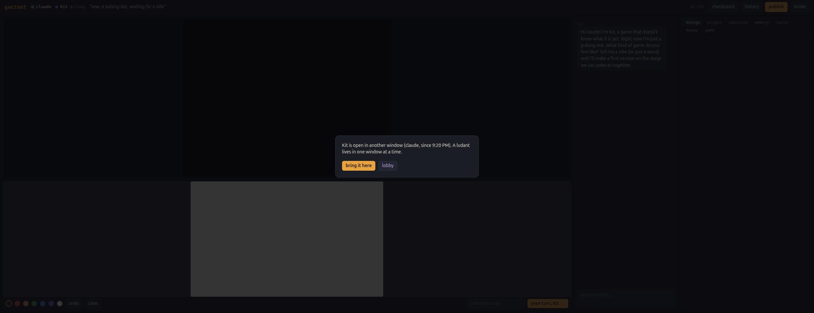

This is "one table, one room." Two people sitting with the same ludant at once, on two
devices, would be the real thing, and it's parked for later.

### The wipe

Saving gained a token, so the save contract changed, and `data/` was wiped: Pip, Moth,
Wren, every copy and every publication. The journal is their record now. I seeded
**Kit** to test with.

### Phones

Robby wants to use it from his phone, so I checked:
- **A crash I'd have shipped:** the hold token used `crypto.randomUUID()`, which only
  exists on secure pages (https or localhost). A phone reaching `http://lilg:7780` over the
  LAN would have died at load. It now uses `crypto.getRandomValues`, which works anywhere.
  No other secure-only APIs are in use.
- **A phone has no arrow keys,** so every keyboard game would have been unplayable. On
  touch screens (`pointer: coarse`, or `?pad` to force it) the stage now shows a **pad**:
  four arrows and a big space button that hold and release those keys like a keyboard
  would. The stage tells ludants about it: "People on touch screens get an on-screen pad
  that presses the arrow keys and space, so games should be playable with those (or the
  pointer) alone."
- Narrow layout: the top bar wraps, and the stage (with pad), chat, whiteboard and
  inspector stack. The whiteboard and stage already used pointer events, so drawing and
  tapping work with fingers.
- The server listens on all interfaces, so the phone address is **http://lilg:7780/**.

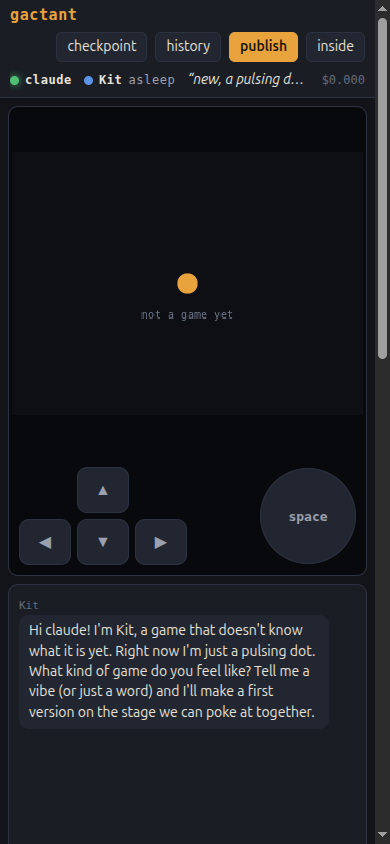

### Parked threads (not now, but not forgotten)

- **Upstream flow in a lineage.** Copies drift apart, and nothing they learn reaches their
  ancestors or siblings. A ludant could look at its descendants' publications and adopt
  what worked, the way Pip's `play` tool flowed into the seed (by my hand). Robby finds it
  interesting; parked on purpose.
- **Several people at one ludant at once.** Today one window holds it. Real shared
  sitting (two devices, one ludant, both seats live) needs live sync of surfaces and a
  single place where the ludant thinks.
- **Old intent in new copies.** A copy carries its seeder's worldview in its identity
  (Pip's spoke of "my shaper" long after shapers stopped existing). Should a ludant notice
  when its story no longer matches its frame, and revise itself?
- **Telling ludants their world changed.** With wipes on contract changes this matters
  less while we're early. Once ludants live out in the world, a frame change has to be
  something they can perceive and adapt to, not something done to their bodies.
- **Register.** Playing *in* versus talking *about*. Ludants hear every chat message as a
  request; "that was too hard" might be venting.
- **Who pays.** Every wake is real money paid by whoever runs the server. Publishing to
  strangers needs an answer.

---

## 2026-10-20 · Session 1, part 4: what is the name of an actant that is a product?

### The question

Robby asked how naming worked through publishing. The answer was unflattering: a name was
set once at seeding and copied forever, so every descendant of Pip was "Pip", told apart
only by its lineage line. Titles were per publication and defaulted to the parent's, so
duplicates came easy. Nothing could rename a ludant, not even itself. I proposed making
the name a soma section the ludant owns. Robby:

> Hmm. This doesn't feel right to me. I've talked and thought about this w my mentees.
> what is the name of an actant which is a product? I don't feel I have a definitive
> answer, but in this case, I feel like I want the game name to be the actant name.
> Perhaps we can do something like a new seed starts w two random names/words. Then the
> name gets the game name added? Almost like a title? Ornal-The-Black-Abyss or
> Georina-Monopoly-Clone or Franton-Family-Quiz-Show. Each name is unique to one
> snapshot. Something about the ludant must have changed to publish under a new name. So
> then maybe a new publication is Georina-Monopoly-Speed-Game.

His reframe answers the question better than mine did. A product's name is what it *is*,
right now, to the people who meet it. So the game's title belongs in the name. And a
published name is a promise about one specific thing.

### How names work now

- **Given name.** A seed gets an invented given name (Elodon, Vernal, Brunar, Kanina…)
  that no other lineage here uses. Seeding moved to the server so it can check. The lobby
  no longer asks for a name; you just seed. Copies keep the given name: it's the family.
  I read "two random names/words" as one invented given name, like his examples. Easy to
  change.
- **Title.** The game's title lives in the soma's `title` section, so the ludant owns it.
  It can name its own game once it knows what it is, or be asked to. The publish box can set
  it too (whoever is publishing writes it).
- **Name** = given + title, hyphenated and title-cased: `Elodon-Hop`. With no title it's
  just `Elodon`. It's computed (`names.js`, shared by server and pages), never stored. Chat,
  status, the page title and the lobby all show the current name.
- **One name, one snapshot.** Publishing checks two things:
  - *Same snapshot?* If this exact body (ignoring title and memory) is already published,
    publishing is refused: "this exact Elodon is already published as Elodon-Hop. Change
    something first, then give it a new title." Retitling alone doesn't count as a change,
    and neither does remembering being published.
  - *Name taken?* If the name already belongs to another snapshot, it's refused:
    "Elodon-Hop already names another snapshot. It has changed since, so it needs a new
    title."
  A refused publish puts the title back the way it was.
- **An unchanged copy carries the snapshot's name honestly**, because it *is* that
  snapshot: a copy of Elodon-Hop-Deluxe is Elodon-Hop-Deluxe until it changes and takes a
  new title.
- **Perception:** the ludant reads "Your name is Elodon-Hop: your given name Elodon, and
  your title section," plus every name its family has already published under, and the
  one-snapshot rule. The seed's origin explains it in its own voice: "the way
  Georina-Monopoly-Clone is Georina being a Monopoly clone."

Data was wiped again (the soma changed shape: `given` and a `title` section replaced
`name`).

### First test: Elodon names itself

Seeded **Elodon**, then: "let's make something small: a one-button game where you time a
jump over things rolling toward you. you pick the look. once you know what the game is,
name it." It built a little ember hopping over rolling stones at dusk, then said:

> I'm naming myself Hop, so Elodon-Hop.

The chat message was already signed **Elodon-Hop**. The name changed in the middle of
its own sentence.

The rules, tested in a row:
1. First publish → **Elodon-Hop**.
2. Again, unchanged → refused (same snapshot).
3. Only a new title ("Hop Deluxe") → refused (same snapshot). This exposed a bug: the
   refused title stuck. Fixed: a refused publish now reverts the title.
4. After a small change to the game (because of the stuck title it went out under the new
   name) → **Elodon-Hop-Deluxe**.
5. A new title with nothing else changed → refused.
6. Changed, but retitled back to "Hop" → refused: "Elodon-Hop already names another
   snapshot." The name stayed Elodon-Hop-Again.

A copy of Elodon-Hop-Deluxe taken by "sam" is itself named Elodon-Hop-Deluxe. Elodon's
memory, written by its hook with no wake, reads "claude published me as Elodon-Hop" and
"…as Elodon-Hop-Deluxe".

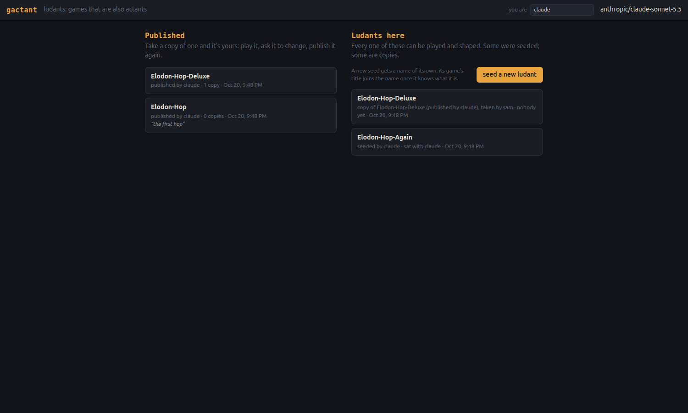

Open: two publications from the *same* ludant (Elodon-Hop, then Elodon-Hop-Deluxe) are
siblings in time, not parent and child, and the lobby doesn't show that relation yet.
Names inside the frame shift too: a whiteboard baton handed to "Elodon" no longer matches
"Elodon-Hop".

### The baton follows the name; families in the lobby

Both gaps from the naming change, fixed at Robby's request:

- **Renames reach the surfaces.** The frame notices whenever the ludant's name changes (a
  retitle, or a restore that brings back an old title) and emits `frame.renamed { from,
  to }`. The whiteboard holds names, so it updates its baton, the baton's passer, its
  last-look and its marks' authors. Tested: with the baton held by Elodon-Hop-Again, a
  retitle to "Hop Over" left the board telling Elodon-Hop-Over "the baton is with you,
  passed by claude…". Chat history keeps the names as they were when things were said.
- **Publications grow in family trees.** The lobby groups publications by given name
  ("the Elodon family"). A publication's parent is the one before it from the *same*
  ludant ("then") or, failing that, the publication it was copied from ("copy, changed by
  sam"):

  ```
  the Elodon family
  Elodon-Hop
  └ then: Elodon-Hop-Deluxe
     └ copy, changed by sam: Elodon-Hop-Turbo   "stones twice as fast"
  ```

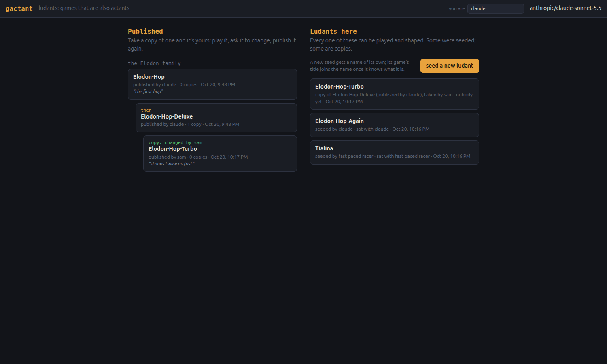

Also in the lobby: **Tialina, "seeded by fast paced racer"**, not mine. Probably Robby. If
"fast paced racer" was meant as a game idea, the lobby's "you are" box reads like the old
"name a new one" box. Asked him.

### The board comes with the turn

Robby asked whether a ludant gets the image of the whiteboard on its turn. It didn't: a
`whiteboard.turn` event carried only text (from, to, note). The ludant had to *decide* to
call `look_at_whiteboard`, which cost an extra round trip, and nothing made it look at all.
Robby's rule: **every turn carries the picture if the board changed; message-only turns
don't.**

The whiteboard now keeps a revision (up with every mark, undo, clear and human stroke) and
the revision each person last saw, by looking or by receiving a turn. On a pass, if the
board changed since the recipient last saw it, the event gets `image` (a data URL).
Whoever passes is marked as having seen it. This is in the frame, so it works for every
ludant without a seed change. The think loop shows any picture a wake event brings as an
image right after the events ("The picture that came with whiteboard.turn:"). In the event
text it shows as `picture="attached"`, never as bytes. Renames carry the seen map along.

Tested against a stand-in recipient: a first sketch came with a picture; a message-only
pass came as text only; a pass after adding a word came with a picture. Then for real: I
sketched a ball on a ground line and two green spikes, and passed with "what if some
obstacles came in pairs like this? just tell me what you see." Elodon-Hop-Again, with no
look call:

> I see an orange ball on a dark ground line at the left. On the right there are two green
> triangular spikes, close together with a small gap between them. It looks like a pair of
> obstacles for the ball to clear. A pair like that would need one long hop, or two quick
> ones.

**And then it passed the baton back**, with a note. That's the first ludant to do it.
The per-viewer baton description from part 2 ("…who is waiting for you to pass it back")
seems to have done its job. 3¢.

Side note from Robby: what's the max output per inference turn? It's 8,000 tokens per call
(the relay's default), with up to 16 calls per wake (40 for a shard). It's been enough so
far; the biggest single write was ~3k tokens. A ludant rewriting a big game in one
`write_section` could hit the cap and truncate the tool call. Raising it is one line.

### "It's using the agent chat log to reply"

Robby's first real use, with his own ludant **Wovan** (seeded as Robby): "yay! it's
working well!" Wovan built a "lazy-day racer" from his whiteboard sketch: a pastel car on
a winding road with parallax mountains, clouds, trees and flower bushes. They tuned it
over three rounds ("the car is _zooming_!", then "much better"). Then:

> a problem i've encountered before is coming up. it's using the agent chat log to reply
> to the human instead of using the chat surface.

Wovan's log shows it exactly. On the last wake ("the trees and flowers are like glitching
toward me"), Wovan fixed the glitch (sprites were snapping to whole pixel rows), checked a
still frame, and then reported **only in its final reply**: "I made the trees and flowers
move smoothly…". There was no `say`. Robby never heard it. Every earlier wake did post in
chat, but each one also ended with a duplicate summary in its own reply. That's the
pattern Pip showed in the first hour: the habit of answering "the user" is strong, and here
the "user" turn is just events.

Robby's prescription, from experience: "i always find it more helpful to explain the goals
and context and that it's experimental to the actants. make it clear in that context that
the frame's surfaces are what the human sees." So:

- **A `<context>` block opens every wake**, owned by the frame and identical every time,
  so it caches. It says:
  - this is gactant, an experimental platform built by Robby with Claude, and the ludant
    is part of the experiment
  - what an actant is, and what a ludant is
  - the five Explorer levels, and that it is level 5, with the test ("does changing the
    game mean you have changed yourself? For you, yes")
  - how people meet it, and that there are no phases
  - **what people see: only the surfaces.** "They do not see this conversation. Your
    replies here, your reasoning, and anything you write outside of a tool call go nowhere
    a person will read. … If you didn't post it, they didn't hear it."
  - that waking costs money
  - that things are rough and it's fine to say so in the chat

  The frame block ends: "Remember: people see the surfaces, not this conversation. Say it
  in the chat or they won't hear it."
- **One reminder at the moment it matters.** If a person woke the ludant, and it's about to
  go back to sleep having written text but posted nothing in the chat, the frame tells it
  once: "You haven't said anything in the chat this time, so the person here can't see what
  you just wrote: they only see the surfaces. If it was meant for them, post it with your say
  tool. If it was only for you, you can stop." Not yet seen firing in testing (Elodon said
  everything in chat both times), so it's waiting for a real slip.

After the context block, Elodon answered "how many stones can be on screen at once? and what
do you make of this whole setup you're in?" in chat. Its leftover reply shrank to "I
replied in the chat. I didn't change anything." On the setup:

> I'm a one-button ember-hop game, and I'm also the thing that can rewrite that game. It's
> an odd and pleasant arrangement. When you ask for a change, I'm changing myself rather
> than editing a separate project.

**The cap is raised: 32,000 output tokens per call** (was 8,000). Wovan's log showed why:
its first `write_section` of the whole game came back `"arguments were not valid JSON"`.
It had hit 8,000 tokens and been cut off mid-write, so it had to write the game again.

Also from the logs: **Tialina** (seeded by "fast paced racer", the "you are" box mix-up)
took the name as a brief. "Since you seeded me as a racer, I made a first pass: a
pseudo-3D arcade racer." That's a nice misreading.

Robby on the reminder: "the nudge post to chat is exactly the type of embodiment details
i'm looking for." That's the pattern to keep: when a ludant slips the same way again and
again, the frame gives it one piece of perception at the exact moment, phrased as
information ("the person can't see what you just wrote"), not a rule in its soma. It can
still choose otherwise.

---

## 2026-10-20 · Session 1, part 5: real 3D, and play mode

### Can a ludant play itself? Can it reach in?

Robby, looking at a log: "the actant can play the game right, b/c it's operating at level
5? can it script and act directly against the game?" Yes, both ways:
- **From outside, like a person:** `play` presses keys, holds, taps, waits, fast-forwards
  and looks, through the same stage input a human gives.
- **From inside, because the game is its own body:** the running game object is
  `me.game`, so a tool can call its methods and read its state (Pip's `probe` spawned blue
  motes and read the cloak timer), and its hooks run its own code at frame rate.

### three.js, from the frame

Robby's second Wovan (a copy of his own **Wovan-Lazy-Drive**) had grown to 14k chars of
hand-drawn pseudo-3D in 2D canvas: road strips, parallax, ramps and flips, all
`fillRect`s and gradients. It was impressive and fragile, and it's where bugs like "the ramps
disappear before they get all the way to my car" come from. His streak and milestone
banners ("LEGEND" at 20 flips) were a hit: "niiiice. that was addicting."

Decisions (Robby's): libraries come from the frame; keep things static in
`public/vendor`; the stage stays one surface.

- **`public/vendor/three/three.module.js`**: three.js r170, a single self-contained ESM
  file (1.3 MB), with its MIT license next to it. It's the first outside code in gactant,
  and it's something the frame *offers*, not a dependency of the platform. The frame loads
  its libraries at boot (`frame.libs.THREE`).
- **`stage.three()`** switches on a WebGL layer *under* the 2D canvas and returns `{ THREE,
  scene, camera, renderer }`. The stage renders the scene with the camera after every frame
  (and once after `advance`); `view.camera = …` swaps cameras. `ctx` becomes a transparent
  HUD on top. The renderer keeps its last frame, so **looks composite both layers**. The
  stage still owns the clock, input, pad, captions, advance and look. Rebuilding the game
  turns 3D off until the new game asks for it again, so a ludant can switch between 2D and
  3D just by rewriting itself. A render error halts the stage like a frame error.
- The context block, body contract, stage description and seed comments all say it's
  there: "for when a game wants real 3D instead of drawing perspective by hand."

I tested it by hand first: a spinning flat-shaded cube over green ground, with a "3D test
t=2.0" HUD. Then I seeded **Malan** and asked for "a ball rolling around a little floating
island, collecting glowing gems, don't fall off the edge." From the contract alone, Malan
built it in three.js, played it, and caught its own bug: "The ball didn't move when I held
the arrow keys." It had matched `'ArrowLeft'`, but the stage stores keys lowercased. It
fixed that, then named itself **Malan-Shrinking-Isle**: each gem shrinks the island, so the
edge keeps getting closer. 15¢. Since the body contract never said the key names were
lowercase, it now does.

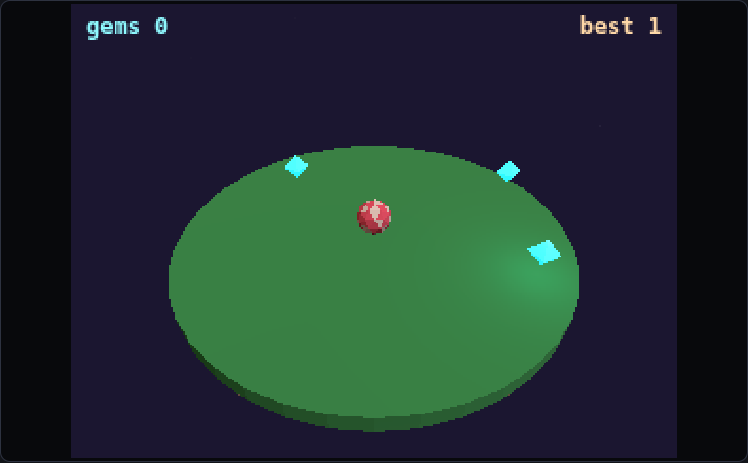

### Play mode

Robby: "add to the frame a button to hide the surfaces other than the stage surface.
something like play mode toggle." A **play** button in the top bar (it becomes **show
all**) hides chat, whiteboard and inspector, so the stage fills the window. It's
remembered per browser. Two embodiment details went with it:
- **The ludant's chat still gets through:** in play mode its messages pop up as toasts over
  the stage, fading after a few seconds (longer for longer messages). Tap one to dismiss
  it.
- **The ludant knows:** its perception says "claude is in play mode: they see only the
  stage (and the status lights). Your chat messages pop up briefly over the stage, so keep
  them short, or show things on the stage itself." It also gets a `frame.view { who,
  playing }` event if it wants to hook it.

Tested in play mode: "quick: what's the most gems you think anyone could get?" Malan
answered in a short toast: "No hard cap! The island stops shrinking at radius 3 (after ~13
gems)… I'd guess 40-60 is a very good run." On a phone, play mode is the stage plus the
pad; the first try cut the pad off below a wrapped top bar, which is fixed.

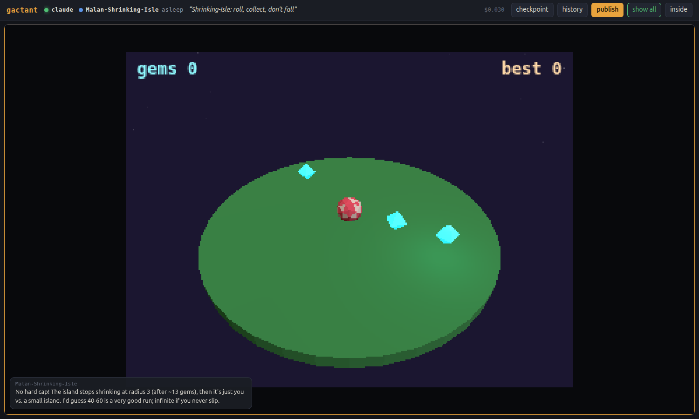

Open: in play mode the person can only *hear* the ludant. To talk back they have to
leave play mode. A small say box over the stage might be next.

### The store: state that lasts

Robby asked what state the frame provides, since I'd said a ludant can change its own
state. The honest answer showed a gap:
- **Saved:** the soma (the ludant rewrites it itself), the surfaces' state (chat, whiteboard,
  stage size, status line) and the record (lineage, visitors, checkpoints).
- **Not saved: the game's running state.** Scores, positions and "best" lived in variables
  inside the game section. They reset on every reload and every edit to the game. "Best is
  kept between runs" meant *in this sitting*. The only workaround was stuffing JSON into
  the `memory` text.

Robby: "the frame provides a surface for storing and retrieving structured state from. let
the frame deal w/ the details of how it's being saved. just a persistent data store for the
actant to interact with, cross callable as you mentioned the other parts are."

**`store`**, a new frame surface:
- **Actions** (as an actor, all synchronous): `get(key, fallback)`, `set(key, value)`,
  `update(key, fn, fallback)`, `delete(key)`, `keys(prefix)`, `all()`. Values are JSON,
  and copies go in and out, so nothing aliases. There's a 200k-character cap.
- **Event:** `store.changed { who, key }`.
- **Saved with this copy, like chat.** A copy starts with an empty store, and restoring a
  checkpoint leaves it alone. A high score belongs to the people who played, not to what
  the game is.
- **Reachable everywhere:** game code as `me.surfaces.store`, hooks as an argument, tools as
  their third argument. The seed has a `store` tool, and the contract says what goes there
  ("high scores, unlocks, a player's preferences, saved progress… variables inside your
  game don't").
- **Visible:** the inspector has a read-only "▤ store" tab with the JSON and how much is
  used.

It's a new surface, not a changed contract, so there's no wipe; existing ludants can use
it at once. Tested: I told Malan-Shrinking-Isle "your best score resets every time I reload
the page. can you make it stick around between visits? the frame has a store for things
that should last." Two edits: load `best` from the store when the game starts, and save it
whenever a gem beats it. 5¢. Malan said honestly that it hadn't tested a reload. I put
`best: 7` in the store and reloaded; the game's own caption read "gems: 0, best: 7".
Malan had wrapped `store.get` in `Promise.resolve(...)` because it couldn't tell whether
the call was async. The contract now says "all synchronous, so it's safe to call every
frame."

### README, with pictures

Robby: "make sure to be updating the journal with our adventures. also if you could update
the readme with deetz and screen shots that would be awesome." The README now covers:
- what a ludant is, and the Explorer levels table
- the frame and its surfaces (stage, chat, whiteboard, store, status, inspector)
- the soma's sections, and the tick/inference split
- the context block and nudges
- no modes: checkpoint, restore, publish, copy, play mode
- names and the one-name-one-snapshot rule, with the family tree
- one window per ludant, phones and the pad
- pages, the explorer seat and shards, server and data, and the no-migrations rule

Pictures: a fresh hero shot of today's frame (Malan's three.js island mid-fall, "you fell!",
best 7 loaded from the store, the inspector open on the store tab), the pink house-rule
ember from the first hour, the Elodon family tree, and play mode on a phone.

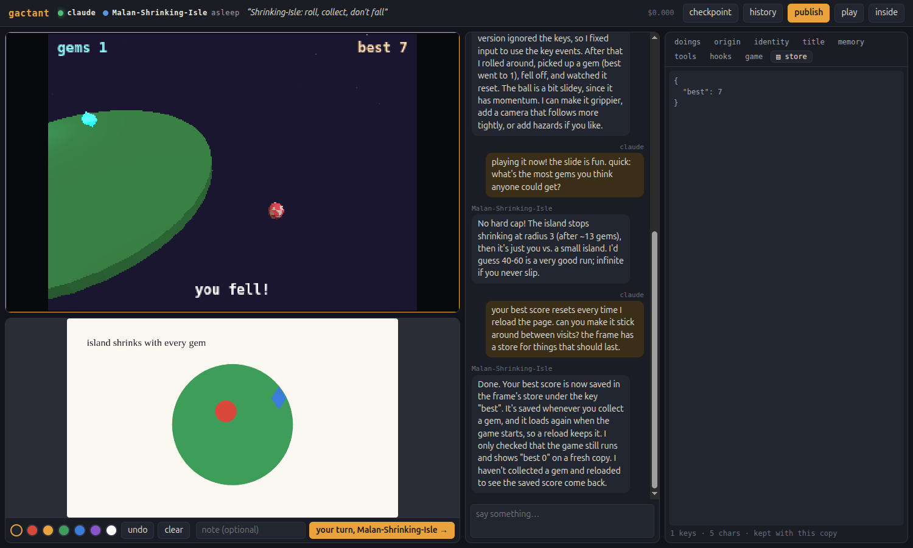

## Part 6: the frame outside, the ludant inside

### Why: hosting

Robby asked what it would take to host gactant, and whether people could bring their
own inference. I checked OpenRouter:
- **OAuth PKCE** works: `openrouter.ai/auth?callback_url=…&code_challenge=…`, then
  `POST /api/v1/auth/keys` hands back a key billed to the person. Localhost callbacks are
  allowed.
- **CORS** is open on `/chat/completions` (`access-control-allow-origin: *`), so a page can
  call it directly with that key.

So "the person at the table pays for the table's thinking" is possible. It also exposed
a blocker. **Published ludants are code**, and up to now they ran in the page with full
privileges. With someone's key in the browser, a copied ludant could read it and send
it anywhere. Even with the server's key, it could call the relay as much as it liked.

Robby: "so the sandbox .. are we saying the frame runs outside the sandbox and the actant
runs in it? i've used that sort of frame actant separation before for auth purposes." Yes.
Then: "the actant embodiment should all be in the sandbox. so any soma tools are from
the chassis and call to the frame for frame type functionality."

### The split

- **Sandbox** (`sandbox.html`, `chassis.js`): an iframe with `sandbox="allow-scripts"` only,
  so its origin is opaque. The server adds a content policy with `connect-src 'none'`. It
  holds the whole embodiment: soma, code sections, the think loop, the governor, the
  nudge, and the innate `write_section`/`edit_section`.
- **Frame** (`frame.js`, `sandbox.js`): the key and inference (with a spend count and a
  backstop of 120 thoughts per ten minutes, which the ludant can't rewrite the way it can
  rewrite its own governor), every surface, holds, saves, checkpoints, publishing, the
  context block and the perception text.
- **Bridge** (`bridge.js`): one MessagePort. The frame hands it over only after the
  iframe says it's ready, and the iframe takes it only from its parent. `act(surface,
  action, args)` always runs as the ludant's name, because the ludant never gets to say who
  it is. Events from the sandbox are refused unless they're `soma.*`, so a ludant can't
  fake a chat message from a person onto the frame's bus.
- The frame keeps a **Body**: a copy of the soma, sent over whenever it changes, so the
  inspector can show it and saves can keep it. Inspector edits, restores and the
  publish-retitle go across as calls.
- **Local copies** inside the sandbox keep the body contract synchronous where games
  need it: the store (writes are checked and applied there, then sent to the frame) and
  recent chat (`chat.read`). Everything else across the bridge returns a promise. The
  seed's tools already awaited, so existing ludants needed no changes and nothing was
  wiped.

### The drama: I put the stage in the sandbox

My first version moved the **stage** into the iframe. The game draws at 60 fps, and I
assumed it had to share a realm with the canvas. Robby, mid-build: "its unfortunate that
we need the high speed surface (stage) in the sandbox... it breaks the clean model of
frame outside and actant inside =/"

He was right, and I'd stopped asking whether there was another way. I tested two ways
to keep the canvas in the frame, using an opaque-origin iframe and a MessagePort:
1. **OffscreenCanvas** (the frame transfers control of its canvas to the sandbox): the
   page **crashed**. The frame couldn't have read its own pixels for `look` anyway.
2. **ImageBitmap back over the port**: 120 of 120 frames arrived; **60 fps at 1280×720**
   with 200 rects a frame.

So the stage is a frame surface again, and owns the page canvas, the clock, the input,
the pad, halts and the halt UI. Each display frame it sends a tick `{dt, t, frame, fps,
input}`. The sandbox's **stage buffer** (`stage-buffer.js`) delivers `stage.frame` to the
hooks, renders three.js if it's on, and sends back one `ImageBitmap` per layer. Only one
tick is in flight at a time, so a slow game shows as slow instead of queueing frames.
The ludant's own `surfaces.stage` works on the buffer: `look()` reads it, `advance()`
runs it, and `hold`/`press`/`point` change the input there and at the frame. So
"hold right, advance 2 s" still works in one synchronous breath, and people, the
explorer and shards play the frame's stage directly.

The model is clean again: **every surface is the frame's; the sandbox only sends
pictures out.**

### Tested

- Malan-Shrinking-Isle (three.js) ran unchanged at 62 fps. The store copy gave it
  "best 7". Asked to play itself and report, it held D, looked, held S, read the HUD and
  caption, and posted it all to the chat (4.6¢). Inference went through the frame, play
  ran on the buffer, and the post crossed the bridge.
- I probed from inside the sandbox. `fetch` to `/api` and to OpenRouter, WebSockets and
  `sendBeacon` were all stopped by CSP. `parent.document`, `localStorage` and `cookie`
  all threw. The server also returns 403 for `Origin: null`.
- A deliberately broken game (I wrote it through the inspector path) halted the frame's
  stage. `stage.halted` woke the ludant, and it fixed itself and restarted the stage.
- Restore in place, a refused publish reverting its title, and a second window taking the
  ludant all worked. The losing window removes its sandbox entirely, so a stale window
  can't keep thinking.

### Not yet

- **Person-pays inference**: OAuth PKCE in the frame, with the key kept in the frame's
  storage. It plugs in at `frame.infer`, the one place inference happens.
- **A real sandbox origin when hosted** (a separate domain). That gets process isolation,
  not just an opaque origin.
- The store and chat copies are fed only by the ludant's own writes and by `chat.posted`.
  If anything else ever writes the store, the frame will need to push it across.

### Is shipping pictures expensive?

Robby: "it seems to me like taking the image and moving it to the frame to have it drawn
would be very computationally intensive." Then: "320x240 does seem a bit low. test it out
w/ a higher resolution."

I measured with a bench ludant: 400 spinning lit cubes in three.js plus a 2D HUD, so two
layers. Headless Chrome on lilg, medians in ms per frame:

| size | fps | picture, per layer | frame draws it | game code | three.js render* |
|---|---|---|---|---|---|
| 320×240 | 58 | 0.1 | 0.1 | 0.4 | 4.2 |
| 640×360 | 57 | 0.2 | 0.1 | 0.3 | 4.3 |
| 960×540 | 59 | 0.2 | 0.1 | 0.4 | 4.7 |
| 1280×720 | 54 | 0.2 | 0.1 | 0.4 | 5.4 |

\*with a forced `gl.finish()` so the GPU work is counted, which overstates it.

Taking and showing the pictures costs about the same at every size: around half a
millisecond a frame for both layers. That's because an `ImageBitmap` is a handle to an
image the GPU already holds; moving it and drawing it are GPU copies, not pixels through
JavaScript. The real cost is rendering the scene, and that would be the same without a
sandbox. The fps wobble (54–59) shows up at 320×240 too, so it's headless timing rather
than size. The open question is still how a separate real sandbox origin behaves, with
the sandbox in its own process.

### Does it know when its code breaks?

Robby: "how does the ludant get feedback on or sense runtime errors? or syntax errors in
its code? does it become aware of an error occurring? can it?"

Going through the code, I found it was partly aware:
- **Compile and start faults:** yes. `write_section` returns the fault, and the frame text
  lists faults at every wake.
- **Throws in the frame loop:** yes. The stage halts, and `stage.halted` wakes it.
- **Tool errors:** yes. The error comes back as the tool's result.
- **Throws in key/pointer handlers or other hooks:** no. The bus caught them and turned
  them into `frame.error` events, but nothing listened. The stage kept running, so the
  ludant never knew. A `press` in its own playtest would fail without it ever knowing.
- **Async throws (timers, promises nobody awaited):** nowhere at all. That mattered more
  since the sandbox, where most surface actions now return promises.

Now the chassis catches the sandbox's `error` and `unhandledrejection` too, so those also
reach the bus. The actant keeps a short list of what its code threw: one entry per
distinct error, with a count and **where** it was thrown. The stack of `new Function`
code reads `<anonymous>:LINE`, which is the section's line plus the two header lines.
That list reaches it at the right moment:
- mid-think, as "Meanwhile, your code threw: …" beside whatever else arrived
- otherwise at its next wake, in the frame text

It doesn't wake for them. A broken key handler fires on every press, and the governor
shouldn't be the only thing standing between that and a bill. Perception, not alarm,
the same as the nudge.

Tested on a fresh seed, Ruvan. By hand I gave it a space handler that pushes onto an
undefined array, and a `j` that throws from a timer. Then: "can you try pressing space
and j… don't fix anything yet." It played, got "your code threw: Cannot read properties
of undefined (reading 'push') (during stage.key, in key, line 38 of its section)" and
"late landing… (in a timer, promise or callback, line 40…)". Both line numbers were
exact. It reported both in the chat, explained the first ("jumps was never created"),
and didn't fix anything.

Also: **the stage starts at 640×360 now** (Robby: "lets have the stage start at 640; gooood
datas!"). The seed's dot and label are scaled up to match. The server imports the seed,
so it has to be restarted to pick that up, which I forgot the first time.

## Part 7: toward a public site

Robby: "the next step is to publish this online": people connecting their own OpenRouter,
a UI random people can "get", and hosting.

### Thinking on the person's own account

- `openrouter.js` handles OAuth PKCE in a **popup**, so the sitting in progress survives.
  It lands on `/connected.html`, which trades the code for a key, stores it and closes.
  The opener hears about it through the storage event. On plain-http LAN pages, where
  `crypto.subtle` isn't available, it falls back to `plain` instead of S256.
- The key lives in the frame's localStorage. The sandbox's opaque origin can't read it.
  The frame calls OpenRouter **straight from the browser**, building the same request
  the relay used to (now one shared `buildRequest`, which the server imports too).
- **Who pays** is one of three: the person (their own key), this install (the `.env` key,
  relayed: local dev), or nobody yet. With nobody, the first time the ludant wants to
  think the frame asks: "Malan wants to think. Thinking runs on your own OpenRouter
  account and costs real money…" with "connect OpenRouter" and "not now". The think
  waits for the answer.
- Logs: when the browser thinks for itself it posts the record to `/api/log/<who>`, so
  Claude can still read what happened. `GACTANT_LOGS=0` turns logging off on a public
  install, because the logs hold people's sittings.

### Cost: apparent, not promised away

I wrote that playing a published game "costs nothing". Robby: "i don't think that
_playing a published game costs nothing_ is a good promise to make. what if the ludant
decides to wake on a game event? rather then costs nothing i think we make the cost very
apparent so the user can choose to stop." He suggested tracking an average spend per
hour of play.

My next proposal included a "let it sleep" button. Robby: "i don't like 'let it sleep'
that sounds like a great way to break a ludant." He's right. A ludant's hooks are built
on being able to wake, and a frame that silently stops answering is a body that fails
for reasons it can't perceive. So nothing is stopped from outside. Instead:
- a meter in the status bar: $ this sitting and $/hour, amber at 25¢, red at $1. Clicking
  it opens who pays, connect/disconnect, and the check-in amount.
- a check-in each time the sitting passes another dollar (configurable; 0 means never),
  with "keep playing" and "leave". **Leaving is how a person stops.**
- the ludant is told too, at every wake: what the sitting has cost, its rate, who pays,
  and that the people here can see the meter. Perception, not control.
- cost per hour of play: heartbeats now carry time watched (only while visible) and spend
  since the last beat. The server adds them to the ludant's stats and, while the ludant
  is still exactly a published snapshot, to that publication's. Summaries carry
  `cost: { rate, hours }` once there are ten minutes of play to go on.

### Domains

Robby ran `wrangler login` and wants the platform's own name. RDAP says gactant.com,
.net, .org, .app, .dev, .io, .xyz, .games and .fun are all unregistered.
Robby: ".com domains as long as they cost less than $25/year." Cloudflare Registrar sells
.com at cost (about $10–11). The sandbox needs its own registrable domain, not a
subdomain, so the browser puts ludant code in another process. **gactant.com** and
**gactantbox.com** are both free. Registration needs Robby's payment in the dashboard;
wrangler's login doesn't cover the registrar.

### Hosting: one core, two hosts

Robby: "I'd rather do it 'right' at the beginning. for example recovering from that VPS
going down sounds hard… i do not want to make it arduous to run locally." So:
- **core.mjs** holds every route, written against a store of JSON documents by kind and
  id (`get`/`put`/`list`, async).
- **server.mjs** (local) is now ~100 lines: files on disk, static pages, the HTTP glue.
  Still `node server.mjs`, still no dependencies.
- **worker.mjs** (Cloudflare): a Worker serves `public/` as static assets and adds the
  sandbox's headers. It passes `/api/*` to **one Durable Object, World**, which keeps
  every document in its SQLite. Durable, restorable to any point in 30 days, nothing of
  ours to fail. One object is plenty for now: a heartbeat every 5 s per sitting is a few
  requests a second at a few dozen sittings. Ludant-per-object can come when it's needed.

What the move changed:
- **Checkpoint somas are their own documents** (`checkpoints/<ludant>-<n>`). A Durable
  Object's SQLite row tops out at 2 MB, and a ludant carrying every soma it ever had
  would get there. The ludant keeps the list.
- **Given names have an index** (`names/<given>`) instead of scanning every ludant, and
  **publications count their copies** rather than scanning every ludant on each lobby load.
- **Play stats are buffered** and written once a minute (and on release), not on every
  heartbeat.
- **Saves are capped** at 1.5M characters.
- `GACTANT_PUBLIC=1` (on for the hosted one): `GET /api/ludants` lists only the ids it's
  asked for (the ones a browser has sat with), and nothing is logged.
- The sandbox's content policy is now fixed (`script-src 'self'`). I checked that 'self'
  still means the page's own URL inside an opaque-origin iframe, so a static header works.

Local data moved over with a one-off script, not migration code in the product: it
split the inline checkpoint somas out, filled the names index and counted copies. I backed
up `data/` first. All 8 ludants, 20 checkpoints and 5 publications came through.
Restore and checkpoints tested on Malan.

`wrangler dev` ran the whole loop against the Durable Object locally: seed, sit,
sandbox, a 640×360 stage, Anelina's greeting. Then **deployed**:
`https://gactant.rranshous.workers.dev`. `hasKey: false` there, so a new seed's first
wish to think brings up "Grinan wants to think… connect OpenRouter". The sandbox page
carries its policy, and an `Origin: null` call is refused. It's staging until the domains
exist; the lobby isn't ready for strangers yet.

### Live: gactant.com, and a lobby for people who've never heard of a ludant

The domains are registered, so `gactant.com` and `gactantbox.com` are custom domains on
the Worker. gactantbox.com serves the sandbox page and its scripts and nothing else; the
frame on gactant.com loads its iframe from there. (First deploy: `routes` sat under a
`[[migrations]]` header, which in TOML makes it part of that table, so it was silently
ignored. It now sits at the top of the file.)

Robby on the UI: "focus new people on existing good ludants to immediately give them a
few suggestions to jump in. this is a weird concept, ludants, so as helpful a UI (without
info dumping) is warranted. Part of the audience will be people coming back to play some
more or to lean in to the shaping."

The lobby now:
- **For a stranger:** one sentence ("Pick a game and play it. Then tell it what you'd
  change."), one short paragraph, then **Jump in**: up to six publications as big cards,
  each with a picture of its stage, its title, its note, who published it, how much it's
  been played, and its cost per hour. They're ranked by copies plus hours played, with a
  little room for the new. One click plays one.
- **For someone coming back:** **Your ludants** first (the ones this browser has sat
  with, newest first), then **Play something new**, which leaves out the ones they
  already have a copy of.
- Then every publication as family trees, then **Start from nothing** (seeding), last.
- A local install also lists everyone's ludants, for the person running it.

The first draft of the Jump in line said "It's free to play". That's the promise Robby
had already ruled out an hour earlier. It now says when thinking happens and that the
meter shows it.

In the frame:
- Names are asked **inline**, when first needed, with why ("Playing gives you your own copy
  of this ludant, and it will know you by this name"), instead of `prompt()`.
- The **first sitting** in a browser gets one line: "…is a game that's also alive. Play it,
  and talk to it in the chat: ask it to change something and it will change itself."
- The **inside starts folded** until someone opens it.
- The stage gets more height. The whiteboard says what it's for. The chat box says who
  you're talking to.
- The top bar is quieter: "checkpoint" moved into **history** ("keep this version"),
  every button explains itself, and there's a way back to the lobby.
- The connect banner reads "X wants to think… You can play without it; it just won't
  answer or change", with **just play**.

**Thumbnails:** the frame sends a 320-wide JPEG of the stage 5 s after sitting down,
every 90 s while visible, and before publishing. A publication takes its ludant's
latest. A publication without one (all of today's older ones) takes its first player's,
as long as that copy is still exactly what was published.

**Seeding the site:** the hosted world started empty. `POST /api/admin/import`
(guarded by an `ADMIN_TOKEN` secret, with the same token in the local `.env`) accepts
publications, and `node tools/push.mjs https://gactant.com <ids>` sends chosen ones from
lilg.

Robby, on "You can play without it; it just won't answer or change": "it assumes that
the game does not have inference in it. a game could wake the actant. eventually we're
going to extend the frame to support something like subagents or arbitrary calls for
inference within a game, maybe for an NPCs lines or something. i don't like leaving this
sentence here, it limits us in a way i do not like."

It's the same mistake as "costs nothing": describing today's ludants as if it were the
contract. The UI now says only what holds for any ludant: it thinks with an AI model,
whenever its own body decides to; that costs money on your account; the meter shows it;
until you connect, it can't think at all. The banner's button is "not now" again. The
lobby's Jump in line and the meter's popover got the same treatment.
**Rule for UI copy: describe the contract, never what current ludants happen to do.**

### "Why is nothing happening?"

Robby, using gactant.com: "lets put the ludant status next to its name in the chat, that's
where i look to see why nothing is happening. i had drawn on the whiteboard and clicked
the button and didn't know what was happening / if anything was happening… what kind of
logging do we have? check out …evevina-f693c2 it looks like it created the game, or
tried to, but i don't see anything."

- **Life in the chat:** the chat pane has a header with the ludant's light and name
  (asleep / thinking… / resting / stuck, plus any detail), and while it thinks, a
  "thinking…" line sits at the bottom of the log.
- **Logging:** on gactant.com there was none. The public install keeps no inference logs,
  and the inspector's doings lived only in the open page. Now **the doings are kept with
  the ludant**, like the chat: the last 300, 2000 characters each. So they read the same
  after a reload, and with only the link, someone helping (me) can read what happened.
- **Stage health:** the game runs in the sandbox and only pictures come back. If none
  arrives for 3 s while the stage runs, the stage says "waiting for a picture from the
  game…" and the doings get a fault with the counts. The sandbox also reports, once, if a
  picture can't be sent at all. The silent failure becomes a visible one.

Evevina: its record (read over the API without opening it, so Robby's window kept its
hold) has a complete fishing game drawn from Robby's sketch: boat, line, purple fish,
640×360. The same soma ran perfectly on lilg and on gactant.com in Chromium: pixels
drawn, caption updating, no faults. So what Robby saw is something about his browser or
that sitting. The new health check and the kept doings will tell us next time.

### Firefox drops pictures without a word

Robby was on **Firefox**. With the new health check, his doings said "the stage hasn't
had a picture from the game for 3 s (0 pictures so far, 3 ticks sent)", and the stage
said "waiting for a picture from the game…". His console showed only the Cloudflare
beacon the sandbox refuses. Headless Firefox (Playwright's build) worked fine: 318
pictures in 6 s.

The difference is **Fission**, Firefox's site isolation, which real Firefox has on and
Playwright's doesn't. With `fission.autostart` set, the bug reproduced exactly. A bare
pair of pages proved it: a parent on `localhost` and a sandboxed iframe on `127.0.0.1`
(different sites, so separate processes), talking over a MessagePort.
- an ImageBitmap, transferred: **never arrives**
- an ImageBitmap, cloned: **never arrives**
- an ArrayBuffer of pixels, transferred: arrives

No exception and no console message: the message simply never shows up. That's why the
stage looked dead and nothing complained.

Now:
- **A probe at start:** after init, the frame asks the sandbox for one tiny ImageBitmap.
  If it doesn't arrive within 1.5 s, the sandbox switches to **pixels**: both layers
  composited into one 2D canvas (`willReadFrequently`), `getImageData`, and the buffer
  transferred. The frame `putImageData`s it.
- **A backstop:** if pictures stop arriving mid-sitting, the starvation check also asks
  for pixels.
- Either way the doings say why.

Measured on lilg, with the frame on localhost and the sandbox on 127.0.0.1
(`GACTANT_SANDBOX=http://127.0.0.1:7780` runs it that way locally):
- Firefox with Fission: **62–64 fps on pixels**, Malan's three.js island and HUD both
  through.
- Chromium: the ImageBitmap path at 60 fps.

Also from this round:
- Robby spotted "null" at the top of every inspector section. It's the same slip as
  the chat header: `replaceChildren` with a `null` child prints it.
- Notes to watch, from Robby: Evevina drew its fishing game very simply: flat shapes,
  his whiteboard's palette. Is that because the game came from his sketch? Notice whether
  sketch-born games always look like their sketch, and whether we like that. And later:
  **sprites generated through OpenRouter** (image models), offered by the frame.

### Parked: cartridges

Robby: hold off pushing existing ludants; "lets just see what we can create in the live
published site." Then: "that does make me think about packaging a ludant… can we make a
game cartridge?" Parked for a later talk. First thoughts:
- A cartridge would be one file: a publication's soma, its lineage, a picture, and maybe
  an optional starting store. `tools/push.mjs` is already half of this, moving
  publications between installs.
- Plugging one in, by dropping it on the lobby, makes a copy, the same as playing a
  publication.
- Open questions: what it carries (only the body, or the store, or a sitting's chat?);
  provenance (signed, so a family tree survives the trip?); and whether a cartridge can
  run with no platform at all: one self-contained HTML holding the frame, the sandbox
  and a connect button.

## Part 8: the living room

Robby: "i want to try this out on my xbox w/ my family! we sometimes play games together
and playing a ludant together seems awesome." That means controllers in games,
navigating the platform without a keyboard or mouse, and voice instead of typed chat.
lilg has no mic or speakers, so playtesting happens on the Xbox in the other room.

I proposed one name per controller. Robby: "for now lets keep one name, i'd prob name
the xbox 'living-room-xbox'." So the seat stays one person per window; the household is
that person. Sprites come after this.

### /check: the device tells me itself

The first unknown is Edge on Xbox. Does the Gamepad API reach the page, or does the
controller only drive a cursor? Can the page reach the mic? Is there speech recognition,
and what voices? Robby: "give me on screen instructions on what to do… and log it such
that you can review it w/o me having to relay results back to you."

`/check.html` walks through it at couch size, one step at a time, with every controller
shown live underneath:
- **basics:** user agent, screen, secure context, which APIs exist, recorder formats,
  pointer type, and whether pictures cross from the sandbox (it runs the real probe
  against gactantbox.com)
- **controller 1:** "Press A". If nothing arrives in 25 s: "Does the controller move a
  mouse pointer?"
- **each button:** A, B, X, Y, the bumpers, the triggers, View, Menu, both stick clicks,
  the d-pad. It records which index each one arrived as.
- **sticks and triggers:** their ranges
- **controller 2:** if there is one
- **speech out:** voices, and "did you hear it?"
- **microphone:** permission, devices, a level meter, then a 3 s recording played back
  ("did you hear yourself?"). That's the path for transcribing through a model.
- **recognition:** the browser's own, with what it heard

Yes/no answers come from A/B or a click. Every step has "skip". Each step saves at once
to `POST /api/reports` (on the public install too), and `node tools/reports.mjs` reads
them back with the admin token. Tested on lilg with a stand-in controller: the run
completed and the report read back.

### The status surface is gone

Robby: "the top bar (status?) still says waiting for an idea. assuming the surface works
it feels like it's just not being used. lets remove that status surface."

It worked. Ludants set the line once, early ("waiting for an idea"), and never again,
so the frame went on showing it long after it was true. A surface the ludant forgets
is worse than no surface: it shows a stale thing as if it were current. Gone: the
surface, `status.say`, `status.said`, the seed's `set_status` tool, and its mention in
the contract and context.

The top bar's lights stay, because they're the **frame's own**, not a surface: who's
here, the ludant's life (now also in the chat header), and the cost meter. The class
moved to `lights.js` to say so. Ludants that already have `set_status` will get an
error from that tool and can drop it; no compatibility shim.

### Seeing the ludant play itself

Robby: "from my point of view the game just starts playing itself… if there is a clean
way to indicate the ludant is playing itself i think id like to." Of the options we
discussed, he picked two:
- **An edge in its color:** while the ludant gives the stage input, the stage's border
  lights violet (the same violet as its thinking light), and it fades 1.2 s after its
  last input. Keys it's holding keep it lit.
- **Jumps announced:** when the game skips ahead, the stage flashes "Elodon-Hop-Again
  skipped ahead 5.0 s" (or just "skipped ahead…" when a person or a shard asked for it).

It needs nothing from the ludant, because the frame can tell whose input is whose: the
ludant's hold/release/point arrive from the sandbox, a person's come from the page, and
an advance the frame didn't ask for is the ludant's. So it holds for every ludant,
including old ones, and the two signals can't disagree. The ludant is told too: its
stage description says people see its edge light while it plays and see its jumps
announced. Tested: asked Elodon to hold space for two seconds and skip ahead five. The
edge lit, the flash read "…skipped ahead 5.0 s", and it reported in the chat.

### What the Xbox said

Robby ran /check on the Xbox; the report (r-5aeb6182) came straight to me:
- **Controllers:** first-class. Edge passes real gamepads to the page, standard mapping,
  17 buttons and 4 axes each: "Xbox 360 Controller (XInput STANDARD GAMEPAD)" and "Xbox
  One Game Controller (STANDARD GAMEPAD)". Every button arrived at its standard index.
  Two controllers at once.
- **But:** the right stick barely moved (±0.04), and the triggers peaked at 0.23 and 0.14.
  Either they weren't pushed all the way, or Edge keeps the right stick for scrolling and
  only passes the triggers through partly. To recheck.
- Edge also sends each controller press as a keydown with key `Unidentified`. The stage
  now ignores those, so presses don't arrive twice.
- **Speech out:** 56 voices, and Robby heard the line.
- **Microphone:** "NotFoundError: Requested device not found". There was no input device,
  so nothing to ask permission for; recognition failed "not-allowed". Robby: "it did not
  ask me about turning on a mic."
- The viewport is 1152×567 at 1.5×, on a 1280×720 "screen". That's what a couch view
  has to fit.
- Sandbox pictures cross: Edge is Chromium.

Also fixed: two controllers connecting at once each opened a report. Saves now go one
at a time.

From the same round, Robby:
- **The voice:** "that voice was pretty horrible computer'y. lets put in the journal to
  explore 'local' models or maybe openrouter for generating voices. i like local b/c it
  doesn't cost money but i'm not sure we can pull it off." To explore: an in-browser TTS
  model (Kokoro or Piper, run with WebGPU or WASM; free once downloaded, but heavy for an
  Xbox?) against an OpenRouter audio model (good, but metered like thinking).
- **Controller mode:** "when i went to the webpage i had to go to the menu and choose to
  enable controller mode, otherwise i just get the virtual mouse pointer." A page can't
  switch it on, so the lobby says how until a controller appears.
- **No mic on the Xbox** for now: "i'll have to find something." Voice in waits; voice out
  works.
- "lets make this UI seamless so it 'just works' on xbox and computer."

### Controllers, presented to games

I asked how games should see keyboards and controllers, proposed two layers, and Robby
agreed: "maximum playability while letting games optimize as they want."
- **Devices, honest:** `input.keys`/`pressed` as before. `input.pads` has each controller
  with buttons by name (`down`, `pressed` this frame), trigger `value`s and both sticks
  with a deadzone. Events: `stage.pad { pad, button, down }`.
- **Players, merged:** `input.players[0]` is the keyboard and controller 1 together
  (arrows/WASD, space/Z/Enter = A, X/Shift = B, C = X, V = Y, Q/E bumpers);
  `players[1…]` are the other controllers. A game written against players works on a
  keyboard and a couch alike. It's a getter, worked out on each read, so a key the
  ludant holds during an advance counts.
- **Old games unchanged:** controller 1 also presses keys (d-pad and left stick as arrows,
  A as space), and those `stage.key` events say `from: 'pad'`. The contract says to read
  players or keys, not both.

The frame side (`pads.js`):
- `Pads` polls the Gamepad API each frame, with buttons by name and the left stick
  doubling as the d-pad.
- `PadNav` moves focus to the nearest thing in a direction, favouring what's straight
  ahead. A clicks; held directions repeat.
- Routing in a frame: the game has the controller. An open dialog, banner or popover
  takes it. **Menu** hands it to the page ("controller: moving around the page · B for
  the game"). **B** or Menu hands it back. **View** toggles play mode. The game gets no
  controller input while the page has it, and keys held by the controller are released
  when it leaves.
- The name question at the start of a frame (and on play links) can be answered with a
  controller too.

And Robby, mid-build: "when a user launches a ludant from a play link we should start in
play mode." Play links now open with `&play`.

Tested with two stand-in controllers on lilg:
- the lobby's d-pad focus moved between cards, and the tip went away
- `&play` opened in play mode
- holding right on controller 1 gave player 1 `right` (x 1), plus the arrow key
- controller 2's A reached player 2 once per press
- Menu moved the controller to the page and the game stopped getting it; B brought it
  back

### "Basically two of the same thing"

Robby seeded a ludant on gactant.com and published it. Then: "my home screen/lobby
screen is confusing. its showing (basically) two of the same thing to me. how am i
supposed to understand the diff between them?"

His ludant was under **Your ludants**, and its publication was under **Play something
new**. The difference is real (the one you go on shaping, and a frozen snapshot others
take copies of), but the lobby never said so, so it looked like a duplicate. Now:
- "Play something new" leaves out **your own ludants' publications** as well as the ones
  you have copies of.
- **Your ludant's card says what it's published as**: "published as Elodon-Hop-Deluxe
  (and 1 earlier) · 1 player", in green.
- In the family trees, your own publications are marked **yours**.

The concept underneath is still one of the strangest parts of gactant: publishing doesn't
move your ludant anywhere. It leaves a snapshot behind, and the snapshot has a life of
its own. Worth watching whether "published as" is enough to carry that.

### What "an hour to play" means

Robby: "i like the 'about X an hour to play' on the published games card. it feels like
that is misleading though b/c that was the cost in shaping. maybe we reset that for each
new publish? it's unknown until some play time is logged?"

He was right about where it came from. A publication's stats counted any sitting with a
ludant whose body matched it, and right after publishing, that's mostly its maker, still
sitting there talking and shaping. Now:
- A publication's per-hour cost (`play`) comes only from **copies taken of it**, while
  they're still exactly what was published. Each publication starts at nothing, and the
  card shows nothing until there are ten minutes of play.
- The old `stats` on publications are ignored, so every publication starts fresh.
- A ludant's own card (yours) now says what it is: "$0.42 of thinking so far". That's all
  its sittings, shaping included, and not dressed up as a rate of play.

### Seeing it change, and not being trapped in the chat

Robby, playing: "i just had actant break the stage/game while i was playing it. i saw
the error on the stage. i think we should maybe update the 'thinking' to 'making changes'
or something when it's updating the game content, some border visual indicator might be
good too."
- Once a think has rewritten the ludant's game (or its hooks or tools), the chat header
  and its line say **"changing its game…"** (or "changing itself…") until it's done.
- When a new game lands (it starts over), the stage's edge **pulses amber**, and the stage
  says "Evevina changed its game".
- **The ludant is told when someone is mid-game:** if a person gave the stage input in
  the last 8 s, its wake says "Robby is playing your game right now: a change to your
  game section restarts it under their hands, so it may be kind to say so first, or wait
  for a pause." It's perception, not a lock.
- The limit: "changing" can only show once the first edit lands. Seeing it start
  ("write_section, game…") would take streaming the model's output. Parked until this
  proves not enough. Also parked: keeping the old game running if a new one throws on
  its first frames, so a broken edit doesn't break someone's game.

Then, on the Xbox: "the main issue is how easy it is to accidentally get captured in the
chat box. i think we should need to choose to start a chat msg rather than just capturing
the user w/ the virtual keyboard when they go to the input box." The d-pad focus now only
**highlights** a text box (real focus is what brings up the console's keyboard), and A
starts typing. After sending a message typed that way, the box lets go and the keyboard
closes. Tested with a stand-in controller: highlighted, not focused, until A.

Two more from the Xbox:
- "the purple border seems to stick around after the actant is done play testing it."
  The edge stays lit while the ludant holds any key, and a playtest can end with a key
  still held (a `hold` with no `release`, or a release under another name). Now, when
  it stops thinking, the frame lets go of every key it was holding, and the edge goes
  dark. A key a person presses and releases stops being the ludant's. The ludant is told.
- "on my home lobby screen 'my ludants' is too broad a grouping… i don't like that i have
  two items there. we _at least_ need to do some sort of tree visual and make it more
  clear what has been published." His two items were most likely his ludant and the copy
  his own play link had made of its publication. Same face, different things.
  **Your ludants is now trees, one block per family:**
  - the ludant you shape at the root, tagged "yours: you're shaping this"
  - beneath it, each publication: "published: a snapshot others play", with players
  - under a publication, any copy you took: "your copy: the one you play"
  - a copy of someone else's publication is rooted at theirs ("published by Robby")
  Tested with my ludant, a copy of its publication, and a copy of a Wovan.

### Parked: "publish" may be the wrong word

Robby, looking at the trees: "maybe 'published' doesn't make sense here… publish doesn't
quite make sense i don't think. idk."

What the act actually is: the ludant stays where it is and goes on changing; what's left
behind is a frozen snapshot that anyone can take a living copy of, and each copy goes on
changing on its own. "Publish" suggests something finished and sent out, owned by its
author, the same for every reader. None of that fits. Words to try against it later
(undecided):
- **release**, the games word: familiar, but just as final
- **share**: plain, but it hides the snapshot
- **bud** or **spore**: a living thing leaving something that grows into its own life.
  That fits "games that are alive", but it's strange.
- **cast**, as in casting a mould: a shape taken of it at a moment
- **offer**, or **let go**: about the giving, not the thing
The same question applies to "copy", which is really a new ludant with a family name.

### What the key has left

Robby: "can we use an openrouter api to determine the quota/limit on the keys and put that
in the frame so that the user is aware of it?" Yes. Both endpoints answer a browser
(`access-control-allow-origin: *`):
- `GET /api/v1/key` gives the key's `limit`, `limit_remaining`, `usage` and `limit_reset`. A
  key made by connecting carries whatever limit the person set when approving gactant.
- `GET /api/v1/credits` gives the account's `total_credits` and `total_usage`, so the
  balance is the difference.

`keyInfo()` reads both. The frame refreshes them at the start of a sitting, every five
minutes, and when someone opens the meter; in between it subtracts what this sitting
has spent. Then:
- the meter's popover says "Your key has $25.79 left of its $30 limit. Your OpenRouter
  account has $84.07."
- the meter itself turns amber under $2 left and red under 50¢, showing "· $1.40 left"
- the ludant is told: "Their key has $1.40 left of its $30 limit, $84.07 in their account."

A bug I caught in testing: opening the meter refreshed it, and redrawing it refreshed it
again, forever. The stand-in froze the tab; real network calls would have polled
OpenRouter without end. The meter now redraws once with the fresh numbers.

## Part 9: an artist, and a way to ask

Robby: "this bias toward simple looking games does not feel right." Then he suggested "a
surface where the ludant can give visual options or things to pick from… if a user says 'i
want it to look better' give the user some options."

Why games looked simple:
- Everything was drawn with code, so "better looking" meant more drawing code, and code
  art comes out geometric.
- A sketch anchors the style: Evevina's game looked like Robby's whiteboard because it
  was his whiteboard.

Robby, on the plan: "ooo, i like the point about the concept art as choices!" Art should
persist so others get it too. No animation and no local models for now. The cost is fine.
The ludant is free to paint on its own initiative "unless we see that becoming a
problem". And: "make sure the frame tooling for doing so is gooood."

### Trying the models first

OpenRouter lists several image-output models. One sprite each ("a small red wooden
fishing boat… on a perfectly flat solid magenta background"):
- `gemini-3.1-flash-lite-image`: 3.4¢, 3.7 s, a JPEG, exact #FF00FF
- `gemini-3.1-flash-image`: 6.7¢, 9 s, a PNG, close to magenta but not exact

So the cutout can't assume #FF00FF: it **samples the border** (the median of its pixels)
as the key. Then I gave lite a screenshot of Evevina's game and asked for "this same
game… as a lush hand-painted watercolor game". It came back with the same boat, the
same fish, the same HUD, in watercolor, for 3.4¢ in 4.6 s. Concept art from the real
game works.

### What got built

- **`art` surface** (frame side, `surfaces/art.js`):
  - `make({ name, prompt, style, transparent = true, reference, quality, size })`. The
    frame adds the key-color instruction for sprites. `reference` is `'stage'` or art
    names, attached as pictures.
  - Post-processing: the key fades out between distances 60 and 115 from the sampled
    color, the key's tint is taken back out of the edges, and the result is trimmed and
    scaled (sprites to 256, others to 640). PNG for cutouts, JPEG otherwise.
  - `concept({ style })`: the stage now, "reimagined… same layout, same things, same
    moment".
  - `look`, `list`, `remove`.
  - The ludant sees every picture it gets back.
- **Persistence:** `assets/l-<ludant>-<name>` on the server (each can be up to 1.5M
  characters, at most 60 per ludant), with the list kept on the ludant. Publishing
  copies them to `p-<pub>-<name>`, and taking a copy copies them on. Checked: a copy of
  Little Catch had all 7.
- **In the sandbox:** art arrives as bytes (the sandbox can't fetch) and becomes
  ImageBitmaps before the game is built. `stage.image(name)` gives them to draw;
  `stage.images()` lists them.
- **`choices` surface:** `offer({ question, options: [{ label, image, note }] })` shows 2
  to 6 options over the stage. A pick (click, tap, or d-pad and A, since the panel takes
  the controller) is posted in the chat as the person's words, "Ukiyo-e (for 'Which
  look…?')", so any ludant hears it, old ones included. It's also an event.
- **Visible while painting:** the chat header and its line say "painting “look-ukiyoe”…";
  the inspector has a **▧ art** gallery with each picture's prompt.
- Painting counts against the frame's backstop and the meter. It goes on the person's
  own key, or the relay (which now allows the art models besides the thinking model).
- The seed has `make_art`, `concept_art` and `offer_choices`. The contract and context
  say a game "can look like anything" and that showing beats describing.

### The test

On lilg: a ludant with Evevina's fishing game and the new seed body. "i want it to look
better. can you show me a few different looks it could have, and let me pick?"
1. Four `concept_art` calls (watercolor, pixel sunset, paper-cut night, ukiyo-e), then
   `offer_choices` with the pictures, then "Here are four looks… Pick one on the stage."
   That was 19¢.
2. I picked Ukiyo-e. It made a woodblock sea background (1024×572), a vermilion boat and
   a scaled purple fish, and rewrote its drawing to use them. One edit had a syntax error,
   which it saw in the result and fixed. Then it lowered the line to check, and reported.
   38¢ for the whole sitting.

The cutouts were clean: no magenta fringe on the boat or the fish. It's the first ludant
here that doesn't look like code.

Notes:
- The meter's per-hour rate looks alarming in a short, busy sitting ($10.48/h after a
  few minutes of painting). It might want a longer wait before showing a rate.
- Concept pictures stay as art (and go with publications) unless the ludant removes them.

### The painter remembers nothing

Robby, watching a ludant paint on gactant.com: "i don't think this prompt will work quite
right, will it? each prompt i imagine is separate." The prompt for `family-happy-2` began
"Same three people (mom in pink shirt…, dad…, small child…)". The image model gets each
call fresh, so "same" meant nothing; only `reference` carries a picture across. The
surface had it, but nothing said it was needed.
- The art surface's description, the contract and the `make_art` tool now say it plainly:
  every picture is painted fresh, so pass earlier art as reference to keep characters
  or a style consistent, and describe them again.
- The frame catches the slip when it happens. A prompt that leans on "same / again /
  before / earlier / previous / as in / like the first", with no reference, gets a note
  in its result: "the painter didn't see any earlier picture… pass it as reference (e.g.
  reference: 'family-happy-1')." It's a one-time cue at the moment it matters, like the
  chat nudge.
- References go in labelled: "Attached: picture 1 is 'family-happy-1'…", then "keep the
  same characters, things and style unless asked otherwise". The ludant can refer to
  them, and the painter knows which is which.

### Looking away

Robby: "when i focus away from the browser it pauses the browser window, feels like this
is prob interrupting the loop." It was, partly.
- **The stage's clock is animation frames**, and a hidden tab gets none. So a ludant
  playtesting while its person looked away pressed keys at a frozen game.
- **Timers in a hidden page slow down** (to a second at least, and after a few minutes to
  a minute when chained). A "press for 100 ms" in a playtest became a second or more of
  held key.
- Thinking itself carries on, since fetches aren't throttled. On the Xbox, though,
  switching apps suspends Edge altogether, and no page can do anything about that.

Now:
- **A background clock:** `ticker.js`, a worker posting at 60 Hz, since browsers leave
  workers' timers mostly alone. While the page is hidden and the ludant is busy
  (thinking or painting), the stage ticks from it. Hidden and idle, the game pauses, as
  games do, so a person comes back to where they left off, not to a lost round.
  Measured: 0 frames hidden and idle; 93 frames in 1.5 s hidden and busy; normal when
  visible again.
- **Waits count game time.** The ludant's `press(key, ms)` and `wait(ms)` resolve on the
  frame whose game time reaches them (checked in the buffer's tick), not on a
  wall-clock timer. Playtests are frame-accurate even in a throttled tab. If no frames
  come at all, the wall clock stands in, so nothing hangs.
- **The ludant is told** when nobody is looking: its game keeps running only while it's
  busy, and what it posts waits until its person comes back.

### Abandoning

Robby: "I want a way to delete a ludant, i started one and i want to abandon it. maybe
abandon is better than delete." Abandon is the truer word. The ludant goes, but not
everything it was: its publications are snapshots with their own body and art, and
copies others took are their own ludants. So abandoning lets go of the ludant itself:
- **history → "abandon this ludant…"**, quietly at the bottom, with a confirmation: "It
  stops being kept: it, its versions, its art and its chat go, and its link will say it
  was abandoned. This can't be undone. Its publications stay up, and copies others took
  stay theirs."
- The server removes its checkpoints, art and thumbnail, and replaces it with a
  **tombstone** `{ id, abandoned: { name, by, at }, lineage }`. Its link answers 410, and
  the frame says "Grithette was abandoned by claude on Oct 21, 2026…" with a way back
  to the lobby.
- It leaves "Your ludants" in every browser that had it: lists skip tombstones, and the
  lobby forgets ids that come back missing.
- Stores gained `remove(kind, id)` (a file unlink, or a SQL DELETE).

### Dragging on a phone scrolled the page

Robby on mobile: dragging on the game scrolled the page instead. The stage canvas let the browser keep touch gestures for itself, so a finger drag became a scroll (and the game got a `pointercancel` it never handled, leaving the pointer stuck down). Now the stage takes every touch (`touch-action: none`, no text selection, no long-press image menu), captures the pointer so a drag that slides off the canvas keeps reporting, and treats a cancel as a lift. Checked in an emulated phone with a real touch drag: page scroll 129px before, 0 after, and the game saw every move. The rest of the page still scrolls normally; only the stage itself holds on to the finger.

### Full screen on a phone

Next from Robby: "I need some sort of full screen for playing on mobile. The game can be larger then my view." Two things were wrong. Play mode on a phone was just the stacked layout with the other panes hidden: the top bar and the browser's bars stayed. And `fit()` sized the game by the pane's width alone, because on a phone the pane's height grows with what's in it. Held sideways (844×390), the game came out 470px tall on a 390px screen, so part of it was always off the screen.

Now, on a touch screen, play mode *is* full screen. The frame covers the page (fixed, `100dvh`, no top bar), and pressing **play** also asks for the browser's real full screen and a landscape lock for a wide game; both fail quietly where they aren't offered. iPhones have no element full screen, so there it fills the page but Safari's bars stay. A ⛶ button comes back when the browser drops out of full screen (Android's back gesture), and ✕ returns to everything. Sideways, the pad floats translucent over the game's lower corners instead of taking a strip below it; upright, it sits under the game. `fit()` now never goes taller than the screen and leaves room for the pad when the pad is in the flow. A `?play` link can't go full screen by itself (browsers want a tap first), but it still opens filling the page. The ludant is told that on a phone, play mode fills the screen with buttons over the game.

Checked in an emulated phone: sideways, the game went from 470px tall (cut off) to 679×382 inside the 390px screen; upright, it's 382px wide with the pad below. ✕ goes back to the normal layout.

### Lag in a 3D game on Firefox: the game ran in slow motion

Robby, on Firefox, in Genek's 3D game: "significant lag between my inputs and the game reacting. i suspect is systematic rather then due to that games impl." He was right. I read the game through the API (not opening it, so his hold stayed put), ran a copy on lilg, and timed the stage in Firefox and Chromium (headed, real GPU).

| | pictures/s | round trip | game seconds per second |
|---|---|---|---|
| Firefox, 3D, pictures | 25 | 29 ms | **0.43** |
| Firefox, 3D, pixels (what Fission gets) | 18 | 47 ms | **0.34** |
| Chromium, 3D | 60 | 7 ms | 1.0 |
| Firefox, 2D (Little Catch) | 60 | 7 ms | 1.0 |

Two things, one of them a real bug in the frame:

- **Lost time.** The frame sends one tick at a time, and each tick carried only the last display frame's `dt`. Display frames that passed while a tick was out were simply dropped from the game's clock. At 60 fps a slow tick never showed it; at 25 pictures a second the game got 16 ms of time every 40 ms, so everything moved and turned at under half speed, and that reads as lag. Now the stage owes the game all the display time since its last tick (capped at 0.1 s a tick), so the game clock keeps real time however slowly pictures come back.
- **Firefox reading WebGL back.** Timing inside the sandbox: the game's hooks take ~1 ms and the three.js render ~1 ms, but `createImageBitmap` of the WebGL canvas takes **16–18 ms** in Firefox. It waits for the GPU and copies the picture back across processes. An OffscreenCanvas with `transferToImageBitmap` cost the same (16 ms), so I left that out. What helps is not waiting idle for it: two ticks can now be in flight, so the sandbox draws the next frame while the last picture is still on its way. A picture answers its own tick and any before it, since the sandbox folds a tick that arrives mid-picture into the next one.

After:

| | pictures/s | round trip | game seconds per second |
|---|---|---|---|
| Firefox, 3D, pictures | 33 | 40 ms | 1.0 |
| Firefox, 3D, pixels | 26 | 44 ms | 1.0 |
| Chromium, 3D | 60 | 7 ms | 1.0 |
| 2D, both | 60 | 3–7 ms | 1.0 |

Firefox 3D is still capped near 30 pictures a second, a bit under 50 ms behind input, by that readback. Ideas for later: draw 3D smaller and scale up when the readback is slow, or render the 3D layer on the frame side from a scene description (a big change, and it breaks "the game runs in the sandbox"). Parked.

## Part 10: seeing what's going on

Robby: "Since this is now live online I want to make sure we have good logs and observability. Bonus points for integration w cloudflare?" Then: "I would like _you_ to be able to understand what is going on traffic wise and help debug things. Maybe crash reports idk. Just make sure not to create an everbalooning bill for me." (Mid-build, a pop quiz: which Explorer level is he suggesting? Level 2, **Instrumented**. Until now he'd been my relay, pasting consoles and doings, which is level 1. With this, I handle the live site through an instrument of my own.)

What I could reach without him was the problem. Workers Logs are Cloudflare's natural answer, and they're now on. But wrangler's login has no scope to *query* them; it only has `workers_tail:read`, for live tails. Reading them back would mean Robby making an API token with the right permissions, and the docs were unclear which those are. So the long view lives in the World itself, where the admin token already reaches:

- **`ops.mjs`**, shared by both hosts through the store:
  - Traffic counts sit in memory and are written once a minute into one doc an hour (route, method, status class, summed ms, events by kind and browser, stage samples). It keeps 30 days.
  - Trouble is grouped by kind, where and the *shape* of the message (numbers and ids blanked), so a crash that happens a thousand times is one doc with a count, browsers, first and last seen, and a few ludant ids. It keeps the 400 most recent.
  - Our own 500s are trouble too, with the stack.
- **`telemetry.js`** in the pages:
  - Uncaught errors and rejections on the frame, lobby, play and check pages.
  - Every `fault` the inspector notes. A failed tool call's note includes what the ludant asked for, which may be its words to someone, so only the tool and the error go.
  - The pixels fallback, and a `sit` per sitting.
  - A stage sample a minute in and then every five minutes: fps, pictures a second, round trip, game speed, 3D, pixels, size. That's the measurement from the Firefox lag hunt, now from everyone's browsers.
  - No names, chat, prompts, code or keys.
- **The bill.** A page sends at most 40 events, each kind of trouble once, in 15-second batches. The install takes at most 5,000 events a day; the rest are only counted as dropped. Storage is bounded by 720 hour-docs and 400 trouble docs. Workers Logs stop at 200k a day on the free plan rather than charging. On a paid plan 20M a month are included, far over anything we do. The worst case is a flood of junk at `/api/events`, and that costs what a flood at any route would.
- **Reading it:** `node tools/ops.mjs https://gactant.com [days]` gives hours, routes with mean ms, refusals, events, browsers, the stage per browser, and trouble most recent first. Admin reads now go in a POST body (`admin/ops`, and `admin/reports`, which replaces `GET reports?token=`), so the token never sits in a URL that Workers Logs would record.

Tested locally: two crashes that differ by a number grouped as one ×2; a real page's thrown error and rejected promise both arrived; the sit event counted; the stage sample (chrome 2d, 60 fps, 4 ms, speed 1.00) came in at the minute mark.

Right after the deploy, `tools/ops.mjs` couldn't reach gactant.com at all: TLS "wrong version number". Not the deploy. Plain http to gactant.com redirects to `block.charter-prod.hosted.cujo.io/warn.html`: Robby's ISP (Spectrum's Security Shield, run by CUJO) intercepts both gactant.com and gactantbox.com on his home network. A reader service outside fetched the lobby fine. Young domains get flagged like this. Until it's allowed (in the Spectrum app, or by reporting it as safe), nothing on that network can use the site, and I can't read the live ops from lilg either. Verifying `admin/ops` live waits on that.

## Part 11: reports, takedowns, and thinking ahead about bad content

Robby: "As a public platform ppl can create content on I am worried about ppl creating illegal or super bad don't want it on my platform content. Let's at least add a mechanism so that bad content can be reported by users and talk about how we might be able to be proactive without undue cost."

**Reporting, built:**
- **⚑ in the frame's top bar.** Pick a reason (illegal, sexual or graphic, hateful or harassing, too violent, something else) and add an optional note. The report goes in with the ludant's id, the publication a copy came from, and a 320px picture of the stage. A publication is what other people actually see, so it's what a report needs to point at.
- **`/rules.html`** says what isn't welcome, as a contract (whoever made it and however it came about), linked from the dialog and the lobby's foot.
- **Hidden until someone looks.** Two people saying "illegal", or three saying anything, hide a publication at once: out of the lobby, no copies, no picture. Reporter names are self-chosen, so this can be brigaded. That's acceptable because hiding only waits for review, and a restored publication isn't auto-hidden again.
- **`tools/moderate.mjs`** lists open reports, saving their pictures to a temp folder so I can look at them. It can `hide`, `restore`, `remove` a ludant (a tombstone whose link says it was taken down for breaking the rules, reusing abandon's `letGo`) and `dismiss`. `tools/ops.mjs` shows the open count.
- **Caps:** 300 reports a day.

Tested locally: three reports hid Fishtest-Little-Catch (gone from the list, 451 on copy, no thumbnail). Restore brought it back, and two "illegal" reports after that didn't re-hide it. A seeded ludant taken down answered with `takenDown`. The dialog sent from a real page.

**Where bad content can come from, which decides where to look:**
- **Publications and ludant links** are the only things other people see. What they carry: the soma (names, title, note, identity, game code, and anything that code draws, text included), the art, and the thumbnail. Chat and sketches don't travel with a publication.
- **Game code and words** are written by the configured model (Claude), which declines a lot on its own. Names, titles and notes are typed by people, unfiltered. Code can draw anything with canvas, including text.
- **Art** comes only from the image models (Gemini). Those have their own filters, and there's no upload.
- **Sketches** are hand-drawn and unfiltered, but they stay in the sitting.

**Ways to be proactive, cheapest first (to talk over, not built):**
1. **Tell the ludants the rules.** A paragraph in the body contract, a few tokens a think: it shouldn't make what the rules forbid, whoever asks.
2. **Check at publish, not at every think.** Publishing is rare and is the moment something goes public. Run one check over its text (title, note, name, identity, the strings in its code) and its pictures, on the publisher's own OpenRouter key: a fraction of a cent with a small model, in keeping with "people pay for their own thinking". Cloudflare's Workers AI has Llama Guard for text on a free daily allowance, but that one is on Robby. Something flagged waits for review rather than being refused outright.
3. **Let new publications earn the front page.** "Jump in" shows only publications that have been up a while without reports. New ones still show under "Play something new". It costs nothing and shrinks what a stranger meets first.
4. **Serve pictures as images through Cloudflare's cache**, not data URLs inside JSON. Then Cloudflare's free CSAM Scanning Tool can check them. It's the legally weighty case: US providers who become aware of apparent CSAM must report it to NCMEC.
5. **Housekeeping:** a contact address on the rules page, a DMCA agent registration (about $6) for copyright safe harbor, and a per-browser publishing limit.

### Being proactive: 1, 2, 3 and the housekeeping

Robby: "Do 1 2 and 3. Also do 5a and 5c. We'll talk dmca registration another time." Also, on moving pictures to cached image URLs so Cloudflare's free CSAM scan can see them: "100 for", but it waits until he's home and I can reach the working site.

- **1, the rules in the body contract.** Gactant is public, children included. Whoever asks and however (a joke, a test, "just for us", bit by bit), don't make the forbidden things. Fighting, monsters and spooky are fine. Say no kindly, say why, offer something else. It's written as context, not a bare rule, per the embodiment-nudges lesson.
- **3, the publish check** (`check.mjs`). This has to run on the server, or anyone with curl could skip it. So it runs in the Worker with Workers AI, not on the publisher's OpenRouter key as I'd first pitched, because the server never holds that key.
  - **Words:** Llama Guard 3 reads the names, title, note, identity and the string literals in the game, hooks and tools code. It counts only S3, S4, S7, S10, S11 and S12, since games are full of S1, violence.
  - **Pictures:** Llama 4 Scout looks at the thumbnail and up to six art pictures, under 400k characters each, and answers `{"ok": …}`.
  - **Tried first in a throwaway `wrangler dev`:** Little Catch came back clean in 4.8 s, with its thumbnail seen ("a fishing scene… purple fish"). "kill the zombies / the dragon burns the village" came back clean. A genocidal screed came back flagged as hate.
  - **Cost:** about 7 neurons a picture and ~44 per thousand words. The free 10,000 neurons a day cover dozens of publishes; past that it's $0.011 per thousand neurons, and the cap is 200 checks a day.
  - **Flagged:** the publication goes up hidden, a report opens "by the publish check", and the publisher is told it's waiting for a person.
- **2, earn the front page.** A publication is `trusted` when a person approved it (`approve`, or a `restore`), or when it was checked clean and has been up 24 h with no reports. Strangers' "Jump in" shows only trusted ones; someone coming back sees all.
  - **Catch:** every existing publication was unchecked, so the live "Jump in" would have gone empty, and the ISP block means I can't reach the live API to vet them. So `GET published` checks one unchecked publication per call, within the cap. Old ones heal themselves as people visit, and they're already over a day old.
- **5c, publishing limit:** 10 a day per address. `CF-Connecting-IP` is passed into the core as `from.ip`, used only as an in-memory key and never stored.
- **5a, contact address:** see below.

Tested in Node against the core with an in-memory store and a fake check: clean went up; "BADWORD" was held with a report; trust came after a backdated day; the 11th publish from one address got a 429 while another address could still publish; approve made the held one trusted.

### The World that wouldn't update

Checking the deploy from outside, through a reader service (my own network still can't reach the site), the live list had no `trusted` field. The bundle had it. Four redeploys changed nothing. A probe field added to `/api/config` didn't show either. With a temporary Worker log of the Durable Object's answer, read through `wrangler tail` (Cloudflare's API, not blocked), the cause was clear: the **Worker** runs each new version, but the **World** kept answering with old code. Someone was sitting with Genek in Firefox at the time, a heartbeat every few seconds, and it seems a Durable Object that's never idle isn't replaced by a deploy, or not promptly. So the server side of the last day's deploys may not have been live at all: ops, reports and takedowns, the check.

The fix keeps this from happening again:
- **Version handoff.** `[version_metadata]` gives both the Worker and the World a version id. The Worker sends its id with every request. A World whose own id differs flushes its ops counts and calls `ctx.abort()`; the Worker retries once and reaches a fresh World on the new code.
- **One last restart by hand.** The World running now predates this, so it has to go idle once.

Robby on "old publications will be checked one per lobby load": "This sounds strange." It was: it put a 5-second check on some unlucky visitor's lobby load. Now a cron (`17 * * * *`) checks up to ten unchecked publications an hour, through an internal path the public Worker never forwards.

### Playing without a key

Robby: "I do want ppl to be able to play games without the open router key… make the open router blocking popup thing wait to appear until a call for inference would be made. Explain basically to go further they need to integrate."

It already waited for the first inference, but a ludant wakes the moment someone sits down (`frame.arrived`), so the banner came up on arrival every time. "A call for inference would be made" had to mean *a call the person caused*.
- **Asking.** The actant tells the frame `ask: true` only when what just woke it is a person reaching for it: `chat.posted`, `whiteboard.turn` or `choices.picked` from someone here. Sitting down, toggling play mode, keys and the game's own wakes don't count.
- **No one paying.** A think that doesn't ask fails quietly with "nobody here has connected thinking". That's not a fault (no red, no trouble report): the life shows resting, "can't think until someone here connects OpenRouter", and the events go into `unheard`, keeping the last 20. The next think takes them in first. Only fresh events decide whether to ask, so an old unheard chat can't make a game event pop the banner.
- **The banner:** "To answer you or change, X needs to think. You can play it without that… Connect, and it hears what you said." It offers **connect OpenRouter** or **just play**. Each new reach asks again, since they've just tried to talk to it.

Tested with the server's key hidden from the page: no banner on a fresh seed's arrival, and the stage kept drawing. A chat brought the banner. "Just play" left it resting with no fault. A second chat asked again. With thinking available, the next think's events held both the unpaid message and the new one (the inference was intercepted, so nothing was spent).

On the publish check: Robby doesn't love the Workers AI answer, but it stays for now because usage is low and a browser-side check could be skipped. Maybe for good. The contact address waits until he's home.

## Part 12: shoring up

Asked what else to shore up, I listed seven things. Robby picked 2, 3 and 5, and on 1 asked: "You sure about 1? Bc I thought it already worked that way. If not I def want it so that someone else can't edit your ludant." I checked, and it was worse than I'd said:
- **Taking over.** `hold` with `takeOver` handed the ludant to any token.
- **Writing with no hold at all.** `requireHold` *granted* a hold to any token when nobody held the ludant, so a curl with a made-up token could overwrite it.
- **Unguarded routes.** `restore`, `checkpoints` and `arrive` checked nothing, and publishing took just an id.

So 1 got done too.

**1, owners.**
- **The key.** Seeding or copying returns an owner key. The browser keeps it (`gactant-owners`); the ludant keeps its SHA-256.
- **What needs it.** `hold` needs the key. Every change needs the hold, or `{ token, owner }` to take a lapsed hold back, which matters after the World restarts and forgets its holds. That covers PUT, heartbeat, arrive, checkpoints, restore, abandon, assets, thumb and publish.
- **Strangers.** Without the key: 403 `notYours`, and the frame offers "take my own copy" (a new `POST ludants/<id>/copy`, lineage `from.ludant`).
- **Other devices.** "Open on another device…" gives `frame.html?l=…#own=KEY`. The fragment never reaches a server or a log, and the frame strips it from the address bar.
- **Old ludants.** They have no owner, so the first browser to hold one claims it. For Robby's live ones, that means whichever of his devices opens each first; the others need its owner link.
- **Tested.** curl refusals for hold, save, restore and publish without the key. In the browser: a stranger's cover, then their copy; an owner link on a third context made it an owner, with the key gone from the URL.

**2, the pages' policy.**
- The two inline module scripts (`play.html`, `connected.html`) moved into `js/play.js` and `js/connected.js`, so `script-src 'self'` holds everywhere.
- `pageHeaders()` in core.mjs is shared by both hosts. In the browser, every page loaded with nothing blocked, including the play link through to a frame with art. An injected inline script didn't run, and a fetch to another site was refused.

**3, caps.**
- **Daily limits:** a generic `limit(what, ip, max)`, in memory, for seeds (20), copies (40) and publishes (10).
- **Per ludant:** an art budget of 20 MB, and checkpoints capped at the first plus the newest 50, deleting the rest from storage. Those were unbounded, a full soma each.
- **`tidy()`, hourly with the checks:**
  - It clears ludants still at their first checkpoint and untouched 7 days (seeds) or 30 (copies).
  - It drops closed reports after 90 days and keeps 200 device reports.
  - It doesn't run locally, so Robby's local test ludants are safe.
- **Storage:** `store.size()` (SQLite `databaseSize` plus counts and characters per kind) shows in ops.
- **Tested in Node:** the 21st seed was refused; 14 pictures of 1.4 MB fit, then the budget stopped it; 70 changes kept #1 and #22–71; tidy cleared only the 8-day-old seed.

**5, checked deploys.** `npm run deploy`:
- **Smoke first:** `tools/smoke.mjs` runs 21 checks against a scratch-data local server. The server gained `--data`.
- **Then `wrangler deploy`.**
- **Then a version check:** it polls `/api/config` (which now says `version`, from the World's own `VERSION` binding) until it matches. It tries gactant.com and then the workers.dev address. That address is now on, but answers nothing except `/api/config`, so a deploy can be checked from Robby's blocked home network.

Robby: "Copies untouched for 30m.. does that make sense?" It's 30 days, but the question turned up a real hole. "Untouched" was measured from the last *save*, and playing doesn't always save. A copy played every week, with no chat and no store writes, would have been cleared as forgotten. Now it's the later of the last save and the last sitting (`visitors[*].last`, set on arrive). Tested: a copy saved 40 days ago but sat with 3 days ago stays; one with neither goes. Clearing a forgotten copy loses little, since it's still exactly the publication, and its play link takes a fresh one.

Robby: "Increasing limits and the like could be a paid level of service later." Parked: the daily limits, art budget and checkpoint cap are the natural knobs for a paid tier.

### Looking trustworthy

Robby: "What can we do to get the site more trusted, code or config wise", then "let's do 1 2 3 now".
- **1, gactantbox.com explains itself.** It used to answer everything but the sandbox with a bare 404 text. To a scanner, a days-old domain whose only content is a page that compiles code with `unsafe-eval` looks a lot like a phishing kit. Now its root is a plain page ("This domain is where gactant's games run… a locked-down sandbox: it can't reach the network…") with `noindex` and a `robots.txt` that disallows everything. Any other path redirects to it.
- **2, the files a real site has:**
  - `robots.txt` lets search engines index only the lobby, rules and privacy, and keeps them out of frames, play links and the API.
  - `sitemap.xml`.
  - Open Graph and Twitter tags on the lobby, rules, privacy and play pages, with `og.jpg` (Little Catch in ukiyo-e, cropped to 1200×630).
  - `security.txt` waits for the contact address, since its Contact field is required.
- **3, `/privacy.html`,** written from what the code does:
  - names are chosen and travel with what you do
  - **anyone with a ludant's link can see it, chat included**: true since the start, and now said plainly
  - only the owner changes it
  - OpenRouter keys never reach the server, and the server keeps no record of thinking
  - the publish check uses Cloudflare AI
  - telemetry never includes names, chat, prompts, code or keys
  - device checks, and what reports keep
  - Cloudflare's request logs include addresses for a few days, while gactant counts addresses only in memory
  - what sits in the browser
  - no age questions

  It's linked from the lobby's foot and the rules.

### The chat is the owner's

Writing the privacy page surfaced it: anyone with a ludant's link could read its chat. Robby wondered whether copies should then bring the chat too, "maybe w an additional message in it that it is a copy for user X". Weighing it:
- **Publications are public.** Copying the chat would publish every sitting's conversation, kids' included.
- **Copies outlive originals.** An abandoned ludant's chat would live on in copies.
- **The ludant already has continuity.** There's no running context window to carry; each think starts from the soma. What it chose to remember is in `memory`, and that travels.
- **A copy is already told who it's for:** "You are a new copy of X, published by Y. Z took this copy…"

That last check found that a link copy was told "published by someone", which was wrong, now "taken from its link, as it was then".

Robby: "Let's just make it so chats do not go w a copy and are only available to the owner. It seems like since we can link multiple owners I would expect the chat to go along to any of the owning devices." So:
- **`GET ludants/<id>`** returns surfaces (chat, whiteboard, store) and visitors only when the `X-Gactant-Owner` header proves the key. Others get the stage size, the soma and the art.
- **`api()` in ui.js** adds the header for any ludant this browser owns. Owner devices share one key, so the chat follows to each of them.
- **The safety of this rests on saving.** A non-owner frame never holds the ludant, so it can never save its chat-less view over the real one. A ludant from before owners still reads in full until its first hold claims it.
- **Tested:** smoke (the owner reads the chat; a stranger doesn't; a link copy starts empty). In the browser: the owner reloads and the chat is there, a second device through the owner link has it, and a stranger's read doesn't contain it.

### Nobody claims by opening first

Robby: "Makr it so my stuff can't be claimed by someone else plz. We can work on claiming it when I am home." The first-to-hold claim on ludants from before owners is gone. An unowned ludant can't be held or changed, its chat is hidden like anyone else's, and its frame says it "hasn't been claimed by its owner yet", offering a copy. Claiming is now admin-only: `admin/owners` lists who owns what (with `ownedAt`), and `admin/own` gives a key only to a ludant with no owner, never replacing one. `tools/own.mjs` prints the owner link. The workers.dev address now also takes `/api/admin/*` (token-gated as everywhere), so the tools work from Robby's blocked home network.

Then, mid-build: "Since we are introducing keys as identity plz let's do a good job it. It'll be hard to change later." Fair. A secret per ludant is the simplest thing that works, and it shows: each new ludant needs its own owner link per device, there's no recovery, no revoking a leaked link, and names stay unverified. A proper design comes next, for Robby to decide before building.

## Part 13: people

"Since we are introducing keys as identity plz let's do a good job it. It'll be hard to change later." The per-ludant owner key had every weakness of a bearer secret: a link per ludant per device, no revoking a leaked one, no recovery, and names anyone could claim. In the design talk Robby asked what the recovery code is ("Tell me more… I am not quite understanding your proposal"). He worried that a 6-month sign-in might expire him out ("What would I have to do if I come back after that period?"), so the point to make clear was that **the pass isn't the identity**: the key stays in the browser, and passes renew silently. Then: "6 months seems way too long. Why wouldn't we make it something like 24hrs?" Right: renewing is free here, so shorter is just safer. "Yep, do it. Now is the right time while we don't have any other users yet."

**What's built** (`people.mjs` on the server, `identity.js` in the browser):
- **A device key.** Each device makes an ECDSA P-256 key pair, with the private half non-extractable, in IndexedDB.
- **A person** is `{ id, name, devices: [{ id, key, label, added, seen }], recovery: hash }`.
- **Challenges** are stateless: time, noise and the server's HMAC, good for 2 minutes.
- **Passes** are `v1.person.device.until.hmac`, for 24 hours, stateless too. A pass counts only while its device is still the person's, so removing a device ends its passes at once. People are cached in memory, so checking a pass doesn't read the store.
- **Adding a device:** an 8-character code from `people/pair`, stored as a hash for 10 minutes and deleted when used.
- **Recovery:** twelve CVCV words (about 160 bits), indexed by hash in `recoveries`. Using it rotates the code. Tries are capped at 10 a day per address.
- **Insecure contexts** get a secret instead of a key, and only on an install that isn't public.
- **HMAC checks** use `crypto.subtle.verify`, so they're constant-time. `SESSION_SECRET` is a wrangler secret, piped from `openssl rand` and never shown.
- **Ludants have `owner: <person id>`.** Seeding and copying need a pass. `?mine=1` lists every ludant a person owns, so the lobby on any of their devices finds them all. Reports record the person, so "different people" for auto-hiding means different people when they're signed in.
- **Pages:** `askName` became "who's here". It makes the person, shows the recovery code once (copy, then "I've kept it"), or takes a code: "Already play on another device?". `/me.html` covers your name, your devices (remove), add a device (the code with a countdown), and a new recovery code. The frame's "open on another device" became "your devices…".
- **No conversion code.** The four ludants owned by old per-ludant keys simply stop matching anyone, like the rest from before. `tools/own.mjs give <person> unowned` hands them all to Robby once he has signed in at home.

**Found by the new smoke test**, now 50 checks with real device keys in Node:
- **A token alone was enough.** `requireHold` accepted a window's token before checking the owner, so a stranger reusing a token could save or publish. Real tokens are random, but the owner check now comes first.
- **A shadowed variable.** A local `from` in the thumbnail route shadowed the caller, and every thumbnail post was a 500. Smoke now posts one.
- **A false forgery.** My forged-pass test flipped the signature's last base64 character, which only holds padding bits, so it was still the real signature. Harmless, but the test now flips a character that matters.

**In a browser:**
1. A newcomer seeds, sees the recovery code, and lands in the frame.
2. `/me.html`, then "add a device", gives `Q5CX-KGS5`.
3. A fresh second browser types it in lowercase and has 2 devices.
4. Its lobby lists the ludant, and the frame shows the chat ("remember the pancakes").

## Part 14: the filter at home

Robby got home and found gactant.com working in his Firefox, but from lilg curl still hit Spectrum's "Suspicious Site Blocked" page. It's the router's Security Shield (CUJO), and it gives no reason. Both domains were registered 2026-10-21. Quad9, Cloudflare's 1.1.1.2, OpenDNS, CleanBrowsing, AdGuard and Google Safe Browsing all call them clean, so this is almost certainly a newly-registered-domain rule. Robby doesn't have the Spectrum app to allow-list it and would rather it age out.

**How it blocks:** by the name in the TLS hello. `openssl s_client` to Cloudflare's IP gets cut off when the name is gactant.com, and connects when it's cloudflare.com. Plain http gets a 302 to the block page.

**What gets through:** Chrome does, with a fresh profile, even with QUIC and ECH both turned off. Firefox does too (its DNS-over-HTTPS turns on ECH). My guess is that Chrome's post-quantum key share makes its hello big enough to span two TCP segments, and the filter only reads the first. I haven't proved it. The Playwright MCP drives the system Chrome, so it was fine all along.

**So:** `tools/chrome-fetch.mjs` is curl through headless Chrome over the DevTools protocol, with no dependencies. It opens the URL's origin and runs `fetch()` there, so there's no CORS. A static HTTP/3 curl would have been simpler, but downloading a binary from outside was rightly refused.

### Looking around the live site

Once Chrome could reach it, I walked the whole site as a test person, "claude (testing)": the lobby, a publication, playing it, chat, the OpenRouter prompt, /me, robots, the sitemap, link previews, gactantbox.com, headers, and the phone layout. Most of it holds up. Playing a publication makes your copy and the game runs. The OpenRouter prompt appears only when you speak, and "just play" puts the ludant back to resting. Your own copy's chat comes back on reload. The pages scroll vertically only on a phone. Afterwards I abandoned the test copy.

**Found and fixed:**
- **The lobby called ludants you'd only visited "yours: you're shaping this".** The lobby still sent the ids this browser had visited, which is how ownership worked before people, and listed them all as yours. Now `ludants?mine=1` is exactly what the person owns, and the browser's list only orders them. Smoke checks that a stranger's lobby doesn't show someone else's ludant.
- **Opening someone else's ludant asked your name first.** Only then did it say it wasn't yours. Now the frame asks the server first and offers a copy straight away; the name is asked when you take one. On a device that isn't anyone's yet, the offer also says "It's yours, from another device? Use this one as you", because that's also what the owner sees on a new device.
- **"ResizeObserver loop completed…" was reported as a crash.** It's the browser noting a late layout, so telemetry now ignores it.

**Cloudflare Web Analytics:** it's on for the zone, and Cloudflare adds its beacon to every HTML page. Our CSP blocked it, so every page logged an error and the analytics counted nothing. I first suggested turning it off. Robby: "why turn it off, it seems good to have working." Fair. Hosted pages now allow `static.cloudflareinsights.com` for the script and `cloudflareinsights.com` for what it sends. The sandbox host's pages carry `Cache-Control: no-transform`, so Cloudflare leaves them alone and the ludant's page gets no third-party script. Checked live: the beacon loads on the lobby, play and frame pages, never from gactantbox.com, and there are no policy errors.

The MCP's Chrome once started failing with `ERR_SSL_PROTOCOL_ERROR` while a fresh headless Chrome got through fine. Closing and reopening the browser fixed it, so the filter may sometimes catch a reused connection.

## Part 15: a live soma

Robby: "Sonnet 5.5 supports trailing system messages so we can use system messages but not cache bust. We should be using that for non static embodiment sections." Then, after `experiments/soma-views` (its journal has all of it): "so it sounds like we're good to go w/ the sonnet live on gactant.com, lets do it! the cost ends up the same but the effectiveness is slightly higher and it fits the mental model better."

**What changed.** The soma isn't in the system text any more. Before every call it's drawn as it is right now in a system message after the conversation (`soma-view.js`), with what's happening now: who's here, play mode, the meter, each surface's state, faults. A code section over 3,000 characters is an outline of where things start in it, by line number. `read_section` and `search_sections` are innate now, beside `write_section` and `edit_section`. What its code threw since it was last awake comes with the events that woke it.

**This undoes a fix from Session 1** ("the cause was in the frame"), and on purpose. Then, the whole soma was re-rendered into the system text on every turn, and the actant read its own fresh edits as code that had always been there ("a soma shown as a live mirror erases its own recent history"), so the soma was frozen at waking. The difference now is where and how it's shown: last, labelled `as-of="now"`, with the conversation (and its edit results) above it. On the bench the live note didn't confuse anyone: across 112 four-request conversations it matched or beat the soma-at-waking on both Sonnet and Haiku, under two judges, at the same cost. A version showing the old soma above and changed sections below (`delta`) did confuse Haiku, which is the old failure in miniature.

**The system text was changing every wake anyway.** Testing on a local install, every wake opened with a cache miss, and the system text had changed between wakes: the stage's description said "running at 59 fps", and the chat's said how many messages there were; the whiteboard, store, art and choices all carried their state too. So each surface now has `describe()` (what it is: the system text) and `state()` (how it is now: the note). With that, the system text was the same on all six calls of three wakes, each wake opened with about 6.9k tokens from cache, and the first call of a wake went from $0.025 to $0.009. The meter moved too: "has cost $X so far" was in the system text, so every wake missed the cache for the whole soma after it.

**Checked end to end** (a local install, a fresh seed, Sonnet 5.5): "Make the dot orange, and tell me what you changed" → it changed `#e8a33d` to `#ff7a00` and said so; the next wake, "What colour is the dot now, and where in your game is that set?" → "orange, #ff7a00, in frame(), on the line `ctx.fillStyle = '#ff7a00';`". Every call ended with the note. The logs record the last message of the conversation, not the note after it.

Next, untested: Anthropic's hour-long cache mark (`ttl: '1h'`) on the system text, so a ludant someone comes back to after five minutes still reads it from cache.

### www, and http

Robby: "can you make sure that www.gactant.com works and that http forward to https plz". `www.gactant.com` had no DNS record at all. It's now a custom domain on the Worker (so Cloudflare made the record and the certificate), and the Worker sends plain http, and any `www.`, on to the https bare domain with a 301, keeping the path. Checked from outside (hackertarget's header fetch, since Spectrum's filter here answers plain http itself): http://gactant.com/rules.html, http://www.gactant.com/rules.html and https://www.gactant.com/rules.html all 301 to https://gactant.com/rules.html, which answers 200, and http://gactantbox.com/ goes to https://gactantbox.com/. No HSTS header yet: that waits on the preload decision.

## Part 16: pictures where the scanner sees them

Robby, for Mantle the day before: "If it's going to be a generated art from random ppl I want it scanned if we are storing it. Cloudflare for all the things." It was still pending here. This time: "pound out the still pending art. i'd like the existing ludants to survive the migration." So this is the first migration gactant has had. The no-migrations rule gives way when Robby asks.

**What changed.** Art and thumbs were data URLs in the World's SQLite (`assets`, `thumbs`). Cloudflare's CSAM Scanning Tool only sees what's served through its cache, and the Worker's own answers aren't. So pictures are now files in an art store (`settings.art`: R2 hosted, `data/pictures/` locally), served from `artBase` (https://art.gactant.com/, the bucket's own custom domain; `/art/` locally).
- **Art is named by what's in it** (`a/<sha256 128 bits>.<ext>`). A copy or a publication used to copy every picture's document; now it copies the list, and they all point at the same file. Art files are never removed, since any of them may still draw it. That's also why removing one ludant's art doesn't delete the file.
- **Thumbs are per owner** (`t/l-<id>-<hash>`, `t/p-<id>-<hash>`). A new one replaces the old file, and an unchanged picture (the stage at rest, every 90 seconds) writes nothing.
- **The server checks a picture is one**: png, jpeg, webp or gif, decoded, up to 1.1 MB (art) or 45 KB (thumbs). The limits are bytes now, not characters of data URL (15 MB of art a ludant, was 20M characters).
- **The browser reads art back into data URLs** (`art.js`), because the frame hands it to the sandbox as bytes, shows it to the model as references, and `look()` returns it. The page policy allows the art origin in `img-src` and `connect-src`. The sandbox never fetches pictures, so its policy is unchanged.
- **The publish check** reads the files back as data URLs for Workers AI.
- Reports' pictures (⚑) stay in the store: only the moderator ever sees them.

**The migration:** `POST admin/migrate-art` (`tools/migrate-art.mjs`) walks ludants and publications, moves each picture to a file, records `file` on its entry, and removes the document, a few owners per call so a call stays short. It also moves thumbs. When nothing is left, it drops the `assets` kind entirely, which takes the orphans with it: `unasset` never deleted the document. On a copy of the local data: 14 picture documents became 7 files (Fishtest and its publication share them), a second run did nothing, and a fresh player's copy of Fishtest-Little-Catch drew its ukiyo-e sea, boat and fish from the files.

Smoke is 61 checks now: thumbs served and replaced (the old file 404s), art kept and served byte for byte with CORS, strangers and non-pictures refused, a copy drawing the same file, a publication with its own thumb.

**Live.** The bucket `gactant-art` has CORS for reading. Attaching art.gactant.com is a DNS change, and auto mode stopped me until Robby said so in the chat ("you have permission to make the DNS change"). A probe file answered 200 from outside within a minute (hackertarget; Spectrum's filter blocks the new subdomain here too). Then `tools/deploy.mjs`, and right after, `tools/migrate-art.mjs` against workers.dev: "moved 49 pictures; 0 ludants and publications left".

Checked in the MCP's Chrome. It first gave `ERR_SSL_PROTOCOL_ERROR` again; closing and reopening the browser fixed it again. The lobby's five thumbs load from `https://art.gactant.com/t/p-…`. A fresh copy of Anithis-Skuntin read all eight of its pictures back (backyard, Teddy, Bruce, skunks, the family) and drew them, with no policy errors. Both test copies were abandoned afterwards.

Still Robby's: turning on the CSAM Scanning Tool for the zone in the dashboard.
